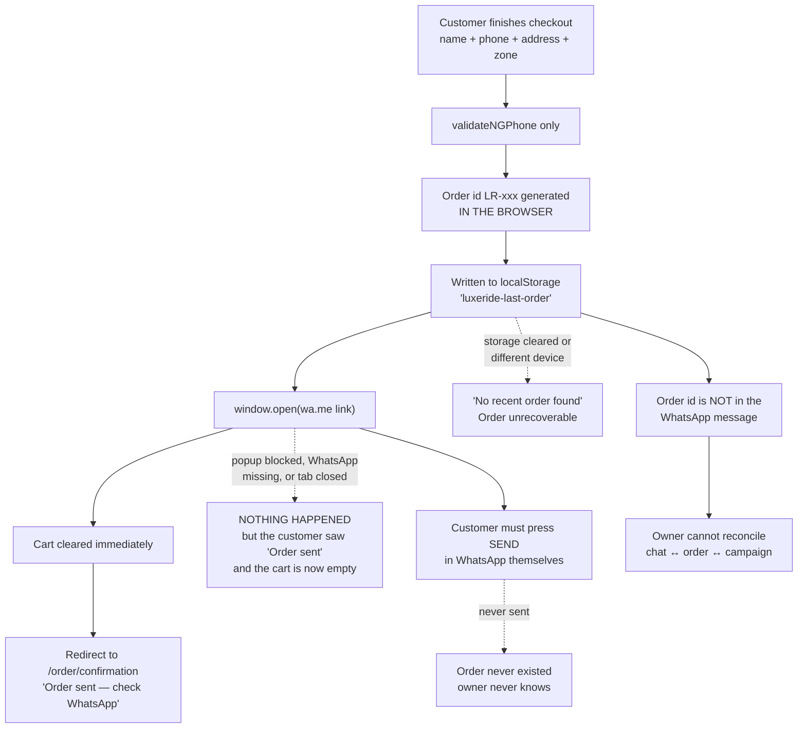

# LuxeRide — Release-Readiness Audit

> **STATUS AS OF 2026-10-02, AFTER THE M0/M1 RUN: B1, B3 and B4 are CLOSED. B2 is OPEN and is M2's
> first task.** The sections below are the audit as written and are preserved that way on purpose, so
> that the record of what was wrong is not quietly rewritten — read the per-blocker lines added under
> the table in section 2 for which are still live. Current state lives in
> [`master-build-plan/tasks.md`](master-build-plan/tasks.md).

**Date:** 2 October 2026
**Scope audited:** `platform/` — the two strategy docs, the validated HTML prototype, and the
`luxeride-web` Next.js application, plus the raw media assets in `Luxeride/footage/`.
**Audience:** the owner, who wants to start paid traffic immediately.

---

## 0. How this audit was produced

| What | How |
|---|---|
| Docs read in full | `luxeride-architecture-plan.md`, `luxeride-fitment-engine-admin-layout-grouping-spec.md`, `overlap-comparison.md`, `luxeride-funnel (2).html` (all 1056 lines), `luxeride-web/README.md`, `AGENTS.md` |
| Code read in full | all 25 files under `luxeride-web/src/`, `prisma/schema.prisma`, `prisma/seed.ts`, `package.json`, `tsconfig.json`, `next.config.ts`, `globals.css`, `.env` |
| Commands actually run | `npm run build`, `npx tsc --noEmit`, `npx eslint .`, and a second `npm run build` with `prisma/seed.ts` temporarily set aside (then restored) |
| Assets inspected | `Luxeride/footage/` via EXIF and `ffprobe` |

Everything asserted below as a fact about the code was verified by reading or running it in this
session. Nothing here is inferred from what a project "usually" looks like.

---

## 1. The verdict

**The application cannot be deployed today, and the fit result it shows customers is not true.**
Those are the two findings that matter. Everything else is ordinary build-out work.

To be precise about the good news first: the hard parts of this product are genuinely done and they
are good. The pricing maths, the car→year→row configuration, the multi-item cart, the WhatsApp
handoff message, the phone validation, the delivery-zone fees and ETAs, and the dark/gold visual
system all work and are worth keeping. The catalogue is real data, not a mock: 33 brand entries
(8 of them premium-tier, 10 flagged unavailable), 213 selectable models, 7 products with per-tier
pricing and 3-row surcharges, 4 delivery zones. The funnel was validated as a prototype with real
customers, and the Next.js port carries most of it across faithfully.

The two problems are these:

1. **You cannot ship it.** `npm run build` fails on a single bad import in `prisma/seed.ts`. Next
   type-checks that file, so the production build aborts. There has never been a successful
   production build — `.next/BUILD_ID` does not exist. There is also no git repository, so there is
   no version control and no way to roll back once you do deploy.
2. **The site currently lies to customers, and the lie is the exact shape of scam these buyers have
   already survived.** `src/components/FitFinder.tsx` decides availability from one boolean per
   brand/model in `src/data/cars.ts`. The model year the customer selects is captured, displayed,
   and then **never checked against anything**. So the app says *"We Found Your Fit! 100%
   precision-molded Double Layer Mats in stock for your 2009 Toyota Camry"* on the strength of
   nothing at all — and says identically the same thing for a 2026. Your own fitment spec states that
   the load-bearing claim of the entire brand is the refusal, that a layout may only go live with
   physical, written or OEM-floor-pan evidence, and that a wrong "yes" costs more than a hundred
   honest "no"s. Right now every yes is unearned.

Running paid traffic into that combination means paying for clicks to a storefront that cannot be
deployed, whose five most expensive products render broken, and whose central claim is false. That is
not a reason not to advertise — it is a short list of things to fix first, and most of them are small.

---

## 2. Launch blockers

| # | Blocker | Evidence | Effort |
|---|---|---|---|
| **B1** | **Production build fails.** `prisma/seed.ts(2,34): error TS2307: Cannot find module './data/products'`. tsconfig's `include` is `**/*.ts`, so Next type-checks `prisma/**` and aborts. With that one import neutralised, the app builds cleanly — 16 pages, all routes. | `npm run build` (twice, second run with the file set aside); no `.next/BUILD_ID` | Minutes |
| | **CLOSED 2026-10-02** — `commerce-backend` §1.1–1.5, master plan M0.2. `npm run build` exits 0 and writes `.next/BUILD_ID`; `npx tsc --noEmit` 0 errors; `npx eslint .` 0 errors, 0 warnings. One further defect surfaced while doing it: `prisma/schema.prisma` did not validate at all — `CarModelFlag.car` had no opposite relation field on `Car`, so `prisma generate` failed with **P1012**, which the new `postinstall` would have turned into a failing `npm install` on every fresh clone. | |
| **B2** | **The FIT ✓ is fabricated — and it is asserted for 4,671 car/year combinations.** 173 selectable models × 27 model years (2000–2026) all return *"We Found Your Fit! 100% precision-molded … in stock for your …"*, decided by one `available` boolean per brand or model. The selected year is captured, displayed, and never validated. The number of confirmed layouts backing all of it is **zero**. | `src/components/FitFinder.tsx:51-97`; `src/data/cars.ts` (`available` flags, brand-level `tier`); counts computed by parsing `cars.ts` | P0 is a **static Confirmed-only fitment table** — the fitment spec's own advice — not the full engine |
| | **STILL OPEN — this is M2's first task, and the single most damaging false claim in the app.** `FitFinder.tsx:261` still renders `100% precision-molded … in stock for your {year} {brand} {model}` beside the `FIT ✓` badge today. Nothing about M1's completion makes that sentence true; M1's own gate does not cover it. | |
| **B3** | **5 of 7 products have no working image.** `public/products/` contains only 6 files, all watermarked SVGs for Single and Double Layer Mats. The `seat-covers.*`, `bundle.*`, `cargo-liner.*`, `mud-flaps.*`, `sun-shade.*` families referenced in `src/data/products.ts` do not exist, and `SafeImage` hides the failed slot — so those PDPs show an **empty image strip** and those cards an **empty grey box**. 21 image paths referenced, 6 present, 15 missing. | `src/data/products.ts:56-106` vs `ls public/products/` | Hours; raw photos already exist in `Luxeride/footage/` |
| | **CLOSED 2026-10-02, for the no-void half** — `storefront-catalog` §8.1–8.9, master plan M1.3–M1.5. `SafeImage` is deleted, every product renders `ProductPlaceholder`, and the fifteen `images[]` paths that named files never produced are gone from `src/data/products.ts`. Measured on the rendered HTML: **zero `` elements** on `/`, `/shop` or any PDP, with the placeholder count matching the card count one-for-one. | |
| | **NOT closed: the photography itself.** `scripts/media.mjs` is built and verified against the real footage — EXIF orientation applied and stripped, outputs deterministic across runs — but `Luxeride/footage/` holds `20260801_*.jpg`/`.mp4` names and only the owner knows which clip shows which product. Until that mapping exists there is no manifest, so every product shows a branded placeholder panel instead of a photograph. Honest and deliberate; not finished. | |
| **B4** | **No git repository.** `platform/` and `luxeride-web/` are untracked, and there is no `.git` anywhere up the tree. No history, no rollback, no safe way to change pricing or publish code the week you start spending. | `find` for `.git` | Minutes |
| | **CLOSED 2026-10-02, except the push** — master plan M0.1. `git init -b main` at `platform/`, a root `.gitignore` covering `node_modules`, `.next`, `.env.local` and the out-of-tree backup directory, and a first commit (`7f28f72`). **Still outstanding: no remote exists, so nothing has been pushed** — there is no off-machine copy and no `git revert` for anything committed since. | |

B1 and B4 are trivial and should be done before anything else. B2 and B3 are the real minimum. Note
that B2's fix is a data problem, not an engineering one: it needs the owner to say which cars are
genuinely Confirmed, and how many layouts that is — which the fitment spec already names as your
launch metric.

**Updated 2026-10-02:** B1, B4 and the no-void half of B3 are done. **B2 is untouched and is now the
only blocker of the four** — which makes M2 the next milestone, and it is a data problem owned by the
owner, exactly as the paragraph above says. B3's photography half is built but never run, for want of
the same kind of owner input.

### 2.1 Additional verified defects

Found while auditing, all traced to source. None is fatal on its own; all are cheap to fix in the
same pass and all degrade a paid-traffic storefront.

| # | Defect | Where | Why it matters |
|---|---|---|---|
| **D1** | **Hydration mismatch on the three highest-intent pages.** `store/cart.ts` and `store/order.ts` use zustand `persist`, which hydrates **synchronously** on the client (verified in `node_modules/zustand/esm/middleware.mjs`: `createJSONStorage(() => window.localStorage)` then a synchronous `toThenable` chain, `hydrate()` called at store creation). On the server `window` is undefined, so storage is undefined and the store stays empty. Server HTML therefore says "Your cart is empty" while the client's first render already has items — a React hydration mismatch on `/cart`, `/checkout` and `/order/confirmation`. `Header.tsx` already carries an explicit `useHasMounted()` workaround for exactly this reason (see its comment at lines 7–9) — but the guard was applied only to the cart badge, not to the pages that render the actual cart contents. | `src/store/cart.ts`, `src/store/order.ts`, `src/app/cart/page.tsx`, `src/app/checkout/page.tsx`, `src/app/order/confirmation/page.tsx` | React recovers by discarding the server HTML for that subtree and re-rendering client-side: a console error plus a visible flicker/layout shift on the three pages where trust is thinnest |
| **D2** | **The database schema cannot represent the current pricing model.** `Product` has a single `basePrice Int` and a `tier` field; the app prices from `product[brandTier]` — i.e. it needs **two** prices per product (`regular` and `premium`) plus the **car's** tier. `prisma/seed.ts` writes `basePrice: p.regular` and `tier: "regular"` for every product, so **the premium price is silently lost** and `Product.tier` is meaningless (it is a per-car concept, not a per-product one). | `prisma/schema.prisma:18-34`, `prisma/seed.ts:43-65`, `src/lib/pricing.ts`, `src/data/cars.ts` | Any order created from the DB would price Lexus/Mercedes/BMW customers at Toyota rates |
| **D3** | `npm run db:seed` cannot run — it invokes `npx ts-node`, which is not a dependency, with a `--loader` fallback that modern Node rejects. The seed also never populates `Car` / `CarModelFlag`, so the 33-brand catalogue has no DB representation even if the schema were applied. | `package.json`, `prisma/seed.ts` | The "scaffold" phase of the architecture plan is not actually complete |
| **D4** | `README.md` claims "`npx tsc --noEmit` and `npx eslint .` both run clean" and documents `npm run build && npm start` as working. The first claim is false today (one `tsc` error), and the second cannot work. | `luxeride-web/README.md` | Misleading for anyone — including a future you — picking this up |
| **D5** | `overlap-comparison.md` is now stale and was incomplete: it never inspected `fit-finder/page.tsx` or `lib/whatsapp.ts` ("content not fully read"), and it missed both the fabricated fit result and the broken build. It is superseded by this audit and by `_CONTEXT.md`. | `platform/overlap-comparison.md` | Read this audit, not that file |
| **D6** | **Empty `alt` on two of the four product-image call sites.** `SafeImage` is called from four places: `products/[slug]/page.tsx:24` and `ProductCard.tsx:16` correctly pass `alt={product.name}`, while `components/FitFinder.tsx:253` (the fit-result gallery strip) and `cart/page.tsx:34` (the cart thumbnail) pass `alt=""`. Separately, the interactive controls — qty ±, remove, back arrows, negotiate toggle — are unlabelled buttons. | `src/app/products/[slug]/page.tsx:24`, `src/components/ProductCard.tsx:16`, `src/components/FitFinder.tsx:253`, `src/app/cart/page.tsx:34` | Missing alt text on the fit-result strip removes free keyword surface from the exact moments a customer is deciding; unlabelled controls are an accessibility failure |
| **D7** | `next.config.ts` sets `images.dangerouslyAllowSVG: true`, needed only for the watermarked placeholder SVGs. | `next.config.ts:4-8` | Should be removed once real raster photography lands; leaving it on is an unnecessary image-pipeline risk |

---

## 3. What is done

Verified working, and safe to build on.

**Storefront — partially.** `/` (hero, 3 badges, 2 CTAs, 5 category tiles, featured grid), `/shop`
with 5 category filters, `/products/[slug]` as SSG with 3-image strip, price range, and a
"Select My Car & Add to Cart" CTA that deep-links into the funnel with the product locked. Cart with
quantity controls, remove, subtotal and a proper empty state. Checkout with name/phone/address/zone
select/payment method, live total, and a live pre-filled WhatsApp message preview. A confirmation
page with an itemised summary.

**The Fit Finder funnel — substantially.** Car search with popular chips, the year step, product
selection, 2-row/3-row configuration with the correct surcharge, a fit result card, add-to-cart,
"Request Live Photos First", a negotiate-your-price path, and honestly-written refusal screens for
brands and models you have flagged as not stocked — each routing to WhatsApp with a pre-written
message.

**Business logic — real, not placeholder.** Tier-based pricing (`regular`/`premium` per brand),
3-row surcharge per product, four delivery zones with real fees and ETAs, prepay = free shipping and
₦2,000 off, Nigerian phone validation, and a structured WhatsApp order message that a human can act
on. 33 brands, 7 products, 5 categories.

**Design system — coherent.** Tailwind v4 tokens (ink/panel/gold/dim/line/muted), three loaded
typefaces, reusable `Button`/`LinkButton`/`Chip`/`ProductCard`/`CategoryTile` components, and a
consistent dark-gold treatment throughout.

**Database schema — designed, not wired.** `prisma/schema.prisma` models Category, Product, Car,
CarModelFlag, Location, Order and OrderItem. It has never been applied and no application code
imports it.

---

## 4. What is partial

| Area | Working | Missing |
|---|---|---|
| **Fit result honesty** | Beautiful, confident fit card with pricing | Any actual fitment data; the Confirmed-only gate; distinct NOT STOCKED vs UNKNOWN handling; demand logging of refusals |
| **Cart → order** | Full client-side cart and order flow | Any server-side order record at all; the order id is never included in the WhatsApp message, so orders cannot be reconciled |
| **Product pages** | Images, price range, guarantee badge, funnel CTA | Reviews, stock, specs/dimensions, what's in the box, delivery ETA, cross-sell, FAQ, gallery interaction, per-page metadata, structured data |
| **Discovery** | Category filter chips | Site search, sort, category routes (`/shop/[category]` per the plan — currently a query param), breadcrumbs |
| **SEO / sharing** | One global title and description | `generateMetadata`, Open Graph, `og:image`, canonicals, `sitemap.ts`, `robots.ts`, JSON-LD |
| **Navigation** | Sticky header, cart badge | **Mobile nav is absent** — the nav is `hidden sm:flex` with no hamburger, so on a phone only the current page's links are reachable |
| **Footer** | Two lines of trust copy | **Zero links** — no policies, no contact, no help |
| **Delivery info** | Four real zones with fees/ETAs, shown at checkout | Not shown in the funnel or on the fit result (the prototype showed both), and no delivery policy page |
| **Prototype parity** | Funnel core | The delivery-zone step, delivery fee in the displayed price, ETA on the result, the 48-hour price-lock line, spill badges, the sticky "Continue to Checkout" CTA, the checkout "Copy message" button, and per-campaign landing headlines are all missing (full table in `_CONTEXT.md` §8) |

---

## 5. What is missing entirely

**Nothing from this list exists anywhere in the application.**

- **Analytics and ad measurement of every kind** — no Meta Pixel, no GA4, no TikTok pixel, no tag
  manager, no UTM capture, no conversion event, no consent handling. You cannot currently tell which
  ad produced which order, or whether any ad produced anything.
- **Campaign landing pages** — the prototype supported `?product=mats|single-layer|seat-covers|bundle`
  which locked the product *and* rewrote the landing headline to match the creative. The app accepts
  product slugs instead (`?product=double-layer-mats`), renders **no landing hero at all** on
  `/fit-finder`, and silently ignores unrecognised values — so old ad links would do nothing.
- **Error and empty-state boundaries** — no `not-found.tsx`, `error.tsx` or `loading.tsx`.
- **Policies and legitimacy** — no privacy policy, terms, delivery policy, returns policy, contact
  page, about page, or business details. The checkout collects a name, phone and home address with no
  consent checkbox and no disclosure.
- **Social proof** — no reviews, ratings, testimonials or customer photos, despite 3 real product
  photographs and 8 video clips sitting unused in `Luxeride/footage/`.
- **Payments** — "Prepay by Transfer" is currently words only: no Paystack dependency, no key, no
  route, no webhook. The customer is told "account details sent on WhatsApp".
- **WhatsApp Cloud API** — `src/lib/whatsapp.ts` builds `wa.me` deep links only. There is no send,
  no template, no Confirm/Cancel webhook, and no 12-hour follow-up, so nothing lands in any system
  until the customer presses send — and if they don't, the order does not exist.
- **Admin console** — no vehicles list, no grouping view, no layout detail, no exclusions, no demand
  log, no audit log, no publish gate. The fitment spec's six admin screens are unbuilt.
- **Server-side anything** — no route handlers, no server actions, no database connection.
- **Tests, CI, deployment config, error monitoring, rate limiting, backups.**

---

## 6. The money path, as it actually behaves today

Every arrow that ends in a dotted line is a lost order the owner will never learn about. Under paid
traffic, this chain is the difference between knowing your cost per order and guessing.

---

## 7. Conversion readiness — what a high-converting store needs vs what exists

| Requirement | Status |
|---|---|
| Loads fast, deploys, never shows a broken page | ✗ build fails; 5 products render empty |
| The claim on the page is true and checkable | ✗ fit result is asserted from a boolean |
| Mobile navigation to browse the catalogue | ✗ nav hidden on mobile, no hamburger |
| Search and category browsing | ~ filter chips only |
| Product page that answers objections | ✗ no specs, reviews, stock or cross-sell |
| Price clarity the quote will honour | ✗ site price omits delivery; result price ≠ checkout price |
| Trust content adjacent to the buy button | ~ one guarantee line per page |
| Policies, contact and business legitimacy | ✗ none |
| Social proof from real customers | ✗ none (raw evidence exists, unused) |
| Offer matched to the ad that was clicked | ✗ no campaign landing pages |
| Every conversion measured and attributed | ✗ no analytics at all |
| Order does not depend on the customer's browser | ✗ entirely localStorage + manual send |
| Recovery when a customer abandons | ✗ no email or phone captured pre-handoff |
| Refusals captured as a sourcing asset | ✗ refusals disappear into a WhatsApp link |
| Payment option that works without a human | ✗ prepay is manual transfer in chat |
| A way to contact a human from any page | ✗ the only `wa.me` link in the codebase is inside `src/lib/whatsapp.ts:39` — there is no persistent WhatsApp/call button, and no `tel:` link at all |
| A reason to buy now, stated plainly | ✗ no announcement/utility bar (nationwide delivery, delivery windows, free-shipping rule, fit guarantee) anywhere above the fold |
| Branded tab, share card and social presence | ✗ the only `favicon.ico` dates from the original scaffold, and there is no logo file, no OG image, no manifest, and no link to Instagram/TikTok/Facebook anywhere — for an ad-driven brand, no social proof trail at all |

Seventeen rows, two partial passes and nothing fully met. That is the honest gap between "prototype
ported to Next.js" and "high-converting e-commerce site".

---

## 8. Assets available but unused

| Asset | Detail | Implication |
|---|---|---|
| 3 × JPG | 4000×3000 raw, **EXIF orientation tag = 6** — i.e. they must be rotated 90° clockwise on decode (verified by parsing the EXIF tag directly; `autoOrient` yields 3000×4000). Serve them without honouring EXIF and **all three display sideways**. 3.1–3.6 MB each, with 36–51 KB of EXIF metadata per file | Too large to serve directly; need orientation fix, resize, crop and WebP conversion |
| 8 × MP4 | 1920×1080 @30fps, 34 s–97 s, 74–208 MB each, ~7.6 min total at ~17 Mbps | Landscape; needs vertical 9:16 cuts for Reels/Shorts ads, short cuts for product pages, and poster frames |
| 2 × Audition projects | "chair cover vo", "single layer voice over" | Ad voiceovers already exist for two product lines — the creative pipeline is ahead of the website |

This changes the imagery problem from "we have no photos" to "we have photos that have never been
processed". That is a contained job, and it is blocker B3's fix.

**One caveat, stated plainly:** I verified the technical properties of these files (dimensions,
rotation metadata, duration, bitrate) but **not their content** — I cannot view images in this
session, so I do not know which products or which cars they show. Before wiring them to specific
product pages, someone needs to look at them and map each file to a product and, where relevant, a
layout. Do not let a spec assume which shot goes where.

---

## 9. Spec index

Eleven specs now live alongside this audit — nine feature specs plus a sequencing plan and an admin
console — each as `requirements.md`, `design.md`, `tasks.md`. Tasks already implemented are checked
`[x]` and annotated with the file that proves it; everything remaining is `[ ]` with a P0/P1/P2 tag.

**Start with [`master-build-plan/`](master-build-plan/tasks.md).** It is the source of truth for
*sequencing*: milestones `M0`–`M10`, each with a checkable exit gate, cross-referencing the module
specs by task number rather than restating them. It also states the authority hierarchy (owner intent
→ that plan → module specs → code) and carries the consolidated decision queue `D-01`…`D-12`. Its
critical path to the first ad is **M0 → M1 → M2 → M3 → M4 → M5**, none of which needs a database.

| Spec | Purpose | State | Done / remaining |
|---|---|---|---|
| [`master-build-plan/`](master-build-plan/tasks.md) | **Source of truth for sequencing.** Milestones M0–M10, exit gates, ladder reconciliation, decision queue | **In progress — M0 done but for the push; M1 done but for three owner-gated halves** | 15 / 138 (+6 partial) |
| [`admin-console/`](admin-console/tasks.md) | How the owner runs the business: shell, auth, dashboard, orders, WhatsApp queue, demand log, catalogue, media, audit viewer | Not started | 7 / 63 |
| [`storefront-catalog/`](storefront-catalog/tasks.md) | Catalogue, categories, PDPs, navigation, search, imagery, SEO foundation | **Partial — imagery, mobile nav and honest product data are built** | 54 / 116 (+4 partial) |
| [`fit-finder/`](fit-finder/tasks.md) | The configurator funnel, honest fit result, refusal paths | Partial — the fit claim must change | 18 / 68 |
| [`ad-landing-and-tracking/`](ad-landing-and-tracking/tasks.md) | Campaign landing pages, event taxonomy, pixels, UTM attribution, ordered pre-spend gate | Not started — **your most urgent need** | 9 / 106 |
| [`cart-checkout/`](cart-checkout/tasks.md) | Cart and checkout conversion, order integrity, failure recovery | **Partial — defect D1 (the hydration mismatch) is closed** | 14 / 96 |
| [`commerce-backend/`](commerce-backend/tasks.md) | Database, migrations, seeding, server actions, order persistence, model reconciliation | **Section 1 done — B1 is closed; the rest is blocked on E3** | 13 / 79 |
| [`payments-paystack/`](payments-paystack/tasks.md) | Real prepay: initialize, verify, webhook, status transitions | **Sections 2–3 done; the payment does not exist** | 10 / 101 |
| [`whatsapp-engine/`](whatsapp-engine/tasks.md) | Cloud API, Confirm/Cancel templates, webhook, 12-hour follow-up, ref codes | Not started | 6 / 104 |
| [`fitment-engine/`](fitment-engine/tasks.md) | Layouts, vehicles, mappings, variants, exclusions, evidence gate, fitment admin screens, `/fit-check`, demand log | Not started — **B2 lives here** | 7 / 105 |
| [`trust-and-policies/`](trust-and-policies/tasks.md) | Policies, contact, FAQ, social proof, refusal copy — plus 7 pre-ad-spend gates | Not started | 6 / 59 (+7 gates) |

**On the counts.** Each figure above is the spec's *own* `## Status` number, which `master-build-plan`
Requirement 2.2 makes authoritative. Those headers count leaf tasks and gates; this table's first
edition counted **every** checkbox line including group headings and therefore read higher — the same
nine feature specs were 86 / 838 by that convention and 81 / 770 by their own headers. Several specs
count their own checkboxes to a slightly different convention again, so if you need an exact figure,
read the spec's `## Status` block rather than trusting any table, including this one.

Every `[x]` in those counts is a **verification of existing code**, not completed feature work —
each is annotated with the file that proves it. Read the counts as "what has been checked", not
"what has been built": nearly all of the remaining items are unbuilt.

Two specs carry an explicit, ordered pre-spend gate rather than leaving you to sequence the work
yourself: **`ad-landing-and-tracking/tasks.md` §12 (15 gates)** and **`trust-and-policies/tasks.md`
"Before any ad spend" (7 gates)**. Their first gate in both cases is the same: a build that passes.
`master-build-plan`'s **M5** is where those two gate lists converge into one.

`_CONTEXT.md` in this directory is the shared factual brief every spec was written against; it
contains the verified code inventory, the prototype-parity table, the known-defect list (D1–D7) and
the locked decisions. Keep it — it is the shortest accurate description of this codebase that exists.

---

## 10. Recommended order of work

> **Superseded for sequencing by [`master-build-plan/`](master-build-plan/tasks.md).** What follows is
> the audit's own prose recommendation, written before the module specs existed. The master plan
> turns it into milestones `M0`–`M10` with checkable gates and a stated critical path, and it is the
> document to work from. This section is kept because it explains *why* that order is what it is.

**Before spending a naira (days, not weeks)**

1. ~~Fix `prisma/seed.ts` so the build passes (B1).~~ **DONE 2026-10-02** — `commerce-backend` §1.1–1.5.
2. ~~`git init`, commit, and push somewhere private (B4).~~ **DONE except the push** — the repository
   exists and the first commit landed; **no remote exists yet**, so this item is half closed.
3. ~~Fix the hydration mismatch on `/cart`, `/checkout` and `/order/confirmation` (D1)~~ **DONE
   2026-10-02** — `cart-checkout` §10.3. The three screens' *server* HTML no longer contradicts the
   client. The browser-console confirmation needs a shell where Chrome can open a socket; see
   `luxeride-web/README.md` → `npm run check:hydration`.
4. ~~Process the existing photos into `public/products/` so no page renders an empty grey box (B3).~~
   **HALF DONE** — no page can render an empty box any more (every product renders a branded
   placeholder, and zero `` elements are emitted), and the pipeline is built and verified against
   the real footage. **The photographs themselves are still not processed**, because the footage files
   are named `20260801_*.jpg` and only the owner knows which clip shows which product. Same kind of
   input as item 5, and it can be supplied in the same sitting.
5. **NEXT — and now the only launch blocker left.** Replace the fabricated fit with a **static
   Confirmed-only fitment table** — the fitment spec's own
   P0 advice. Even 15–25 confirmed layouts, hardcoded, makes the "FIT ✓" true. Then write down that
   number: it is your launch metric.
6. Write honest NOT STOCKED and UNKNOWN copy, and capture every refusal. The demand log is the only
   sourcing signal the site produces, and the fitment spec is explicit that it must work from day one.
7. Add Meta Pixel + GA4 and the handful of events that matter, with a thank-you page that survives a
   cleared browser. Without this you are buying data you cannot read.
8. Publish privacy, terms, delivery, returns and contact pages, and link them in a real footer.
9. Build campaign landing pages so the headline matches the ad that was clicked.

**Week one of trading** — persist orders server-side with a ref code in the WhatsApp message; capture
UTM onto the order; merge the funnel's delivery step back in; mobile navigation; product page
objections (specs, delivery, FAQ, cross-sell); reviews captured through the WhatsApp loop after
delivery.

**Weeks two to four** — the database and the admin console, then Paystack, then the WhatsApp Cloud
API loop with the 12-hour follow-up. The fitment engine's P1 admin replaces the static sheet without
changing the front-end contract — which is exactly why the sheet is worth building against now.

---

## 11. Decisions the owner has to make

These are not engineering questions and no spec can settle them. Item 1 has since been decided; it is
kept, with the answer, because an audit is a record and not a status board.

1. **Supabase, Neon, or self-hosted Postgres? — DECIDED, 2 October 2026: a local native Postgres for
   development.** PostgreSQL 16 installed from `apt` on the owner's own Ubuntu 24.04 machine; not a
   container, not a managed host. §8 of the architecture plan is answered *for the development
   environment only*. **The consequence to carry forward is backups:** a local cluster ships no managed
   daily backups, and there is no git repository either, so the replacement is an explicit `pg_dump`
   discipline plus one tested restore (`commerce-backend` tasks 2.8–2.9). A hosted database is still
   owed before launch (`commerce-backend` task 10.5). Full reasoning in `commerce-backend/design.md`
   § Decisions, Decision 1.
2. **Broad ad targeting, or only cars you have already Confirmed?** The fitment spec is blunt: with
   Confirmed-only enforced at launch, `/fit-check` will refuse more cars than it accepts. Broad
   targeting is therefore a *demand-mapping* exercise, not an acquisition one. Decide which it is
   before you spend, and let that decide your audiences.
3. **What is the conversion event?** Money changes hands on WhatsApp or on delivery, not on the site.
   The pixel has to be told what "success" means, and the answer is a business decision.
4. **How many layouts are genuinely Confirmed today?** Everything in the fitment engine is gated on
   that number, and it is also the honest basis for any fit claim you make in ad creative.
5. **The Fit Guarantee as written** — "doesn't fit? We swap it free" — is a promise. Who pays return
   shipping, and within what window?
6. **Exact price or "from" price on the site?** The fitment spec leaves this open and warns only that
   the site must never show a figure the WhatsApp quote then contradicts.
