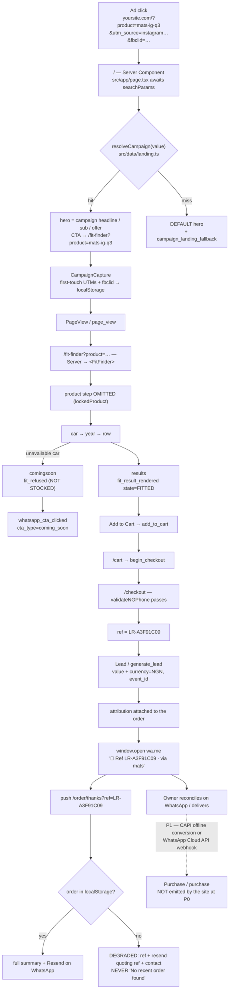
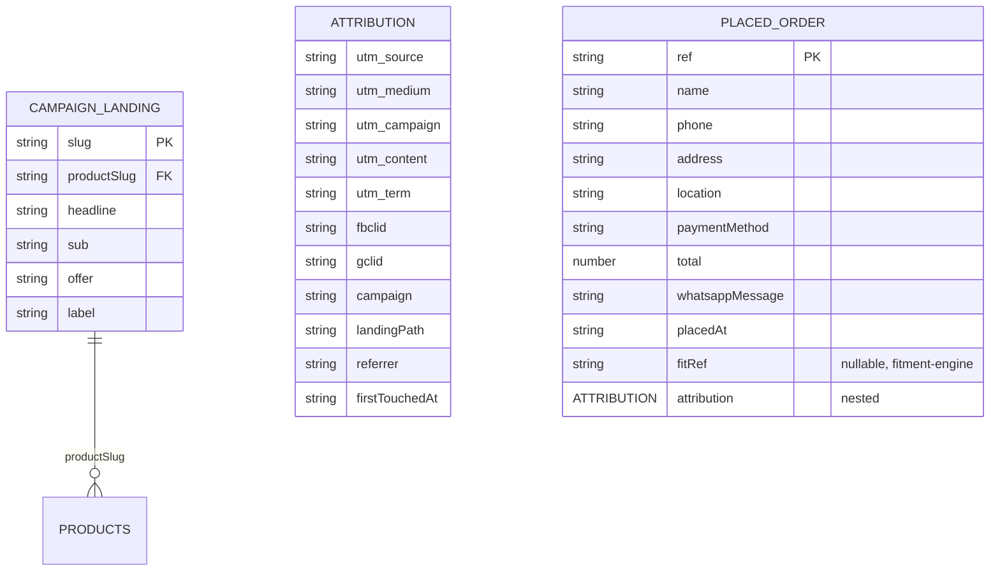

# Design Document

## Overview

Three mechanisms, in the order they have to exist:

1. **A campaign resolver** that turns `?product=<value>` into copy + a locked product, on **both**
   `/` and `/fit-finder`. It restores a capability the prototype had and the app lost, and it
   restores it on the home page, which currently ignores the parameter entirely.
2. **One typed event registry** fanned out to GA4 and the Meta Pixel through a single `track()`,
   loaded with `next/script` from the root layout.
3. **First-touch attribution plus an order reference that rides in the WhatsApp message**, so that
   a sale on a phone can be tied back to the ad that caused it without a server.

The honest constraint that shapes everything below: **there is no backend.** `_CONTEXT.md` §6 — no
Prisma client imported anywhere under `src/`, no `route.ts`, no server actions, no migrations, and
`src/app/order/confirmation/page.tsx` reads `localStorage`. That means the site can measure a
**click** and a **lead**, and it can *carry* an attribution forward in a string the customer sends by
hand. It cannot record a completed sale. The spec says so out loud rather than firing `Purchase` and
pretending.

---

## Current State (verified)

Everything in this section was read in this session on 2026-10-02.

### Exists today and is reused unchanged

| Fact | File | Line(s) |
|---|---|---|
| `?product=` is read and passed as `lockedProductSlug` | `src/app/fit-finder/page.tsx` | 6, 8, 11 |
| Unknown slug silently produces `lockedProduct === undefined`, funnel runs unlocked | `src/components/FitFinder.tsx` | 22 |
| Product resolution helper | `src/data/products.ts` | 109-111 |
| Price range helper | `src/data/products.ts` | 115-118 |
| Naira formatter and tier/row pricing | `src/lib/pricing.ts` | 4-14 |
| WhatsApp link builder and message builders | `src/lib/whatsapp.ts` | 38-50 |
| Business WhatsApp number `2347049621694` | `src/data/locations.ts` | 14 |
| Nigerian phone validation | `src/lib/validation.ts` | 2-13 |
| `crypto.randomUUID()` already used for ids | `src/store/cart.ts` | 34-37 |
| Order id minted client-side, **not** in the message | `src/app/checkout/page.tsx` | 62; `src/lib/whatsapp.ts` 35 |
| Order persistence is a `localStorage` Zustand store, one order only | `src/store/order.ts` | 28-36 |
| "No recent order found" dead end | `src/app/order/confirmation/page.tsx` | 11-23 |
| Footer has zero links | `src/components/Footer.tsx` | 1-10 |
| Root layout is where a site-wide script belongs | `src/app/layout.tsx` | 28-40 |

### Does not exist anywhere

A regular-expression sweep of the whole of `luxeride-web/src/` for
`gtag|googletagmanager|fbq|facebook|analytics|pixel|consent|cookie|utm_|fbclid|gclid|next/script|Script`
returned **no matches**. So, specifically:

- No GA4, no Meta Pixel, no TikTok pixel, no tag manager.
- No UTM capture, no `fbclid`, no `gclid`, no campaign slug anywhere in state.
- No consent banner, no cookie notice, no privacy-policy link.
- No event of any kind. Not one `console.log`, let alone a `track()`.
- No per-page `metadata` anywhere except the single global export at `src/app/layout.tsx:23-26`.

### The prototype behaviour that was lost

`luxeride-funnel (2).html`:

- `CONFIG.PRODUCT_LANDING` at lines 670-691 — four aliases (`mats`, `single-layer`, `seat-covers`,
  `bundle`), each `{ product, headline, sub }`, with the comment at 665-669: *"Add one entry per ad
  you run; the slug is whatever you put after `?product=` in the link."*
- `applyProductLanding()` at lines 724-731 — sets `lockedProduct` and rewrites
  `#landingHeadline` (line 402) and `#landingSub` (line 403).
- The `lockedProduct` branch at lines 737-741 already omits the product step from the progress
  order — the same rule `FitFinder.tsx:113-121` implements today.

### The sibling specs this one must not contradict

| Spec | Constraint we inherit |
|---|---|
| `fit-finder` 8.1–8.8 | `/fit-finder` renders a landing hero for everyone; `?product=` resolves against **either a campaign alias or a product slug**; the four prototype aliases must keep working; a single resolver feeds the tracker |
| `cart-checkout` 2.1 | the order reference **must not be derived from the wall clock** and must not be enumerable |
| `cart-checkout` 2.2 | the reference is in the WhatsApp message |
| `cart-checkout` 6.2/6.5 | an unknown reference yields a recovery screen, not "No recent order found" |
| `cart-checkout` 13.3 | events queue without blocking or delaying the order flow |
| `trust-and-policies` 12.1 | the seven-gate trust floor that must clear before paid traffic |
| `fitment-engine` 8, 15 | the three fit states; Confirmed-only; the Confirmed count as launch metric |

---

## Architecture



### Decision 1 — one parameter, one resolver, on two routes

`?product=` is the only campaign key, and it is honoured on **`/` as well as `/fit-finder`**.

I considered a separate `?c=<campaign>` key, and rejected it. `fit-finder` 8.2 already fixes `?product=`
as the key that resolves "either a campaign alias or a product slug", and 8.7 fixes the four prototype
aliases. Adding `?c=` would create two spellings for one concept, and `seat-covers` would then mean
two different things depending on which key was used. One key, one resolver, both routes.

Resolution order in `resolveCampaign(raw)`:

1. `CAMPAIGN_LANDINGS[raw]` — campaign aliases win.
2. `getProductBySlug(raw)` — a bare product slug still works, because
   `src/app/products/[slug]/page.tsx:48` links to `/fit-finder?product=${product.slug}` and every
   internal link depends on it.
3. Otherwise unresolved.

`seat-covers` is both an alias and a product slug (`src/data/products.ts:38`). Alias-first means the
campaign copy renders and the product lock is `seat-covers` — which is what the alias names anyway,
so the two entries agree and no behaviour diverges. The rule exists so the collision is a decision
rather than an accident.

### Decision 2 — unknown `?product=`: graceful default + a loud event

**Decision: render the default. Do not 404. Do not redirect to `/shop`. And fire
`campaign_landing_fallback` so the broken ad URL is visible in Events Manager.**

- **Not a 404.** There is no `not-found.tsx` in the app (`_CONTEXT.md` §11), so a 404 renders
  Next's bare not-found page on a paid click. It also destroys the `PageView` that carries the
  ad's session attribution, and it punishes the customer for an error the *owner* made in Ads
  Manager. `/fit-finder` 8.4 independently reaches the same conclusion for the funnel route;
  having `/` 404 and `/fit-finder` fall back would be incoherent.
- **Not a redirect to `/shop`.** A redirect throws away the campaign's intent (the ad sold a
  product; `/shop` asks them to browse), it adds a hop that can drop query parameters in some
  click-tracking chains, and it conceals the mistake — the owner sees traffic arrive and has no
  signal that the URL is wrong.
- **Graceful default + event** is the only option that fixes the actual problem. A wrong ad URL is
  an **ad-ops bug**, and the cheapest bug detector for it is the analytics layer the owner already
  has open. The fallback event is the product here.

**When this decision is revisited:** if `campaign_landing_fallback` volume becomes material relative
to `campaign_landing_viewed` after two weeks of live traffic, the owner has a link-management
problem, not a code problem, and the fix is fixing the links.

### Decision 3 — the conversion event is `Lead`, and `Purchase` is not ours yet

**The site fires `Lead` (Meta) / `generate_lead` (GA4). It does not fire `Purchase` at P0.**

Money changes hands on WhatsApp and in cash on delivery. There is no payment processor
(`payments-paystack` is unwritten), no webhook, no server, no database. `window.open("https://wa.me/…")`
at `src/app/checkout/page.tsx:78` is the entire "payment" step.

Three signals, in the order the owner should watch them:

| Tier | Event | What it actually means |
|---|---|---|
| Leading | `whatsapp_cta_clicked` (`cta_type` = `live_photos`, `offer`, `coming_soon`, `car_not_found`, `checkout_order`) | any WhatsApp handoff, **including** the ones that will not convert (a live-photo request is not a purchase) |
| **Optimisation** | **`Lead` / `generate_lead`** | name + phone + address collected and the order handed to WhatsApp. This is the strongest honest signal the site can produce and it is what the campaign should optimise to |
| Completion | `Purchase` / `purchase` | **not emitted by the site.** P1, and only via the Conversions API offline or the WhatsApp Cloud API webhook (`whatsapp-engine`) |

Firing `Purchase` at checkout would train Meta's delivery system toward a signal that does not
correspond to money received, and would make ROAS a fiction. `Lead` under-claims slightly (some
leads never buy) which is the correct direction to be wrong in.

GA4 marks `transaction_id` **required** for purchases and names duplicate transaction IDs as a cause
of dropped events ([ecommerce](https://developers.google.com/analytics/devguides/collection/ga4/ecommerce),
[validate-ecommerce](https://developers.google.com/analytics/devguides/collection/ga4/validate-ecommerce)).
At P0 we emit no purchase, so this costs nothing — but the field is reserved in the type from day
one so `cart-checkout`'s server-priced order can supply it when a purchase does become emittable.

### Decision 4 — first-touch for UTMs, captured-once for click IDs

**UTMs are first-touch and never overwritten.** The reasoning is specific to this business:
LuxeRide's funnel is *one short session* — click, car, year, cart, WhatsApp. There is no email
capture, no newsletter, no retargeting sequence, no second visit before purchase. In a funnel that
short, first-touch and last-touch are almost always the same visit, so the choice barely changes any
number — which is exactly why first-touch is safe: the thing it costs you is nothing measurable, and
the thing it protects is that no later navigation can rewrite the credit.

The moment this stops being true is the moment the owner builds a retargeting sequence. Even then,
"which ad brought this person in" is the question that decides budget, and first-touch still answers
it. Meta and Google already store the click-through parameters in their own first-party cookies for
the session ([UTM parameters in GA4](https://support.google.com/analytics/answer/10917952)); we
persist in `localStorage` because **neither cookie survives the move to WhatsApp or to another
device** — the reference line the customer sends by hand is the only copy that does.

**`fbclid` and `gclid` are captured on first sight and never forwarded to the other platform.**
`fbclid` is Meta's matching key for ad attribution; handing it to GA4 or TikTok pollutes their
matching. Mirror rule for `gclid`. The event-level `event_id` (requirement 3.13) is our own identifier
and is the only id shared across providers — that is exactly the mechanism Meta documents for
de-duplicating browser and server sends
([Handling Duplicate Pixel and Conversions API Events](https://developers.facebook.com/docs/marketing-api/conversions-api/deduplicate-pixel-and-server-events)).

### Decision 5 — the order reference format

```
LR-A3F91C09          order reference — 8 uppercase hex from crypto.randomUUID()
TC-2009-2013         fitment layout internal code (fitment-engine), a separate field
via mats             campaign marker — the registry key, never a raw fbclid
```

Line shape in the WhatsApp message:

```
🔖 Ref LR-A3F91C09 · via mats
🔖 Ref LR-A3F91C09 · fit TC-2009-2013 · via mats
```

**Why not a date in the ref.** It is the obvious first idea and it is wrong: `cart-checkout` 2.1
requires a reference "not derived from the wall clock, so that consecutive orders cannot be
enumerated by incrementing a counter". A date prefix leaks order volume to anyone holding the ref,
which on WhatsApp is anyone in the thread. The date is not lost — `PlacedOrder.placedAt`
(`src/store/order.ts:20`) already carries it as a separate field.

**Why `via <campaign>` is in the customer-facing message at all.** Because there is no server, the
WhatsApp thread is the only durable record that survives a device change. Putting 22 characters on
the end of a message the customer presses send on costs the customer nothing and gives the owner
campaign attribution at the exact moment they are doing dispatch, on a phone. It is the same trick
the fitment spec uses with `TC-2009-2013` — *"That ref is what makes both the conversation and the
attribution cheap"* (`luxeride-fitment-engine-admin-layout-grouping-spec.md:102`).

### Decision 6 — script injection

Read from `node_modules/next/dist/docs/`:
**`01-app/02-guides/scripts.md` (How to load and optimize scripts)** and
**`01-app/03-api-reference/02-components/script.md` (Script Component API reference)**.

- Root layout placement: *"To load a third-party script for all routes, import `next/script` and
  include the script directly in your root layout."*
- `strategy="afterInteractive"` is the default and the docs name **"Tag managers / Analytics"** as
  its candidates.
- Inline scripts are supported via `dangerouslySetInnerHTML`, and the docs warn: *"An `id` property
  must be assigned for inline scripts in order for Next.js to track and optimize the script."* The
  Meta Pixel base code is inline; the GA4 loader is a `src` plus an inline init.
- `worker` strategy is **unavailable**: the API reference states it *"does not yet work with the
  App Router"* and *"can only currently be used in the `pages/` directory"*. LuxeRide is App Router
  only, so that option is off the table. Recorded here so nobody proposes it later.

**Two documented traps this design walks around:**

1. **Double-counted first page view.** The Meta base code normally ends with
   `fbq('track','PageView')` and `gtag('config', …)` sends `page_view` automatically. Neither
   re-fires on a Next.js client-side navigation, so following the stock snippets literally gives
   you *one* `PageView` on a hard load and *zero* on every subsequent `<Link>` navigation. **The
   design omits both automatic sends** (`send_page_view: false` for GA4) and fires
   `PageView`/`page_view` explicitly from the route-change component.
2. **Build failure from `useSearchParams`.** `01-app/03-api-reference/04-functions/use-search-params.md`:
   *"During production builds, a static page that calls `useSearchParams` from a Client Component
   must be wrapped in a `Suspense` boundary, otherwise the build fails."* `/` is a static route
   (`_CONTEXT.md` §3). The tracking component is therefore wrapped in `<Suspense>` in the root
   layout. Given that `npm run build` is **already** failing on `prisma/seed.ts`, adding a second
   build-breaking mistake is not a risk worth taking.

`redirect()` was read (`01-app/03-api-reference/04-functions/redirect.md`) and **not used** — the
graceful-default decision above makes it unnecessary, and it preserves the query string by
construction.

---

## Components and Interfaces

All new files. Nothing outside `.kiro/specs/ad-landing-and-tracking/` is modified by this document;
the app source below is the target the implementation phase will change.

### `src/data/landing.ts` — the campaign registry *(new)*

Matches the shape of `src/data/products.ts` / `src/data/cars.ts` / `src/data/locations.ts` — a plain
exported `const` and plain exported helper functions. No DB, no fetch, no server.

```ts
export interface CampaignLanding {
  /** Ad-facing key. What goes after ?product= in the ad URL. */
  slug: string;
  /** PRODUCTS[].slug — locks the funnel's product step away. */
  productSlug: string;
  /** Plain text with {em} markers around the gold-highlight phrase. */
  headline: string;
  sub: string;
  /** Only offers the checkout already honours. P0 allowed values: the ₦2,000 prepay saving. */
  offer?: string;
  /** Short human label for the ad-ops report: "Mats — IG Q3". */
  label: string;
}

export const CAMPAIGN_LANDINGS: Record<string, CampaignLanding>;

export interface ResolvedLanding {
  raw: string;
  /** null when the value resolved as a bare product slug rather than a campaign alias. */
  campaignSlug: string | null;
  productSlug: string;
  headline: string;
  sub: string;
  offer?: string;
  /** "campaign" | "product" | "unknown" — drives the fallback event. */
  match: "campaign" | "product" | "unknown";
}

export function resolveCampaign(raw?: string | null): ResolvedLanding | null;
```

Seed entries, preserving the prototype's four aliases and its copy verbatim
(`luxeride-funnel (2).html:671-690`):

| slug | productSlug | headline | sub |
|---|---|---|---|
| `mats` | `double-layer-mats` | Custom-Fit Mats for *Your Exact Car* | Laser-measured to your model. Fully waterproof. Pay on delivery. |
| `single-layer` | `single-layer-mats` | Custom-Fit Mats for *Your Exact Car* | Laser-measured top-layer protection. Pay on delivery. |
| `seat-covers` | `seat-covers` | Custom-Fit Seat Covers for *Your Exact Car* | Tailored to your seats. Premium finish. Pay on delivery. |
| `bundle` | `full-bundle` | The Full Interior Upgrade for *Your Exact Car* | Double layer mats + seat covers, laser-measured. Pay on delivery. |

Note the prototype wrote its headline with `innerHTML` (line 729) to get the `<em>` gold highlight.
**This design does not reproduce that.** `{em}` markers are split on the server and rendered as a
`<span className="text-gold">`, so a campaign string can never inject markup.

### `src/lib/analytics/events.ts` — the taxonomy *(new)*

One registry, one source of truth for both providers:

```ts
export type LuxeEventName =
  | "page_view" | "view_item" | "add_to_cart" | "begin_checkout" | "lead" | "purchase"
  | "campaign_landing_viewed" | "campaign_landing_fallback"
  | "car_search" | "car_search_no_match" | "fit_refused" | "fit_result_rendered"
  | "live_photo_requested" | "offer_sent" | "waitlist_phone_submitted"
  | "whatsapp_cta_clicked" | "ref_code_copied";

export type FitState = "FITTED" | "NOT STOCKED" | "UNKNOWN";
export type WhatsAppCtaType =
  | "live_photos" | "offer" | "coming_soon" | "car_not_found" | "checkout_order";

export interface BaseEvent {
  eventId: string;          // one per event, identical across providers
  campaign: string;         // registry key, product slug, or "(not set)"
  // first-touch attribution, attached automatically — never written by a call site
}

export interface EventMap { /* one interface per name, with typed params */ }
```

Each entry declares its Meta name and its GA4 name. The mapping is not guessed: Meta's standard
event names come from the
[Meta Pixel API reference](https://developers.facebook.com/docs/meta-pixel/reference) and GA4's
from the
[GA4 recommended events](https://developers.google.com/analytics/devguides/collection/ga4/reference/recommended-events).
Custom events use the LuxeRide name as a `CustomEvent` on Meta.

### `src/lib/analytics/providers/*.ts` — adapters *(new)*

```ts
export interface AnalyticsProvider {
  id: string;                              // "ga4" | "meta" | "tiktok"
  isConfigured(): boolean;                  // env var present
  loadScript(): ReactElement | null;        // the next/script element(s)
  pageView(payload: PageViewPayload): void;
  track(name: LuxeEventName, payload: unknown): void;
  flushBeacon(eventId: string): void;      // P1: unload-time send for CAPI parity
}
```

- `ga4.ts` — pushes to `window.gtag`. Emits `page_view` with `page_location`, `page_referrer`,
  `page_path`, and `send_page_view` is set to `false` in the config call.
- `meta.ts` — pushes to `window.fbq`. Emits `PageView`, `ViewContent`, `AddToCart`,
  `InitiateCheckout`, `Lead` and `CustomEvent`, each with `eventID`.
- `tiktok.ts` — **registered, inert.** Same interface, same event mapping, `isConfigured()` returns
  `false` until `NEXT_PUBLIC_TIKTOK_PIXEL_ID` is set. Exists so the extension point is real and
  reviewed rather than a promise.

### `src/lib/analytics/index.ts` — the single entry point *(new)*

```ts
export function track<T extends LuxeEventName>(name: T, payload: EventMap[T]): void;
export function pageView(): void;
export function setDebug(on: boolean): void;
```

`track()` is **synchronous and never returns a promise.** It appends to an in-memory queue first
(requirement 3.14, `cart-checkout` 13.3), then fans out to every configured provider inside a
`try/catch` so one broken provider cannot break the funnel. The order of `track()` and
`window.open()` at checkout is load-bearing — see requirement 6.8.

### `src/lib/analytics/attribution.ts` — first-touch capture *(new)*

```ts
export interface Attribution {
  utm_source: string; utm_medium: string; utm_campaign: string;
  utm_content: string; utm_term: string;
  fbclid: string; gclid: string;          // never cross-forwarded
  campaign: string;                        // resolved registry key, or "(not set)"
  landingPath: string;
  referrer: string;
  firstTouchedAt: string;
}
export const ATTRIBUTION_STORAGE_KEY = "luxeride-attribution";
export function readAttribution(): Attribution | null;
export function captureAttribution(): Attribution;  // write-once, never overwrites
```

Read exclusively inside effects. Every field is a string and `"(not set)"` is written explicitly
rather than leaving a gap, so "organic" and "broken tracking" are different rows in a report.

### `src/components/Analytics.tsx` — the mount *(new, Client Component)*

Mounted once from `src/app/layout.tsx`. Renders the GA4 `<Script src>` and the Meta inline
`<Script id="meta-pixel-base">` when their env vars are present and nothing at all when they are not.
Holds the provider registry in a `useRef` so no event is replayed across a re-render.

### `src/components/PageView.tsx` — page-view and route-change fire *(new, Client Component)*

```tsx
"use client";
// reads usePathname() + useSearchParams(), fires page_view on first render and on every change,
// and fires campaign_landing_viewed / campaign_landing_fallback exactly once per resolved variant
```

**Must be wrapped in `<Suspense>` in `src/app/layout.tsx`** because `/` is a statically prerendered
route — see Decision 6.

### `src/components/CampaignCapture.tsx` *(new, Client Component)*

Runs the write-once capture in a mount effect. Separate from `PageView` so that capture is never
gated on a Suspense boundary resolving late.

### Route changes required

| Route | Change | Kind |
|---|---|---|
| `src/app/page.tsx` | accept `searchParams`, resolve, render variant hero + offer badge, retarget the CTA | Server Component |
| `src/app/fit-finder/page.tsx` | accept `product` **and** `utm_*`/`fbclid`/`gclid`, pass the resolved variant down | Server Component |
| `src/app/layout.tsx` | mount `<Analytics />` + `<CampaignCapture />` inside `<Suspense>`; keep the global metadata | Server Component |
| `src/app/products/[slug]/page.tsx` | mount a `<ViewItemTracker product>` client child | Server Component |
| `src/components/FitFinder.tsx` | fire the eight funnel custom events at the named sites; add `wa.me` click capture; render `ref` on the results card | Client Component |
| `src/app/cart/page.tsx` | fire `begin_checkout` on the checkout link's `onClick` | Client Component |
| `src/app/checkout/page.tsx` | mint the ref, build the message with it, attach attribution, fire `Lead` | Client Component |
| `src/app/order/confirmation/page.tsx` | accept `?ref=`, look up by reference, render the degraded state, fire `Lead` once per ref | Client Component |
| `src/lib/whatsapp.ts` | `buildOrderMessage` gains a `ref` field; new `recoveryMessage(ref, campaign)` | plain module |

**No new route is required.** `/order/thanks?ref=` reuses `/order/confirmation`, which is correct:
the reference is already the identifier (`cart-checkout` 2.3), and a second URL for the same screen
would fragment the owner's bookmarks and the analytics.

---

## Data Models



**`PlacedOrder` changes** (additive, in `src/store/order.ts`):

| Field | Type | Why |
|---|---|---|
| `ref` | `string` | renamed from `id`, format fixed to `LR-` + 8 hex (Decision 5). `cart-checkout` owns minting. |
| `fitRef` | `string \| null` | the layout code, `null` until `fitment-engine` lands. Separate field, never concatenated. |
| `attribution` | `Attribution` | copied from `luxeride-attribution` at submit, so the order carries its own campaign even if the attribution record is later overwritten or cleared. |

**Storage shape change.** Today: `{ state: { lastOrder }, name: "luxeride-last-order" }` — one order.
New: a bounded list of the last **10** orders keyed by `ref`, because requirement 7.3 needs a second
order not to erase the first, and requirement 7.4 needs a reference lookup that can miss.
Bounded because `localStorage` is a few megabytes and an unbounded order list containing addresses is
a liability, not a feature.

**What is never stored in the URL:** `name`, `phone`, `address`, `location`, `paymentMethod`, any
free-text search query. GA4 collects the full `page_location` and the Meta Pixel reads the referring
URL — a name and an address in a query string is a personal-data leak into two advertising platforms
and into browser history, in exchange for a page that already reads the record out of `localStorage`.

---

## Error Handling

| Failure | Behaviour | Why not the obvious alternative |
|---|---|---|
| Provider script fails to load | Record the failure once, keep the session alive, do not retry more than once | An ad blocker hitting one provider must not stop the funnel or the `Lead` |
| `track()` throws inside a provider | Caught per provider; the other providers still receive the event; a debug-mode console error | One provider's bad payload must not cost the checkout |
| `localStorage` throws (private mode, quota, disabled cookies) | Attribution capture no-ops, funnel proceeds, confirmation degrades to the recovery screen | `cart-checkout` 12.3 requires exactly this |
| Unknown `?product=` | Default hero + `campaign_landing_fallback` event | Decision 2 |
| Campaign names a product that no longer exists | Whole entry unresolved; default hero + fallback event | Requirement 2.3 — no half-resolved hero |
| Provider ID env var missing | No script tag rendered, events queue locally, zero console noise | Requirement 4.5; lets the code merge before the owner has IDs |
| Google Tag blocked in Nigeria / by an ad blocker | GA4 silently absent, Meta still fires, funnel unaffected | Independent providers are the reason there is a registry and not a hard-coded pair |
| `crypto.randomUUID` unavailable | Fall back to `Date.now().toString(36)` + `Math.random()`, and note the weaker collision profile in debug output | `src/store/cart.ts:34-37` already carries this fallback; matching it keeps one behaviour across ids |
| Ref collides with a retained order | Re-roll up to 3 times; on a fourth collision, append a counter rather than reusing | Requirement 6.3 |
| The customer never reaches the thank-you page | The order is already in the local store and the message is already in WhatsApp — nothing is lost | The handoff, not the page, is the real event |

---

## Testing Strategy

**There are no tests, no CI and no test runner in this repo** (`_CONTEXT.md` §1-2). This spec does not
introduce one; it specifies **manual verification the owner performs alone**, because the owner is
the only person who will run it before the spend.

### Meta

1. Events Manager → Data Sources → select the pixel → **Test Events**. There is no public
   documentation page for Test Events — the guide URL `…/meta-pixel/troubleshoot/test-events` 404s
   and the Meta Pixel docs left-nav has no such page — so this is an in-product path, not a link.
   ([Meta Pixel get started](https://developers.facebook.com/docs/meta-pixel/get-started))
2. Open the pixel base code from that page; paste it into `NEXT_PUBLIC_META_PIXEL_ID`.
3. Browse `/`, land on `/?product=mats`, run the funnel to checkout, submit.
4. Assert in Test Events: `PageView`, `ViewContent`, `AddToCart`, `InitiateCheckout`, `Lead`, plus the
   LuxeRide `CustomEvent`s — each with its parameters and a populated `eventID`.
5. Repeat with `?product=bogus-slug` and assert a **single** `campaign_landing_fallback` carrying
   `bogus-slug`, and that the page still renders the default hero.

### GA4

1. GA4 Admin → **DebugView**
   ([DebugView help](https://support.google.com/analytics/answer/7201382)), with the Google Analytics
   Debugger extension active. DebugView can lag tens of minutes for untagged devices; the extension
   is the fast path.
2. Assert `page_view` (not `session_start` alone), `view_item`, `add_to_cart`, `begin_checkout`,
   `generate_lead`, and the custom names, with `currency: "NGN"` and numeric `value`.
3. Confirm the GA4 **Realtime** report shows the visit, and confirm
   `Traffic acquisition → Session source/medium` shows the UTM or `(not set)`.
4. Walk a `<Link>` navigation from `/` to `/fit-finder` and back and assert a `page_view` fired for
   each — this is the check that catches the double-count / missing-navigation bug in Decision 6.

### Local, no dashboard

`?debug=1` on any route sets debug mode; every event and every provider payload prints to the
console. This is the five-second check, and it needs neither Meta nor Google account access.

### The durability check

Submit an order, open DevTools → Application → clear `localStorage`, then reload
`/order/confirmation?ref=…`. Assert the **recovery screen**, not "No recent order found", and that
its WhatsApp button carries the ref.

### Before any spend

The ordered checklist in `tasks.md` §11 is the gate. Item 1 is the build, because
`npm run build` fails today.

---

## Research and citations

Mechanics were checked against primary documentation before being specified. Every URL below was
fetched on 2026-10-02 and its page title read, rather than taken from a search snippet; where a
citation failed that check it is called out rather than quietly dropped. (One methodological note,
because it will bite the next author: `developers.facebook.com` returns HTTP 400 to a default
`curl` and needs full browser headers, so a naive status check discards valid Meta URLs, while
`facebook.com/business/help/*` returns 400 for *every* id including fake ones, so a status check
there proves nothing.)

**Meta**

- [Meta Pixel — Get started](https://developers.facebook.com/docs/meta-pixel/get-started) — base
  code and installation. **Note:** the widely-cited `…/meta-pixel/implementation` URL 404s; the
  live path is `get-started`.
- [Meta Pixel API reference](https://developers.facebook.com/docs/meta-pixel/reference) — the
  standard event names and their required parameters (`PageView`, `ViewContent`, `AddToCart`,
  `InitiateCheckout`, `Lead`, `Purchase`).
- [Conversions API — Get started](https://developers.facebook.com/docs/marketing-api/conversions-api/get-started)
  — the server-side counterpart. P1, needs a server this repo does not have.
- [Handling Duplicate Pixel and Conversions API Events](https://developers.facebook.com/docs/marketing-api/conversions-api/deduplicate-pixel-and-server-events)
  — the `event_id` mechanism behind requirement 3.13.
- [Conversions API — Customer Information Parameters](https://developers.facebook.com/docs/marketing-api/conversions-api/parameters/customer-information-parameters)
  — customer data sent to Meta is restricted to hashed values; the basis for requirement 8.3.
- [Dataset Quality API](https://developers.facebook.com/docs/marketing-api/conversions-api/dataset-quality-api)
  — match-quality measurement, for when CAPI lands.
- [Meta Advertising Standards](https://transparency.meta.com/policies/ad-standards/) — the umbrella
  policy under which privacy-policy and personal-attribute rules sit. The specific privacy-policy
  sub-page is not crawlable, which is why requirement 8.1-8.5 is phrased against what the site must
  contain rather than against a quoted policy clause.

**Google**

- [gtag.js](https://developers.google.com/tag-platform/gtagjs) — the Google tag.
- [GA4 recommended events](https://developers.google.com/analytics/devguides/collection/ga4/reference/recommended-events)
  and [set up events](https://developers.google.com/analytics/devguides/collection/ga4/events) —
  the `view_item` / `add_to_cart` / `begin_checkout` / `generate_lead` / `purchase` mapping.
- [GA4 ecommerce](https://developers.google.com/analytics/devguides/collection/ga4/ecommerce) —
  `transaction_id` is required for purchases; reserved in the type from day one.
- [Validate ecommerce](https://developers.google.com/analytics/devguides/collection/ga4/validate-ecommerce)
  — duplicate `transaction_id` as a cause of dropped events.
- [GA4 DebugView](https://support.google.com/analytics/answer/7201382) — realtime event debugging.
- [UTM parameters](https://support.google.com/analytics/answer/10917952) — the canonical five
  parameter names used in requirement 5.1.
- [Attribution models](https://support.google.com/analytics/answer/10596866) — data-driven
  attribution; the reason first-touch is a storage decision on our side rather than something GA4
  will adjudicate for us.

**Next.js 16 (read locally, in this checkout)**

- `node_modules/next/dist/docs/01-app/02-guides/scripts.md`
- `node_modules/next/dist/docs/01-app/03-api-reference/02-components/script.md`
- `node_modules/next/dist/docs/01-app/03-api-reference/04-functions/use-search-params.md`
- `node_modules/next/dist/docs/01-app/03-api-reference/04-functions/redirect.md`

**Nigeria**

- [Nigeria Data Protection Act 2023 (NDPC gazette)](https://ndpc.gov.ng/wp-content/uploads/2025/03/NDP-ACT-GAID-2025-MARCH-20TH.pdf)
  and the [NDPC](https://ndpc.gov.ng/) guidance notices — the basis for requirement 8.8. Registration
  attaches to a "Data Controller of Major Importance", a category that includes e-commerce, so an
  online retailer is in scope on sector grounds. **Flagged as an owner/legal question, not a build
  task** — see Open Questions.

---

## Open Questions

1. **NDPC registration: does the owner register, and when?** The framework registers "Data
   Controllers of Major Importance", and e-commerce is a listed sector — so LuxeRide is in scope on
   sector grounds regardless of customer count. There is a carve-out for a trader keeping only
   routine contact and receipt files, which a first ad test plausibly sits inside, but a store
   taking online orders is not obviously a routine-contact trader. This needs the owner's call, and
   it is cheap to get wrong late. **Blocks nothing in the build; may block the first spend.**

2. **Which is the first campaign — acquisition or demand mapping?** `fitment-engine`'s locked
   decision 2 consequence is explicit: *"Ad targeting should favour cars you already have
   Confirmed. Running a broad Lagos car-owner audience into a fit-check that mostly says no is a
   deliberate choice… the broad run is a demand-mapping exercise, not an acquisition one. Decide
   which it is before spending."* The instrumentation this spec delivers makes both measurable —
   `fit_refused` and `fit_result_rendered state=FITTED` split them — but the owner has to pick the
   one conversion rate they will judge the campaign against. **The owner's decision, not a build
   task.**

3. **How many Confirmed layouts are there on launch day?** Open in `fitment-engine`. It is a launch
   metric that must be written down on the day, not derived afterwards.

4. **Should the fitment `NOT STOCKED` refusal become a real waitlist before the first ad?** Today
   the coming-soon phone number goes nowhere but WhatsApp. If the first ad is a demand-mapping run,
   the refusal rate is the actual product and the waitlist matters more than the pixel. Cross-ref
   `fit-finder` 3.3/3.4.

5. **Does `commerce-backend` land before or after the first ad?** If the backend lands first, the
   `Lead` can be matched to a stored order immediately and `Purchase` becomes emittable via CAPI.
   If not, the ceiling stands as written in Decision 3: click and lead are measurable, the sale is
   not. Nothing in this spec depends on the answer; the P1 items do.

6. **PII hashing for the coming-soon waitlist.** Meta's customer-information parameters are hashed
   values, and hashing without a server-side secret is theatre. Deferred to `commerce-backend`. At
   P0 the phone number is not sent anywhere, which is both compliant and simple.

7. **Is there a second ad platform in the plan?** The TikTok adapter is written and inert. If the
   owner is only ever running Meta, the adapter is dead code carrying a maintenance cost — though
   the extension point it proves is what makes the registry worth having at all.

8. **What is the real domain?** `next.config.ts` has no `basePath`, `images.remotePatterns` or
   redirect rules. Ad review requires a verifiable domain, and Meta's destination URL must be the
   final one after any redirect chain. Unblocking, but it is a deployment question rather than a
   code one.