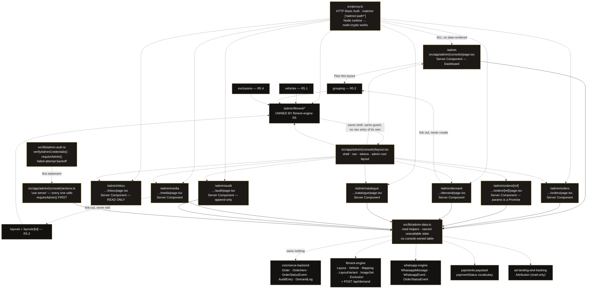
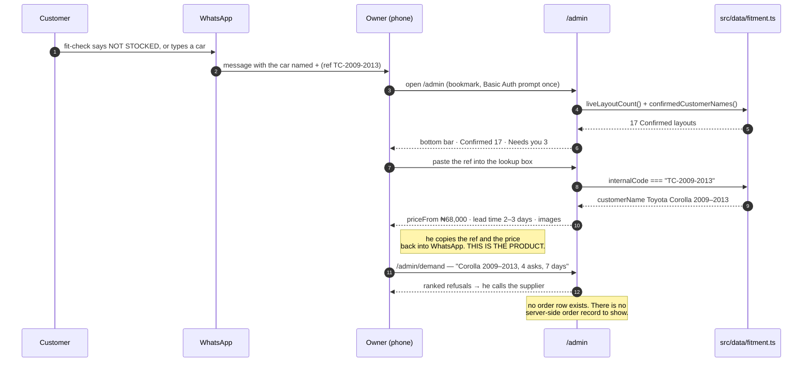
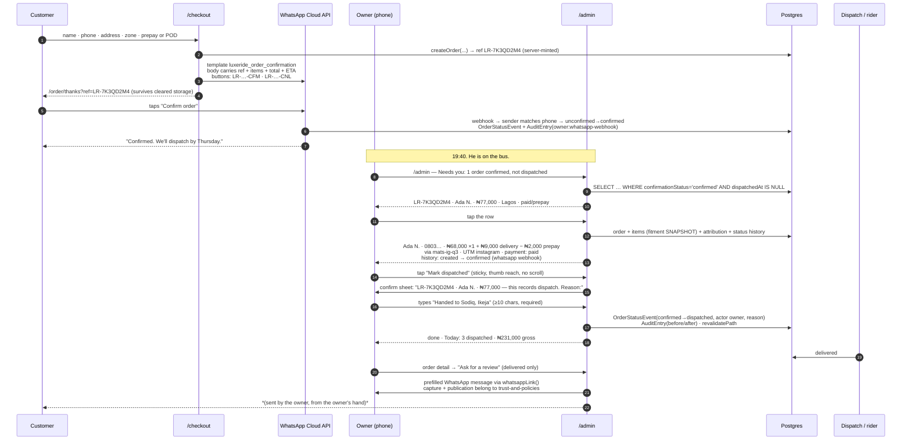
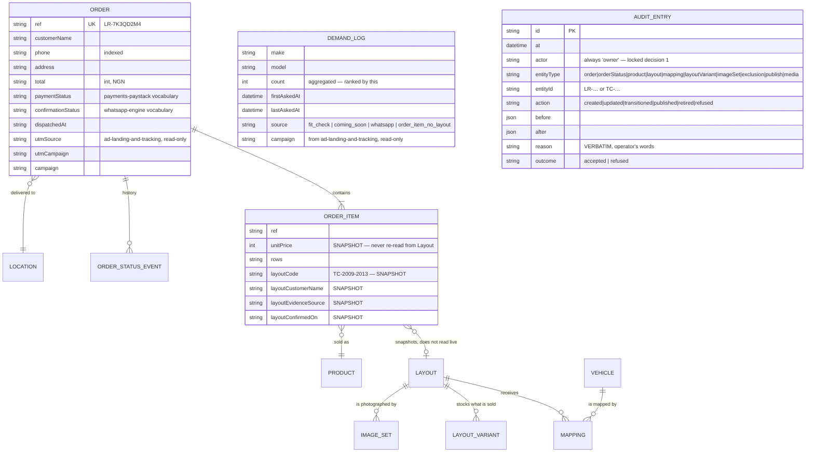

# Design Document

## Overview

The admin console is one screenful of numbers the owner reads in the morning, four things he does
with his thumb during the day, and one screen he opens when something has gone wrong. It is not a
system; it is a **single-operator tool with one person, on a phone, usually inside WhatsApp**.

Three decisions carry the whole thing.

1. **Adopt `fitment-engine`'s auth decision exactly, and add nothing to it.** HTTP Basic Auth in
   Next 16's `src/proxy.ts` + a mandatory `requireAdmin()` first-statement check in every mutating
   Server Action, `scrypt` from `node:crypto`, zero new dependencies. This spec does not diverge —
   see *Authentication* below for why a second mechanism would be strictly worse here.
2. **The console is read-only until it can audit itself.** There is no database, so there is no
   append-only log, and an unlogged mutation is the one thing a single-operator console must never
   produce. So the whole P0 is read-only, and the first write arrives with its audit store in the
   same task. This is the cleanest honest answer to "what is possible before Postgres lands".
3. **Mobile is the primary viewport, not a responsive afterthought.** The nav is a bottom bar, the
   tap targets are 44 px, and the order detail's next action is reachable without scrolling on a
   360 × 640 screen. The desktop-only work is named explicitly and is a short, closed list.

**Guides read in this session before specifying any Next-shaped behaviour.** Required by
`_CONTEXT.md` §12 hard rule 1, and by `luxeride-web/AGENTS.md`, which says *"This is NOT the Next.js
you know… Read the relevant guide in `node_modules/next/dist/docs/` before writing any code."*
All paths are relative to `luxeride-web/`.

| Guide | File read | What it fixed here |
| --- | --- | --- |
| Proxy (getting started) | `node_modules/next/dist/docs/01-app/01-getting-started/16-proxy.md` | *"Starting with Next.js 16, Middleware is now called Proxy"*; one `proxy.ts` per project, logic may be broken into imported modules; `matcher` config |
| Proxy (file convention) | `node_modules/next/dist/docs/01-app/03-api-reference/03-file-conventions/proxy.md` | **Proxy defaults to the Node.js runtime** and the `runtime` config option *throws* in a Proxy file — so `node:crypto`'s `scrypt`/`timingSafeEqual` are available. Matcher array syntax; the warning that a matcher change can silently remove coverage; the line that Proxy defaults to running on every request including prefetched routes |
| Route Groups | `…/03-file-conventions/route-groups.md` | `(folder)` is organisational and absent from the URL; navigating between different **root** layouts causes a full page load; groups must not resolve to the same path; multiple root layouts need no top-level `layout.js` |
| Layouts and Pages | `…/01-getting-started/03-layouts-and-pages.md` | The root layout is required and must contain `<html>`/`<body>`; layouts preserve state and do not rerender on navigation |
| Mutating Data | `…/01-getting-started/07-mutating-data.md` | `"use server"`; Server Actions are `POST`-only and *"reachable via direct POST requests… Always verify authentication and authorization inside every Server Function"* |
| Data Security | `…/02-guides/data-security.md` | The `admin/page.tsx` example verbatim: a page-level redirect controls which UI renders, **the action is a separate entry point and must verify on its own**; the Data Access Layer pattern; `server-only` (verified not installed); rate limiting is called out as a should for expensive operations; *"A page-level authentication check does not extend to the Server Actions defined within it"* |
| Authentication | `…/02-guides/authentication.md` | *"Optimistic checks with Proxy (Optional)"* — read the session, avoid DB checks; the Data Access Layer with `cache()`; `cookies()` is async; session libraries are recommended, not bundled |
| Backend for Frontend | `…/02-guides/backend-for-frontend.md` | The **Rate limiting** section — `checkRateLimit(request)` → `429` with `NextResponse.json(…)`; the documented pattern for a dependency-free limiter |
| `revalidatePath` | `…/03-api-reference/04-functions/revalidatePath.md` | Callable from Server Functions and Route Handlers only, never from a Client Component or Proxy; a dynamic segment needs the `type` parameter |
| `next.config.js` → `headers` | `…/03-api-reference/05-config/01-next-config-js/headers.md` | `headers()` returning `{ source, headers: [{ key, value }] }` — used for `X-Robots-Tag: noindex, nofollow` on `/admin/:path*` |
| `robots.ts` | `…/03-file-conventions/01-metadata/robots.md` | `export default function robots(): MetadataRoute.Robots` with `disallow` — a documented file convention the app does not yet have |

`fitment-engine/design.md` had already read five of these (route handlers, route groups, proxy,
authentication, server actions) and reached the same conclusions; this spec re-read them independently
and additionally read `proxy.md` for the **Node runtime** fact, `data-security.md` for the DAL and
the admin/action split, `backend-for-frontend.md` for rate limiting, `headers.md` and `robots.md`.

---

## Current State (verified)

Everything below was read in this session. Line numbers are exact.

### Exists and is used

| Thing | Path | Relevance |
| --- | --- | --- |
| Root layout, one global `metadata` export, `<Header />` / `<main>` / `<Footer />` | `src/app/layout.tsx:23-40` | The admin must not inherit this. The only `metadata` in the app |
| Design tokens — `--ink #0a0a0a`, `--panel #141210`, `--panel-2 #1c1916`, `--gold #d4af37`, `--gold-dim #8c7853`, `--line rgba(212,175,55,.22)`, `--muted rgba(255,255,255,.55)`; `font-display` / `font-sans` / `font-mono`; `bg-panel`, `border-line`, `text-gold-dim` | `src/app/globals.css:3-24` | The console's entire visual system. No second system |
| `Button` / `LinkButton`, variants `primary \| outline \| ghost` | `src/components/Button.tsx:6-33` | Note `base` is `"… w-full … px-5 py-3.5 …"` — **full width**. In a two-column admin toolbar that must be overridden with `className` |
| `Chip` — `title`, `hint`, `selected`, `tag`, `onClick`; `px-4 py-4` | `src/components/Chip.tsx:1-31` | Large tap target, so usable as a phone filter chip with no change |
| `SafeImage` — returns `null` after `onError` | `src/components/SafeImage.tsx:11-15` | A missing photograph is **invisible** on the storefront. This is why the media view has to count paths that resolve |
| Cart store, `CartItem { id, productSlug, productName, brand, model, year, rows, unitPrice, qty, image? }`, key `luxeride-cart` | `src/store/cart.ts:6-50` | The shape an `OrderItem` mirrors |
| Order store, `PlacedOrder`, key `luxeride-last-order`, `lastOrder` only | `src/store/order.ts:7-36` | No history, no server copy. The order exists in one browser |
| Order id minted in the browser | `src/app/checkout/page.tsx:62` — `` `LR-${Date.now().toString(36).toUpperCase()}` `` | The ref family the console's lookup matches |
| `buildOrderMessage()` — the body has **no ref** | `src/lib/whatsapp.ts:18-36` | This is why the owner receives a message he cannot look up |
| `whatsappLink(msg)` → `wa.me/2347049621694?text=…` | `src/lib/whatsapp.ts:38-40`, number at `src/data/locations.ts:14` | The one `wa.me` call site in the whole app. Every console "message the customer" action routes through it |
| `fmtNaira(n)` | `src/lib/pricing.ts:4-6` | The only money formatter the console may use |
| `validateNGPhone(raw)` | `src/lib/validation.ts` | Used by the console to display a phone as a `tel:` link safely |
| `PRODUCTS` (7) with `regular` / `premium` / `threeRowSurcharge` / `images: string[]`; `priceRange()` | `src/data/products.ts:9-13, 32-119` | What the catalogue view reads at P0 |
| `LOCATIONS` — 4 zones, `fee`, `eta` | `src/data/locations.ts:7-12` | The delivery table beside pricing |
| `BRANDS` (33), `available`, `tier`, `FLAT_CARS`, `POPULAR_CARS` | `src/data/cars.ts:11-81` | Backs the fitment `Vehicle` records; the console does not re-derive it |

### Does not exist — verified, not assumed

| Thing | How I verified it |
| --- | --- |
| **Any authentication, anywhere** | `rg` for `auth\|Auth\|session\|Session\|password\|Password\|middleware\|proxy\|jwt\|token\|role\|permission\|login\|requireAdmin` across `luxeride-web/src` returns **3 hits**, all irrelevant: `cars.ts:37` (the string `"regular"` in a tier), and `order.ts:4` / `cart.ts:4` (the import of `zustand/middleware`) |
| **A `/admin` route** | `find src/app -type f` returns exactly 9 files: `page.tsx`, `layout.tsx`, `globals.css`, `favicon.ico`, `cart/page.tsx`, `checkout/page.tsx`, `fit-finder/page.tsx`, `order/confirmation/page.tsx`, `products/[slug]/page.tsx`, `shop/page.tsx`. No `admin/`, no `api/` |
| **`src/proxy.ts` or `src/middleware.ts`** | `ls` on both → "No such file or directory" |
| **Any route handler or server action** | No `route.ts` anywhere in the file list; no `'use server'` string in `src/` |
| **`jose`, `iron-session`, `server-only`, `bcrypt`, `@node-rs/argon2`** | `node_modules/` contains none of them. `package.json` lists only `next`, `react`, `react-dom`, `zustand`, `@prisma/client`, `prisma` |
| **A test runner** | `package.json` has no `vitest` / `jest` / `node:test` script; `node_modules/vitest` and `node_modules/@playwright/test` absent |
| **Rate limiting** | No limiter anywhere in `src/`; the framework's own `backend-for-frontend` guide offers the pattern |
| **A durable store** | `prisma/schema.prisma` exists, `prisma/migrations/` does not, nothing under `src/` imports `@prisma/client`, `.env`'s `DATABASE_URL` is `postgresql://user:pass@l…` (`_CONTEXT.md` §6) |
| **A footer link of any kind** | `src/components/Footer.tsx:1-10` — 10 lines, two `<p>`, no `next/link` import. There is nowhere for a link to `/admin` to hide |
| **An indexable-surface control** | No `robots.ts`, no `sitemap.ts`, no `not-found.tsx`, no `error.tsx`, no `loading.tsx` (`_CONTEXT.md` §11) |
| **Postgres, on this machine** | The owner has decided on local Postgres; nothing is installed on this Ubuntu 24.04 host yet |

**Launch precondition that is not this spec's to fix:** `npm run build` fails on
`prisma/seed.ts(2,34): error TS2307: Cannot find module './data/products'` (audit B1). The console's
P0 is designed so that it adds no build risk of its own, but it cannot be deployed until
`commerce-backend` fixes that import. Stated here so the owner is not surprised.

---

## Architecture

### The shell's navigation map



**Read the graph as three rings.** Inner: the guard and the shell, which I own and
`fitment-engine` consumes. Middle: the eight operational screens. Outer: the four fitment screens,
nested, with no navigation entry of their own, plus the sibling specs whose state I read.

### The day in the life of the owner

This is the question "how is the admin gonna function" is actually asking, so it gets the most space
in the document. Two eras, because the honest answer today is not the honest answer in six weeks.

#### Era A — today, no database, no Cloud API

The order does not arrive anywhere except WhatsApp. The owner is standing in a shop. The console's
entire job is to make him fast and accurate in the conversation he is already having.



**What he can do in Era A:** read the launch metric, look up a layout ref, read the ranked refusal
roadmap, read the catalogue and what it actually costs, see which product photos are missing, and
message the customer. **What he cannot:** see an order (it does not exist server-side), see a
WhatsApp message log (there is no Cloud API), change anything (there is no store to audit to).

#### Era B — after `commerce-backend`, `whatsapp-engine` and `payments-paystack`



**The nine clicks, in order**, because the question is literally *what does the owner click, in
order*:

1. The bookmark / app shortcut for `/admin`. **Once.** After that the browser has cached the Basic
   Auth credential for the session, so there is no login step — this is why a session library would
   be ceremony here rather than security (Requirement 2.9).
2. `Needs you` on the dashboard. The list is already sorted; he reads a number, not a filter.
3. The order row. One tap, full width, the whole row is the target.
4. `Mark dispatched` — sticky at the bottom of the order detail, above the fold on a 360 × 640
   screen, ≥ 44 px, and **not** adjacent to the destructive control (Requirement 12.4).
5. `Confirm` in the sheet — the sheet names the order, the customer and the naira figure.
6. The reason field — typed, ≥ 10 characters, never a dropdown for a destructive action.
7. `Done`. The action returns in one round trip; the dashboard already shows the new totals.
8. *(on delivery)* `Ask for a review` on the order detail — a prefilled WhatsApp message, not a form.
9. *(weekly)* `/admin/demand` → the top refusal → `Plan this layout` → straight into
   `fitment-engine`'s grouping screen with the make and model pre-filled.

Steps 2–7 are the loop. Everything else is occasional.

### Why the guard is `proxy.ts` + `requireAdmin()` and not something else

`fitment-engine/design.md` evaluated this and chose option A. I re-read the guides and the code and
**adopt it without divergence**. Recording the reasoning here so a future reader does not "improve"
it:

| Option | Cost | Why rejected, on the evidence |
| --- | --- | --- |
| **A. Basic Auth in `proxy.ts` + `requireAdmin()` in every action** ← taken | ~80 lines, zero new dependencies | `jose`, `iron-session` and `server-only` are all **verified not installed**. Next 16 **defaults Proxy to the Node runtime** and forbids the `runtime` option there, so `node:crypto`'s `scrypt` and `timingSafeEqual` both work. The authentication guide's "optimistic checks with Proxy" section is exactly this shape. Locked decision 1 forbids the alternative's surface |
| B. Password page + signed cookie session | A login route, a session module, a DAL with `cache()`, a logout, a secret, **and a new dependency** | Five times the surface for one user, and the one session artefact the owner would actually notice is a login screen he has to dismiss on his own phone. Locked decision 1 |
| C. Secret in the URL or a hardcoded header | Nothing | Insecure. Rejected outright |

**What this spec adds on top of A, and why it is not a divergence:**

- **A failed-attempt backoff inside the same module.** The framework's own rate-limiting pattern
  (`backend-for-frontend.md` §Rate limiting) is a `checkRateLimit(request)` helper returning a
  boolean, wrapped around the handler. There is **no rate limiting anywhere in this app**, and this
  console is the single highest-value target on it: pricing, publish controls, customer phone
  numbers. It is an in-process counter keyed on the client address with exponential backoff and a
  `Retry-After` header — no dependency, and honest about its limits (below).
- **A structured `console.warn` per failed attempt**, so a blocked brute force is still visible in
  the platform log.

**The limits of the backoff, stated plainly.** An in-process counter is per-instance, resets on
restart, and is weakened by a multi-instance deploy. It is a speed bump, not a defence. The real
controls are: a long passphrase, `requireAdmin()` inside every action (the boundary that actually
matters), and `/admin` not being linked from anywhere. If the host ever fronts this with a managed
edge rate limiter, the helper is the single place to change.

**What the guard is not.** `src/proxy.ts` contains no layout, price, order, demand or message data.
It reads one header and returns allow/deny — which keeps it inside the Proxy guide's *"not intended
for slow data fetching"* warning, and means a matcher mistake degrades to a page that renders, not to
a page that stalls. `fitment-engine/tasks.md` 7.2 already specifies the matcher; the matcher
`['/admin/:path*']` covers `/admin/fitment/*` with no change, which is how Requirement 10.8 is
satisfied for free.

### The second root layout, and why

The storefront's `src/app/layout.tsx:35-37` wraps every route in `<Header />` and `<Footer />`.
`Header` is `"use client"` and reads the persisted cart behind a `useHasMounted()` guard
(`Header.tsx:7-16`) — audit defect **D1**'s worked example. None of that belongs in an admin
request, and `Footer` renders the Fit Guarantee line, which sitting underneath a pricing table is
exactly the kind of visual noise that causes a misread.

Route groups exist for this: *"Defining multiple root layouts"* is a listed use case, and
`route-groups.md` notes that navigating between routes with different root layouts triggers a full
page load — irrelevant here, and arguably desirable across the admin/storefront boundary. The
convention requires that with multiple root layouts there is **no top-level `layout.js`**, and that
every route is inside a group.

```mermaid
graph LR
    subgraph BEFORE["Today — one root layout"]
        L0["src/app/layout.tsx<br/>html · body · Header · Footer · global metadata"]
        L0 --> P0["/ · /shop · /cart · /checkout<br/>/fit-finder · /order/confirmation<br/>/products/[slug]"]
    end
    subgraph AFTER["After — two root layouts, no top-level layout.tsx"]
        LA["src/app/(storefront)/layout.tsx<br/>html · body · Header · Footer · global metadata"]
        LB["src/app/admin/layout.tsx<br/>html · body · admin chrome · 'LuxeRide Admin'"]
        LA --> PA["/ · /shop · /cart · /checkout<br/>/fit-finder · /order/confirmation<br/>/products/[slug]"]
        LB --> PB["/admin/**  (the whole console)"]
    end
    BEFORE -.->|"7 page.tsx files move one<br/>folder deeper; URLs unchanged" .-> AFTER
```

`globals.css` is imported by both root layouts, so the tokens in Requirement 1.7 are global to both
trees. `src/app/favicon.ico` stays at the app root and keeps working. Every sibling spec that
specifies a storefront route (`storefront-catalog`, `fit-finder`, `cart-checkout`, `trust-and-policies`,
`ad-landing-and-tracking`) writes a path under `src/app/`; the move changes where the file lives, not
the URL, and it is a mechanical rename. **This is the one place in this spec that touches another
spec's files**, and it is flagged in Open Questions.

---

## Components and Interfaces

### The route table

Every file named is under `luxeride-web/`. Type and rationale are given for each, satisfying
`_CONTEXT.md` §12 hard rule 6.

| URL | File | Type | Why this type |
| --- | --- | --- | --- |
| `/admin` | `src/app/admin/(console)/page.tsx` | Server Component | Reads fitment counts, demand and orders. Nothing on this screen needs client JS except the lookup form, which is a `GET` form — no component needed |
| `/admin/orders` | `src/app/admin/(console)/orders/page.tsx` | Server Component, reads `await searchParams` | A filtered list is a URL. No client state, no hydration cost on a phone |
| `/admin/orders/[ref]` | `src/app/admin/(console)/orders/[ref]/page.tsx` | Server Component, `const { ref } = await params` | `params` is a Promise in Next 16. The snapshot, the money and the history are all secrets that must not cross to the client |
| `/admin/inbox` | `src/app/admin/(console)/inbox/page.tsx` | Server Component, **read-only** | Reads the message log wholesale. Rendering it server-side is the point: the log must never ship to a browser |
| `/admin/demand` | `src/app/admin/(console)/demand/page.tsx` | Server Component | A ranked table. Ranking is a query, not a client sort |
| `/admin/catalogue` | `src/app/admin/(console)/catalogue/page.tsx` | Server Component | Prices must come from the server. A client-editable price field is a price field that can be tampered with in the DOM before it is ever submitted |
| `/admin/media` | `src/app/admin/(console)/media/page.tsx` | Server Component | Counts whether paths resolve. `fs.existsSync` over `public/products/` is a server concern and the result must not be trusted from the client |
| `/admin/audit` | `src/app/admin/(console)/audit/page.tsx` | Server Component | The log is the most sensitive thing in the console |
| `/admin/fitment/**` | `src/app/admin/fitment/**` | Server Components + Server Actions | **`fitment-engine`'s, per its tasks.md 8.3–8.9. Named here only so the shell's shape is unambiguous. Not specified by this spec** |
| — | `src/app/admin/(console)/actions.ts` | `'use server'` Server Actions | One module, every mutation, each opening with `requireAdmin()` then validation then the write then the audit then `revalidatePath` |
| — | `src/app/admin/(console)/error.tsx` | Client Component (required) | Next's error boundary must be a client component. First admin error boundary in the app |
| — | `src/app/admin/(console)/loading.tsx` | — | Reserves the final height so a slow phone never shows an empty screen |
| — | `src/app/admin/(console)/not-found.tsx` | — | Four words and a link back |
| — | `src/app/proxy.ts` | Proxy, Node runtime | The optimistic gate |
| — | `src/lib/admin-auth.ts` | Plain server module | One credential store for the whole console (Requirement 2.3) |
| — | `src/lib/admin-data.ts` | Plain server module | Every read helper, and **one** function that returns a typed named-unavailable state instead of throwing |
| — | `src/lib/admin-ratelimit.ts` | Plain server module | The failed-attempt backoff, kept out of `admin-auth.ts` so the auth module stays a credential verifier |

### The two-state contract — `admin-data.ts`

Every read helper returns a **discriminated union**, never a bare value and never a thrown error:

```ts
// shape only; the real file is written in task 2.4
export type Read<T> =
  | { state: "ok"; data: T; readAt: string }        // live
  | { state: "stale"; data: T; readAt: string; cause: string }  // degraded, last known
  | { state: "unavailable"; reason: string };       // no store yet

export async function readOrders(filter: OrderFilter): Promise<Read<OrderList>>;
export async function readDashboard(): Promise<Read<DashboardModel>>;
export async function readDemandLog(window: DemandWindow): Promise<Read<DemandRow[]>>;
```

The third state is the one that carries Requirement 11: before Postgres, `readOrders` returns
`{ state: "unavailable", reason: "No server-side order record exists until commerce-backend lands" }`
and the page renders that sentence. It does not render `[]`. The difference matters — an empty order
list reads as *no business*, which is the exact confusion `fitment-engine` Requirement 11.3 exists to
prevent on the demand side.

### The action contract — `actions.ts`

```ts
// shape only
"use server";
export async function setOrderStatus(formData: FormData): Promise<ActionResult>;
export async function cancelOrder(formData: FormData): Promise<ActionResult>;
export async function setProductPrice(formData: FormData): Promise<ActionResult>;
// ...
type ActionResult = { ok: true; message: string } | { ok: false; error: string };
```

Every one of them, in this order, without exception:

1. `await requireAdmin()` — the boundary. Not a redirect, not a `return`; it throws a typed
   unauthorized, which the caller converts to `{ ok: false, error: "unauthorized" }`.
2. Read and validate **every** `formData` field. The Data Security guide is explicit: *"Always
   validate input from client, as they can be easily modified."*
3. Re-check the transition against `payments-paystack`'s table. An illegal transition is **refused and
   audited** (Requirement 9.6) — a refused transition is the interesting one during a dispute.
4. Enforce the tier rules: `reason.length >= 10` for state-changing, typed reason for destructive.
5. Write the domain record and the audit entry.
6. `revalidatePath()` the affected routes — never from a Client Component, never from Proxy, per
   `revalidatePath.md`.
7. Return only what the UI needs. The guide's BAD example returns the whole database record; the
   console never does, because an order row contains a customer's name, phone and home address.

**Why Server Actions and not route handlers for the mutations.** The server-actions guide records
that actions are `POST`-only, CSRF-checked (`Origin` against `Host`), capped at 1 MB, and carry an
encrypted action id with unreferenced actions stripped from the client bundle — so there is no public
endpoint to probe. A route handler would buy a URL, a content type and a response shape the confirm
sheets do not need. `fitment-engine/tasks.md` 8.9 already specifies this file for the fitment screens
and **the same file serves them**; there is one `actions.ts` per console, not one per screen.

**Read-only route handlers**, by contrast, do have a job: the `scripts/` hash helper is a script,
not a route, but the demo/verification of the limiter and the optional `/admin/healthz` are route
handlers. Neither is required at P0.

### The confirm sheet

Not `window.confirm()` — a native dialog cannot carry a reason field, cannot show the naira figure
beside the customer's name, and is suppressed in some in-app browsers. A bottom sheet on a phone, a
side panel at `sm+`, rendered as a **Client Component** (it holds local state for the reason field)
inside a Server Component page. It shows, at render time, every field the action will change — so the
confirmation is never made against a figure the owner has not seen (Requirement 16.1).

```
┌─────────────────────────────────────┐
│  Mark dispatched                    │   ← target, named
│  LR-7K3QD2M4 · Ada N. · ₦77,000     │   ← ref in font-mono
│                                     │
│  Status                             │
│    confirmed  →  dispatched         │   ← before → after, side by side
│                                     │
│  Reason *                           │
│  ┌───────────────────────────────┐  │
│  │ Handed to Sodiq, Ikeja        │  │   ← typed, ≥ 10 chars, required
│  └───────────────────────────────┘  │
│  38 characters                      │   ← live count, turns gold at 10
│                                     │
│  [  Cancel  ]      [ Mark dispatched ]│
└─────────────────────────────────────┘
```

The destructive variant (cancel, refund) changes three things: the button is `outline` not
`primary` and sits **left** of nothing, the customer block is repeated inside the sheet, and a second
press is required. Requirement 12.4's spacing rule is why `Cancel` and a destructive control are
never neighbours.

---

## Data Models

**The console owns no table.** It owns no migration, no Prisma model, and no column that no sibling
reads (Requirement 11.7). Everything below is either read-only from a sibling spec or produced by
`fitment-engine`'s module at P0.



**The snapshot rule is the load-bearing one.** `fitment-engine` Requirements 20.1–20.5 and its
Requirement 12.7 require that an order keeps the fitment facts it was sold against even after the
Layout is split or retired. So `OrderItem` columns are read as **history**, never joined to the live
`Layout`. The order detail shows both — the snapshot as the record, the current Layout status as an
informational note beside it — and the Requirement 4.10 criterion exists to stop a future helper
"helpfully" re-joining them.

**The audit log is append-only and it is the reason the console is read-only at P0.** There is no
`updatedAt` on an audit row because there is no update. There is an `outcome` column because
`payments-paystack` is explicit that a refused transition is the interesting one, and an audit log
that only records successes cannot answer "did something try to cancel a paid order last Tuesday".

**`actor` is a single value.** `"owner"`, or a system string for a machine writer
(`"owner:whatsapp-webhook"`, `"owner:paystack-webhook"`) so a human action and a machine action are
distinguishable in the log without a user table. Locked decision 1 forbids a second editor, so
there is nothing else to record.

### What the dashboard reads, and from where

| Card | Source | P0 behaviour with no DB |
| --- | --- | --- |
| **Confirmed layouts** (launch metric) | `liveLayoutCount()` — `fitment-engine/tasks.md` 2.9 | **Live.** A plain function over a typed module. This is the one headline number the console can deliver before any infrastructure exists, and it is the number `fitment-engine` Requirement 15.7 says must be written down on go-live day |
| Layout status breakdown | same module, by `status` | Live |
| **Live now** | `confirmedCustomerNames()` — `fitment-engine/tasks.md` 2.9 | Live. This is the list `ad-landing-and-tracking` aligns ad creative to (Requirement 15.5 there), shown so the owner can see it without reading code |
| **Refusals (24 h / total)** | `POST /api/demand` sink → structured log lines, `data/demand.jsonl` best-effort | **Live**, with the honest caveat from Requirement 6.7 about where the data actually is |
| Ranked demand | same sink, aggregated | Live, unranked-but-sorted; no time window before a store exists |
| Today / 7-day revenue | `Order.total` | `unavailable` panel naming `commerce-backend` |
| Needs you | `Order` + `WhatsappMessage` + payment state | `unavailable` |
| What changed today | `AuditEntry` | `unavailable` — and the message is *"the console is read-only until there is a store to audit to"*, which is true |

### Ordering, so the dashboard is one cheap query set

The dashboard is a Server Component, so its cost is one request's worth of parallel reads. Rule: at
most **five** queries, all issued together, none nested. `liveLayoutCount()` is a function over an
already-imported module and costs nothing. Order aggregates are `count` + `sum` grouped, never a
row fetch. The demand ranking is a `groupBy` on `make, model` with a `count`, capped at 50 rows
before rendering. Anything that would need a second round trip does not go on the dashboard; it goes
on the list it belongs to.

---

## Error Handling

| Condition | Response | Why |
| --- | --- | --- |
| `/admin/:path*` with no or wrong credentials | `401` + `WWW-Authenticate: Basic realm="LuxeRide Admin"`, no data rendered | Requirement 2.4, and `fitment-engine` 5.7 |
| Repeated failed attempts | `429` + `Retry-After`, one structured `console.warn` per attempt | There is no rate limiting anywhere in the app and this is its most valuable target |
| Server Action invoked without credentials | abort before any read or write, `{ ok: false, error: "unauthorized" }` | A page-level check is **not** a boundary; the action is a separate entry point |
| `ADMIN_USER` / `ADMIN_PASSWORD_HASH` absent from the environment | **fail closed** — `401`, and one loud startup `console.error` | An unset secret must never mean "no auth required" |
| Postgres not up yet | `Read.state === "unavailable"`, the named panel, a link to the sibling spec that owns it | An error page teaches the owner nothing; a named panel tells him what is missing and who builds it |
| Postgres up but the query fails or times out | `Read.state === "stale"` — last known data plus a staleness banner with the read time | A console that shows nothing during a blip is worse than one that shows yesterday, marked as yesterday |
| `assertLiveLayouts()` throws at import | dashboard shows the failure panel naming the offending `internalCode`; **never** a zero | A zero Confirmed count is the most dangerous wrong number in the entire product. `fitment-engine` Requirement 4.6 makes this a build-time failure, and Requirement 14.5 makes it a panel, not a crash |
| Illegal order transition (e.g. `cancelled → paid`) | refused at the action, refusal audited, control not rendered | `payments-paystack`'s table is the authority; `cancelled` is terminal and `paid` never returns to unpaid |
| Reason shorter than 10 characters | refused, the counter is visible *before* submit | The rule should be felt while typing, not discovered on submit |
| Audit write fails after the domain write | **the whole action fails**; the domain write is rolled back or the pair is reconciled | Requirement 12.6. A change with no audit row is the one artefact this console must never produce |
| Destructive action on the wrong row (owner opened a stale detail, the ref changed under them) | confirm sheet shows the value read at render time; the action re-reads and refuses on mismatch | Requirement 16.1 — never confirm against a figure the owner has not seen |
| Filter matched nothing | "No orders match this filter" + a one-tap clear | Requirement 14.1: a filter with no results is not an empty table |
| Nothing recorded yet | "No orders recorded yet — the database is not live" | Requirement 3.10 |
| Feature not built yet | "Catalogue editing needs the database. Read-only for now." | Requirement 14.1, four distinct sentences, not one empty box |
| A path that is not an admin route | admin `not-found.tsx`, one link back to the dashboard | Requirement 1.9 |

---

## Testing Strategy

No test runner is installed — `package.json` has no `vitest` / `jest` entry and neither is present in
`node_modules`. Adding one is a decision, not a free choice; `fitment-engine/tasks.md` 14.1 proposes
`vitest` as its single dev dependency, and **admin-console adopts that rather than proposing a second
runner** (Requirement 11.7's spirit). The layers below are ordered cheapest-first, and the first two
cost nothing.

**Layer 1 — a pure-function check, no runner.** `src/lib/admin-ratelimit.ts` and the reason-length
rule are small pure functions. `node --test` ships with Node and needs no dependency, so the
backoff curve and the `>= 10` rule can be checked with `node:test` at zero cost. This is the one
place a test earns its keep before P1, because a limiter with a bug in its backoff is a limiter that
does not limit.

**Layer 2 — a manual phone test, once, at P0.** Five checks, on a real phone, in this order:

1. `/admin` with no credentials → the Basic prompt appears, and no layout, price, order or demand
   data appears in the page source.
2. A wrong password eleven times in a row → `429`, then a `Retry-After`; the platform log shows one
   `console.warn` per attempt.
3. With `ADMIN_PASSWORD_HASH` **unset**, `/admin` → `401`, and the platform log shows the loud
   startup error. Fail closed, not open.
4. On a 360 × 640 screen: the bottom nav is reachable with a thumb, every tap target is ≥ 44 px, and
   the dashboard's `Needs you` row and the order detail's primary action are both visible without
   scrolling.
5. With no database: `/admin`, `/admin/demand`, `/admin/catalogue` and `/admin/media` render real
   data; `/admin/orders` renders the named unavailable panel, **not** an empty table.

**Layer 3 — `vitest`, P1, six files**, once `commerce-backend` has a database to test against:

| File | Asserts |
| --- | --- |
| `auth.test.ts` | `requireAdmin()` throws on absent, malformed and wrong credentials; never throws on the correct one; fails closed when the env vars are unset |
| `action-auth.test.ts` | **every** exported action in `actions.ts` calls `requireAdmin()` first — asserted by calling each with no credentials and asserting nothing was written |
| `transitions.test.ts` | each permitted transition in `payments-paystack`'s table is accepted; each forbidden one is refused; a refusal writes an `AuditEntry` with `outcome: "refused"` |
| `reason.test.ts` | a state-changing action with a 9-character reason is refused; with 10 it passes; the reason is stored verbatim including newlines and emoji |
| `snapshot.test.ts` | an order whose Layout has since been retired still renders its snapshotted `layoutCode`, `layoutCustomerName` and `priceFrom` |
| `unavailable.test.ts` | each `admin-data.ts` reader returns `unavailable` (not `[]`, not `0`) when its source is missing |

**Layer 4 — no e2e.** No Playwright, no Cypress. One operator, one phone, a console that is mostly
reads — the manual test in Layer 2 is the higher-fidelity check, and `fitment-engine` made the same
call with the same reasoning.

**The verification that is not a test.** After P0, open `/admin`, read the Confirmed Layout count, and
**write it down** (`fitment-engine` Requirement 15.7). That number is the launch metric, it is the
basis for every ad audience decision, and it is not recoverable later.

---

## Open Questions

Each is the owner's call, not an engineering question. None blocks the P0.

1. **Is local Postgres the answer, and who operates the backups?** The owner has decided to run
   Postgres locally for now and nothing is installed on this Ubuntu 24.04 host yet.
   `commerce-backend` Open Question 1 asks the hosting question and gives the honest reason it is
   still open: a self-hosted database has no managed daily backup, this project has **no version
   control either** (audit B4 — no `.git` anywhere), and so it currently has no way to recover from
   anything at all. Everything in this console's P1/P2 is downstream of that answer, and the audit
   log is the one thing that genuinely cannot be regenerated.
2. **Does the second root layout survive contact with the other specs?** Requirement 1.3 needs
   `src/app/layout.tsx` split into `src/app/(storefront)/layout.tsx` and `src/app/admin/layout.tsx`,
   which moves seven existing `page.tsx` files one folder deeper. URLs are unchanged and it is a
   mechanical rename — but five sibling specs each name a storefront `page.tsx` path, and if any of
   them has already been written to disk, it now points at a file that moved. **This is the one task
   in this spec that touches another spec's files**, and the owner should decide whether to do it here
   or hand it to `storefront-catalog` as a coordinated change. If it is not done, the fallback is
   that the admin renders inside the storefront's `<Header />` and `<Footer />`, which works and is
   ugly.
3. **What is the actual ordering of the sibling specs?** The console's P1 is blocked on three things
   at once — `commerce-backend` (the database), `whatsapp-engine` (the message log and the
   `Order` extension columns) and `payments-paystack` (the status vocabulary). The order detail
   screen needs all three to be useful, and `/admin/orders` exists only once the first is done.
   `/admin/inbox` needs only the second. Which one the owner wants first is a trading-priority
   question, not an engineering one.
4. **Is the audit log a compliance artefact or a working tool?** This spec builds it as a working
   tool — last 7 days by default, the reason verbatim, the before → after side by side (Requirement
   9). If it is also meant to be the NDPR-facing record of what the business holds, its retention
   and access rules are `trust-and-policies`' question, and a growing audit log that nobody prunes
   becomes a liability. Nothing here assumes a retention period.
5. **Does the owner ever need to hand the console to someone else — a driver, a supplier — even
   once?** Locked decision 1 says no second editor seat, and this spec builds none. But the demand
   log is described as a *sourcing* roadmap, and a supplier is exactly the person who would want to
   read it. If that ever becomes real it is a locked-decision change and belongs to the owner, not a
   feature flag added later. Raised now so nobody builds the read-only-for-suppliers variant by
   accident.
6. **Which of the two overlapping screens wins if `fitment-engine` lands first?** Requirements 10.4
   and 10.5 resolve the demand log and the audit log by saying *"admin-console owns the single
   route; if fitment-engine builds a separate screen first, this route is deleted and replaced by a
   link."* That is a rule, not a plan — the two files will be written by whoever moves first, and the
   second one will find a route already there. **The one thing that must not happen is two ranked
   demand tables with different numbers in them.** This is the coordination point I am least certain
   about, and it is the answer I would most like confirmed.
7. **Should the 12-hour unanswered-confirmation follow-up be a WhatsApp message or a dashboard
   badge?** `whatsapp-engine` owns the 12-hour sweep and sends `luxeride_order_followup`. The console
   surfaces it in `Needs you`. If the owner never opens the console, the badge is invisible and the
   sweep is the only mechanism — which is arguably correct, since it is the one that works when he is
   asleep. The badge is a convenience, not the safety net. Confirm that is the intent.
8. **Does the owner want an export of any of this — orders, demand, audit — to a CSV?** A phone-first
   operator with seven products and one database will eventually want their numbers out of the tool.
   It is not in this spec because it is a P2 at best and a spreadsheet-shaped answer to a question a
   database console already answers. Raised so it is a decision rather than a gap.
