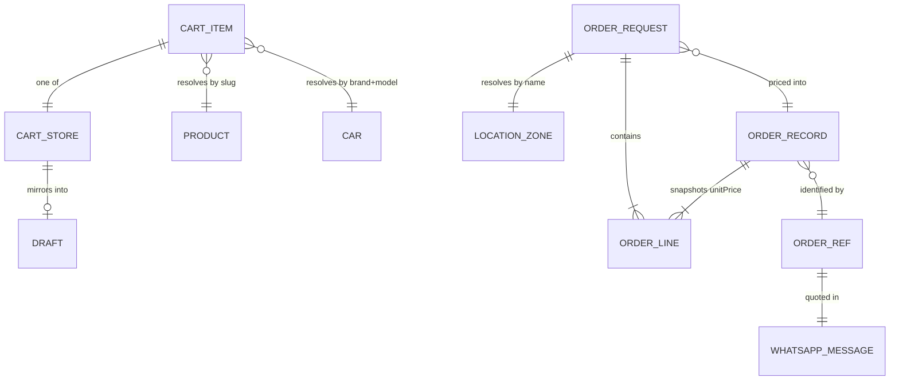

# Design Document

## Overview

This feature rebuilds `/cart → /checkout → /order/confirmation` around one rule: **the site may only
claim what it can prove.** Today the checkout mints an id in the browser, writes it to `localStorage`,
opens a `wa.me` link, empties the cart and tells the customer "Order sent" — with no network call
anywhere in the sequence. The fix is not "add a database" (there isn't one, and `commerce-backend`
owns that); the fix is to move the one step that must be trusted — **pricing the order** — to the
server, give every order a **reference that reaches WhatsApp**, and change the sequence so the cart
survives until the customer confirms the handoff.

Three facts make this possible on P0 with no infrastructure:

1. `src/data/products.ts`, `src/data/cars.ts` and `src/data/locations.ts` are **plain static
   TypeScript modules**, so a route handler can import them and re-price an order with zero
   provisioning. A `route.ts` file works the moment the app is deployed.
2. `productBase()` in `src/lib/pricing.ts` is a **pure function of the catalogue**, and the cart line
   already carries `productSlug`, `brand`, `model`, `year` and `rows` — everything needed to recompute
   `unitPrice` without trusting the stored one. The one thing a line does **not** carry is the tier,
   which is exactly right: the server should look it up.
3. `WHATSAPP_NUMBER` is a constant, so the site can both *send* to and *receive from* the owner
   without any new configuration.

What genuinely cannot be done on P0, and is deferred to `commerce-backend`, is stated explicitly in
each decision below rather than glossed over.

Next.js 16 specifics asserted here were read from the bundled docs, not from memory:
`node_modules/next/dist/docs/01-app/01-getting-started/15-route-handlers.md`,
`.../03-api-reference/03-file-conventions/route.md`,
`.../02-guides/server-actions.md`,
`.../03-api-reference/04-functions/use-router.md`,
`.../01-getting-started/10-error-handling.md`,
`.../03-api-reference/03-file-conventions/error.md` and `.../not-found.md`.

---

## Current State (verified)

Every claim below was read from the file named, in this session.

### Order creation is entirely client-side

`src/app/checkout/page.tsx:48-81` — `submit()` builds a message, constructs an object, and stops:

```ts
setLastOrder(order);
window.open(whatsappLink(message), "_blank");
clear();
router.push("/order/confirmation");
```

There is **no `fetch`, no server action, no form `action`** anywhere in the file, and
`_CONTEXT.md` §11b D-? records that `src/` contains no `route.ts` and no server actions at all. The
order exists only in the customer's browser.

### The id is generated client-side and never reaches WhatsApp

`src/app/checkout/page.tsx:62` — `` id: `LR-${Date.now().toString(36).toUpperCase()}` ``.

Two separate problems:

- **It is derived from a millisecond clock**, so consecutive orders are sequential and enumerable by
  anyone who knows a rough time window. That makes it unfit as a lookup key the moment an
  order-status page exists.
- **`buildOrderMessage` in `src/lib/whatsapp.ts:18-36` never receives it.** The signature is
  `(input: OrderMessageInput, preview = false)` and `OrderMessageInput` (lines 5-16) has no id
  field. The rendered message at line 35 contains name, item lines, delivery address, location,
  phone, payment line and a sign-off — and no reference. **The owner cannot reconcile a conversation
  with an order.**

### The cart is cleared before delivery is confirmed

`src/app/checkout/page.tsx:79` — `clear()` runs on the line immediately after `window.open(...)`, and
the return value of `window.open` (a `Window | null`) is **discarded**. If the popup is blocked,
`window.open` returns `null` and nothing is announced. `clear()` runs anyway. The customer's cart is
gone and no order exists anywhere.

### Order storage is `localStorage` only

`src/store/order.ts:28-36` — a Zustand store with `persist` under key `luxeride-last-order` holding
`lastOrder: PlacedOrder | null` and nothing else. No history, no server copy, no index. `PlacedOrder`
(lines 7-21) embeds `items: CartItem[]` — the *cart* shape — so the stored order freezes the client's
own unverified prices into what looks like an order record.

Consequences, all reachable in normal use: clearing site data loses the order, a second device shows
nothing, a private window shares nothing, and **the owner has no path to any of it**.

### Prices are client-asserted

`CartItem.unitPrice` (`src/store/cart.ts:14`) is written into `localStorage` by `addItem`
(`src/store/cart.ts:33-39`), and the value comes from `productBase(product, tier, rows)` computed in
the browser in `src/components/FitFinder.tsx:82`. `subtotal()` (`src/store/cart.ts:46`) is
`items.reduce((sum, i) => sum + i.unitPrice * i.qty, 0)` — it reads the stored number back.
`removeItem` and `setQty` (`src/store/cart.ts:40-44`) trust whatever is stored. `productBase` itself
(`src/lib/pricing.ts:9-15`) is a sound pure function, but nothing has ever been on the other side of
it. Nothing in the repo has ever recomputed a price.

### Validation exits silently

`src/app/checkout/page.tsx:49-54`:

```ts
if (!validateNGPhone(phone)) { setPhoneError(true); return; }
setPhoneError(false);
if (!name.trim() || !address.trim()) return;
```

Only the phone produces UI. Empty name or address **returns with no message, no focus and no error
state** — the button appears dead. The phone error at lines 107-111 is a bare
`<p className="mt-1 text-xs text-[#FF6B35]">` with no `role="alert"`, no `aria-invalid` on the input
(lines 100-106) and no `aria-describedby`. There is no `<form>` element in the file, so no native
`required` and no native submit validation. The prototype did focus the offending field
(`luxeride-funnel (2).html:1013-1014`); the app dropped even that.

### D1 — hydration mismatch on all three routes

`_CONTEXT.md` §11b defect **D1**: `zustand/persist` hydrates synchronously in the client but the store
stays empty on the server, so the server-rendered HTML for `/cart` says **"Your cart is empty"** while
the client's first render already holds items. `src/components/Header.tsx:10-16` solves this for the
cart badge with a `useHasMounted()` helper built on `useSyncExternalStore`, but that guard was never
applied to the pages that render the cart itself: `src/app/cart/page.tsx`,
`src/app/checkout/page.tsx`, `src/app/order/confirmation/page.tsx`.

This matters here more than anywhere else. The same three components are being given storage-backed
draft state and a three-branch confirmation screen, so the guard must be centralised and reused, not
reinvented per page.

### Other verified facts that shape the design

| Fact | Evidence |
|---|---|
| The delivery-zone `<select>` defaults to `LOCATIONS[0].name` — Lagos — for every visitor. | `src/app/checkout/page.tsx:21`, `src/data/locations.ts:8` |
| `zone.eta` is displayed **only** inside the `<option>` text and nowhere else. | `src/app/checkout/page.tsx:134` |
| Prepay copy promises "account details sent on WhatsApp"; no account number, bank or constant for one exists anywhere in `src/`. | `src/app/checkout/page.tsx:161`, `src/lib/whatsapp.ts:30-33` |
| The prepay discount and the `Math.max(..., 0)` floor are inline literals, duplicated between the page and the prototype. | `src/app/checkout/page.tsx:27-28`, `luxeride-funnel (2).html:968-971` |
| The POD payment line always interpolates the fee, so a zero-fee zone would render "incl. ₦0 delivery". | `src/lib/whatsapp.ts:33` |
| `addItem` always pushes a new row — no merge, no natural key. | `src/store/cart.ts:33-39` |
| `setQty` floors at 1, so the "–" control is a **no-op** at quantity one. The `+` control has no upper bound. | `src/store/cart.ts:41-44`, `src/app/cart/page.tsx:47,53` |
| The confirmation screen renders a success tick and "Order sent — check WhatsApp" unconditionally whenever a record exists, and "No recent order found" when none does. | `src/app/order/confirmation/page.tsx:27,30,14` |
| The prototype has a **`Copy message`** button and a **`← Back to your fit`** link; the app has neither. | `luxeride-funnel (2).html:563,568,1040-1048` vs `src/app/checkout/page.tsx:171-176` |
| The prototype's `submitCheckout()` claims nothing after `window.open`. **The "Order sent" promise is app-only.** | `luxeride-funnel (2).html:1001-1019` |
| `SafeImage` returns `null` on error, and 3 of 7 products (`seat-covers`, `full-bundle`, `cargo-liner`, `mud-flaps`, `sun-shade` — 5 of 7) point at image paths that do not exist. | `src/components/SafeImage.tsx:12-14`, `_CONTEXT.md` §7 |
| No `not-found.tsx`, `error.tsx` or `loading.tsx` exists anywhere in `src/app/`. | `_CONTEXT.md` §11 |
| `prisma/schema.prisma:26` stores one `basePrice` per product while the app prices from two; this is defect **D2** and it blocks server-side re-pricing *from the database*. | `_CONTEXT.md` §11b D2, `src/data/products.ts:36-40` |
| The catalogue floor price is ₦15,000 and `setQty`'s minimum is 1, so the `Math.max(..., 0)` floor in the total can never actually trigger today. | `src/data/products.ts:102`, `src/store/cart.ts:43` |

---

## Architecture

### Order creation sequence

Failure branches are in the diagram. Every branch that can strand an order ends on a screen the
customer can act from, never on a dead end.

```mermaid
sequenceDiagram
    autonumber
    actor C as Customer
    participant CP as /checkout<br/>Client Component
    participant API as POST /api/orders<br/>Route Handler
    participant SRC as src/data + src/lib<br/>server modules
    participant LOG as Server log
    participant WA as wa.me / WhatsApp
    participant LS as localStorage
    participant CF as /order/confirmation<br/>Client Component

    C->>CP: Tap "Send my order on WhatsApp"
    CP->>CP: validate name, phone, address, zone, consent

    break A field is invalid
        CP-->>C: inline error, aria-invalid, role=alert, focus first bad field
    end

    CP->>API: POST customer fields plus lines of slug / brand / model / year / rows / qty
    Note over CP,API: no price field is sent in this payload
    API->>SRC: resolve product, brand tier, zone fee

    break A line cannot be resolved or priced
        API-->>CP: 422 with the offending line and a reason
        CP-->>C: name the item; cart untouched; nothing sent
    end

    API->>SRC: recompute every unitPrice from the catalogue
    API->>API: subtotal, fee, discount, total, mint ref
    API->>LOG: append one structured JSON line
    Note over API,LOG: P0 record. commerce-backend swaps this line for an Order row
    API-->>CP: 200 with ref, priced lines, total and the finished message

    Note over CP,WA: every figure and the message text<br/>on screen now come from this response

    CP->>WA: window.open the wa.me link, keeping the returned handle

    break Popup blocked, handle is null
        CP-->>C: "Your browser blocked the window" plus Open WhatsApp and Copy message
        Note over CP: cart is NOT cleared, draft is NOT cleared
    end

    Note over C,WA: WhatsApp opens. The site cannot observe<br/>whether the customer actually hits send.
    C->>CP: Tap "I've sent it"
    CP->>LS: clear cart, clear draft, write lastOrder with ref
    CP->>CF: router.push the confirmation URL carrying the ref

    CF->>LS: read lastOrder
    break No record, storage cleared or new device
        CF-->>C: "We can't see this order on this device" plus quote this reference on WhatsApp
    end
    CF-->>C: reference, itemised lines, ETA, resend button, what happens next
```

### Route inventory

| Route | File | Kind | Why this kind |
|---|---|---|---|
| `/api/orders` | `src/app/api/orders/route.ts` | **Route Handler** (`POST`) | The client must be able to observe success *and* failure with a distinct status code — a 422 that names an unpriceable line is the whole point. Route Handlers are uncached by default and `POST` is never cached (`15-route-handlers.md`), which is exactly the semantics needed. A `route.ts` cannot sit at the same segment level as a `page.tsx`, which is why this lives under `/api`. |
| `/checkout` | `src/app/checkout/page.tsx` | **Client Component** (unchanged kind) | Reads the persisted cart and the persisted draft out of `localStorage`. Cannot become a Server Component without moving the cart server-side. |
| `/order/confirmation` | `src/app/order/confirmation/page.tsx` | **Client Component** (unchanged kind) | Same reason: it reads `lastOrder` from the persisted store. It additionally reads the `ref` query parameter. |
| `/order/lookup` | `src/app/order/lookup/page.tsx` | **Server Component** + `searchParams` (P1) | Reference lookup must work on a device that has no local record, which is precisely the case a Client Component cannot serve. Blocked on `commerce-backend`. |
| `/order/[id]` | `src/app/order/[id]/page.tsx` | **Server Component** (P2) | The route named in `luxeride-architecture-plan.md` §4. **Must not be created before `commerce-backend`** — a status page that always 404s is worse than no link. |
| `src/app/error.tsx` | | **Client Component** | Error boundaries must be Client Components. Next 16 passes `{ error, retry }` — **not** `reset` (`error.md`). |
| `src/app/not-found.tsx` | | **Server Component** | Root 404 with cart and fit-finder routes out of it. |

### New library surface

| File | Exports | Notes |
|---|---|---|
| `src/lib/order-pricing.ts` | `priceOrder(lines, zoneName, paymentMethod)`, `PREPAY_DISCOUNT`, `MAX_LINE_QTY`, `lineKey()` | **Pure**, no React, no storage, no `window`. Imported by both the client (display) and the route handler (authority). One set of rules, one place to change. |
| `src/lib/order-validation.ts` | `validateName`, `validateAddress`, `validateZone`, `validateConsent` | Reuses `validateNGPhone` from `src/lib/validation.ts` unchanged. |
| `src/lib/order-ref.ts` | `mintOrderRef()` | Returns `LR-` plus 8 chars from `crypto.randomUUID()`/random bytes. Server-only in practice; never clock-derived. |
| `src/lib/analytics.ts` | `track(name, props)` | Queue-only stub. No provider is installed; it buffers and never awaits. `ad-landing-and-tracking` supplies the real sink. |

`src/lib/whatsapp.ts` keeps `buildOrderMessage` and `whatsappLink` and gains an optional `ref` on
`OrderMessageInput`, so the function stays callable with the old shape. `src/store/order.ts` gains a
`draft` slice alongside `lastOrder`; `src/store/cart.ts` gains merge, clamp and rehydrate validation.

---

## Components and Interfaces

### Decision 1 — The minimum viable *honest* order record on P0, with no database

**The constraint.** `commerce-backend` is not built: there is no `prisma/migrations/`, `DATABASE_URL`
is a placeholder, nothing in `src/` imports `@prisma/client`, and `npm run build` currently fails
outright (`_CONTEXT.md` §3). The owner needs something recoverable **this week**, because paid traffic
starts before any of that.

**What "a record" has to mean.** Not "something exists in the customer's browser" — the owner cannot
read that, which is the entire bug. A record has to satisfy: the owner can find it; it survives the
customer clearing their phone; and it is tied to something the customer can quote back.

**Options considered and rejected.**

| Option | Why rejected |
|---|---|
| Keep `localStorage`, just change the wording | Honest copy, still an unrecoverable order. Solves the lie, not the loss. |
| A third-party form service (Formspree et al.) | Sends a customer's name, phone and home address to a vendor outside the repo, with retention the owner does not control. Wrong trade for a business whose entire channel is a personal WhatsApp number. |
| Send the order by email from the client | Same PII-to-third-party problem, plus a mail provider that does not exist here. |
| Wait for `commerce-backend` | The owner's stated posture is to run ads today. Paid traffic with the current flow loses orders invisibly. |

**Decision.** `POST /api/orders` is a route handler that re-prices the order, mints the reference,
appends **one structured JSON line to the server log**, and returns the priced order. That log line is
the P0 record: it contains the reference, name, phone, address, zone, payment method, every priced
line, the total and the exact message text — everything in Requirement 2.4. It is readable in the
host's dashboard, searchable by reference or phone number, and it needs **no database, no account and
no third party**.

The reference in the WhatsApp message is the second half of the answer and the more important one:
it makes the **customer's own WhatsApp thread** the durable record. Even if log retention expires,
the thread carries the order, the reference and the customer's words. That is the mechanism source
doc C already calls out — *"The ref is what makes both the conversation and the attribution cheap"*
(`luxeride-fitment-engine-admin-layout-grouping-spec.md:102`).

**Trade-offs, stated plainly.** Server logs are not queryable, are not indexed, have host-dependent
retention and can be truncated. They cannot be updated, so there is no status to move from
`pending` to `confirmed` — that is `whatsapp-engine`'s webhook job. They contain PII and are subject
to the same retention and access questions as any log; `trust-and-policies` should know customer
details are written to the application log. And a log line is a **stopgap, explicitly labelled as
one** in code comments.

**Why it does not become dead work when `commerce-backend` lands.** The write happens at exactly one
place — the end of the `POST` handler — behind a `persistOrder(order)` function with a
"write a log line" implementation. `commerce-backend` replaces that one function body with a Prisma
`create`; the handler's validation, pricing and response shape do not change, and the client does not
change. That is the seam.

**What must wait, and is explicitly not promised on P0:** queryable status, order history, re-order
across devices, abandoned-cart recovery, and any `confirmed`/`cancelled` transition.

**Update, 2 October 2026.** The database question `luxeride-architecture-plan.md` §8 left open is
decided for development: a local native Postgres (`commerce-backend` `design.md` § Decisions,
Decision 1). That does not change this decision, and nothing here is redesigned ahead of it — it only
means the log-versus-database choice above now has a named destination and a date to revisit by. The
P0 record stays the server log line, with the WhatsApp thread behind it, until `commerce-backend`
lands and the `persistOrder(order)` seam swaps its body for a Prisma `create`.

### Decision 2 — What `/order/confirmation` shows when there is no local order

The screen has three inputs and must handle all of them, because all three occur in normal use —
customer clears site data, switches phone, or opens the link on a different device.

1. **A record whose `ref` matches the URL.** Show the reference in a copyable element, the itemised
   lines, the delivery fee or "Free", the prepay discount, the total, the delivery ETA, a **re-send**
   button that reopens the same conversation, and a short "what happens next". Copy says the order was
   *prepared and sent to WhatsApp*, never *received*.
2. **A `ref` in the URL but no record.** This is the case that currently dead-ends. Say: *"We can't
   show the items for this order on this device, but your order is in your WhatsApp. Quote reference
   `LR-…` and we'll pick it up."* One tap opens WhatsApp with a message **already containing the
   reference**. The customer's data may be perfectly intact — we simply cannot read it from their
   phone. Saying so is true and useful; "No recent order found" is neither.
3. **Neither.** Offer three actions — start a new order, contact us on WhatsApp, look up a reference —
   and say plainly that no order is stored on this device. Do **not** say the order was lost. It may
   be sitting in their WhatsApp chat, fully delivered.

The success tick at `src/app/order/confirmation/page.tsx:27` renders only in case 1. Requirement 1.4
and 6.4 exist because the tick is a promise, and a promise the site cannot keep is what this whole
feature is removing.

### Decision 3 — The server-side revalidation invariant

One pure function, `priceOrder()` in `src/lib/order-pricing.ts`, called in **two** places: by the
client for display, and by `POST /api/orders` for authority. The server's result wins. There is one
set of rules, not two that can drift.

```
lineKey      = `${productSlug}|${brand}|${model}|${year}|${rows ?? ""}`
unitPrice    = productBase(product, BRANDS[brand].tier, rows)     // src/lib/pricing.ts
subtotal     = Σ (unitPrice × qty)
shippingFee  = payment === "prepay" ? 0 : zone.fee                 // src/data/locations.ts
discount     = payment === "prepay" ? PREPAY_DISCOUNT : 0         // = 2000
total        = max(subtotal + shippingFee − discount, 0)
```

The rules that make it an invariant rather than a function:

- **No price crosses the wire.** The payload carries `{productSlug, brand, model, year, rows, qty}`
  and the customer fields. Any `unitPrice` present in the body is ignored outright, not clamped.
- **Tier is resolved server-side** from `BRANDS[brand].tier`, so a car that is re-tiered in
  `src/data/cars.ts` is priced by today's catalogue, not by what the cart cached weeks ago.
- **Rejection is whole-order and named.** An unknown slug, an unavailable brand or model
  (`isModelAvailable`), a `rows` value on a product where `rowApplicable === false`, or a `qty` outside
  `1..MAX_LINE_QTY` rejects the **entire** order with the offending index and a reason. Partial
  fulfilment of a cart the customer believed complete is worse than a clear refusal.
- **The client's total is provisional.** Requirement 3.4 requires the corrected total to be shown
  *before* the handoff if the server disagrees — the customer must agree to the number that is real.
- **Per-line price snapshot.** Requirement 3.5 writes each `unitPrice` onto the order record, the
  rule `luxeride-architecture-plan.md` §5 already states for `OrderItem`.
- **Delivery line.** `src/lib/whatsapp.ts:33` interpolates the fee unconditionally; it must print
  "Free" at zero, matching what the confirmation screen already does at line 47.

**On P0, before a database exists.** The invariant still holds end-to-end, because the confirmation
screen, the order summary and the WhatsApp message are all built from the **server's response**, not
from the cart. `commerce-backend` stores the same object; it does not change the arithmetic.

**The blocking dependency.** `prisma/schema.prisma:26` gives `Product` a single `basePrice`, while
the app prices from `product[brandTier]` — this is defect **D2**, and `prisma/seed.ts` writes
`basePrice: p.regular` for all seven products, losing the premium price outright. **Until D2 is fixed,
prices cannot be re-read from the database.** The P0 handler reads from the TypeScript modules, which
are correct; `commerce-backend` must reconcile the schema before its own re-pricing is trusted.

### Decision 4 — `/checkout` stays a single page

**Recommendation: keep one page. Do not split it.**

- `luxeride-funnel (2).html` shipped checkout as one view and is the validated funnel. `_CONTEXT.md`
  §12 hard rule 2 says the docs win over instincts.
- There are five inputs and two payment options. A `details → payment → review` split triples the
  taps and the back-navigation risk to save the customer from scrolling, which is not a real cost.
- **The risk here is not length — it is the customer never sending the message.** Splitting the page
  attacks the wrong risk. A wrong field is now caught visibly (Requirement 5), which is what actually
  costs orders.
- Phone-first argues for one long scroll with the primary action reachable, not for a wizard.

Three additions instead of a split, all cheap:

1. **A sticky bottom bar on small screens** showing the server-priced total and the primary CTA. The
   "Total due" line at `src/app/checkout/page.tsx:166-169` currently sits above a full-width button
   and scrolls out of view.
2. **A collapsible order summary** so the customer can see what they are buying without scrolling up.
3. **The post-handoff state**, in place, on the same page — the "I've sent it" gate below.

**One behavioural change is required, and it costs a tap.** The handoff no longer navigates away
immediately. It shows the prepared order, an "I've sent it" button and a resend/copy pair; only that
tap clears the cart and navigates. One extra tap buys the difference between "the cart vanished and
nobody has the order" and "the cart is still there". Given that the current flow loses orders
silently under paid traffic, this is the cheapest reliability gain available anywhere in the funnel.

The prototype's two lost controls are restored as part of this: **`Copy message`**
(`luxeride-funnel (2).html:1040-1048`, using `navigator.clipboard.writeText` and a 1800 ms "Copied ✓"
revert) is now **load-bearing**, not cosmetic — it is the manual fallback when the popup is blocked.
**`← Back to your fit`** (line 563) is safe to restore precisely because Requirement 9.1 persists the
draft.

### Cross-sell content, priced from the catalogue

Two offers are computable from `src/data/products.ts` today and need no new data:

- **Single → Double layer upgrade**, same car/year/rows. Regular Δ₦23,000, premium Δ₦24,000,
  3-row Δ₦22,000 / ₦24,000 (surcharges 10,000 vs 12,000). A one-line swap that preserves every other
  field on the cart line.
- **Full Bundle against the two items separately**: regular ₦110,000 vs ₦120,000 (save ₦10,000);
  premium ₦135,000 vs ₦147,000 (save ₦12,000); 3-row ₦160,000 vs ₦163,000 (save ₦3,000). Consistent at
  every tier, so the claim is safe to state.

`luxeride-architecture-plan.md` §5 is explicit that a bundle is an ordinary `Product` row and that a
cart-level promo engine is **not needed for launch**. This spec therefore introduces **no** promo
engine — the bundle saving is a comparison of two catalogue prices, not a discount rule.

**Rendering constraint.** `full-bundle` points at `/products/bundle.jpg` and two siblings that do not
exist, and `SafeImage` returns `null` on error — so an image-bearing bundle card would render an empty
grey box. Cross-sell and upsell cards are therefore **text-only** until real photography lands
(Requirement 8.6).

---

## Data Models

No new database tables. The client keeps two persisted stores; the server holds one value in memory
for the duration of a request.



**`CartItem`** — `src/store/cart.ts`, unchanged shape. `lineKey()` is derived, never stored, so a
legacy cart written before this change still rehydrates.

**`CheckoutDraft`** — new in `src/store/order.ts`, persisted under the same `luxeride-last-order` key
as a sibling of `lastOrder`: `{ name, phone, address, zone, paymentMethod, consent, updatedAt }`.
Cleared on successful handoff (Requirement 9.2).

**`OrderRequest`** — what the client posts. Deliberately contains **no price field**:

```ts
{ customer: { name, phone, address, zone, paymentMethod, consent },
  lines: [{ productSlug, brand, model, year, rows, qty }],
  attribution?: { source, medium, campaign, content, term } }
```

Attribution is included as a requirement from `ad-landing-and-tracking`; the stub simply carries it.

**`PricedOrder`** — what `POST /api/orders` returns, and what becomes the record. Structurally a
superset of today's `PlacedOrder`, plus the fields this spec needs:

```ts
{ ref, name, phone, address, location, locationEta, paymentMethod,
  items: [{ ...identity, unitPrice, qty }],   // unitPrice recomputed, then frozen
  subtotal, shippingFee, discount, total, whatsappMessage, placedAt, attribution? }
```

`locationEta` is added because the ETA currently exists only inside an `<option>` label.

**`OrderRecord`** (P0) — the `PricedOrder` plus `{ loggedAt }`. Serialised to one JSON line.
**`OrderRecord`** (P1, `commerce-backend`) — the same fields as `Order` + `OrderItem` rows in
`prisma/schema.prisma:64-94`, subject to the D2 fix. `Order` has **no** `subtotal`, `shippingFee`,
`discount`, `total`, `ref`, `locationEta` or attribution column today; all seven must be added before
a database order can be reconciled — flagged to `commerce-backend`, not designed here.

**`OrderRef`** — `LR-` + 8 characters from `crypto.randomUUID()` with the dashes stripped and the
first 8 hex taken, uppercased. Not clock-derived (Requirement 2.1). The customer-facing layout code
(`TC-2009-2013`) from source doc C is a *different* namespace and belongs to `fitment-engine`; this
ref is the *order* reference. They coexist in the message when both exist.

**Validation on rehydrate** (Requirement 7.4). A persisted cart entry survives only if it has a
non-empty `productSlug` and `brand`, a finite non-negative `unitPrice`, an integer `qty` within
`1..MAX_LINE_QTY`, and a `rows` of `"2" | "3" | null`. Everything else is dropped. `zustand/persist`
accepts a `merge` option and a `version`; both are used here so a shape change cannot resurrect a
cart the new code cannot price.

---

## Error Handling

Failures on this path are product features, not exceptions. The rule applied throughout: **the
customer keeps their cart, their typed details and their reference in every failure branch.**

| Failure | Detection | Behaviour |
|---|---|---|
| A field is invalid | `validateName` / `validateNGPhone` / `validateAddress` / `validateZone` | Block submit; `aria-invalid` + `aria-describedby` + `role="alert"`; focus the first bad control. Nothing is sent, nothing is created. (5.1–5.5) |
| Consent not given | `validateConsent` | Block submit with the message inline. Nothing is sent. (10.2) |
| Unknown product slug | `getProductBySlug` returns `undefined` | `422` naming the line: "Double Layer Mats is no longer available." Whole order refused. (3.3) |
| Car no longer stocked | `isModelAvailable(brand, model)` / `BRANDS[brand].available` | `422` naming the line. This is the same truthful refusal source doc C makes first-class. (3.3) |
| Invalid row configuration | `product.rowApplicable === false && rows !== null` | `422` naming the line. (3.3) |
| Quantity out of bounds | `qty < 1 \|\| qty > MAX_LINE_QTY` | `422`. Also blocked client-side by the disabled `+` control. (3.3, 7.3) |
| Popup blocked | `window.open` returns `null` | Say so; offer **Open WhatsApp** (a real anchor, so a tap navigates without a popup) and **Copy message**. **Do not clear the cart.** (1.2, 4.2) |
| WhatsApp not installed | `wa.me` shows a "not available" page | Nothing the site can detect. Mitigated by the copy button and the manual WhatsApp contact route on the confirmation screen. The site's copy never promises the message was sent. (1.1) |
| Customer closes the tab without sending | Cannot be detected | The cart and draft survive; the ref is in the log line and in the prefilled message text. (4.6, 9.3) |
| Endpoint unreachable / 5xx | `fetch` rejects, or `!res.ok` | Keep the cart, keep the draft, show the error inline with **Try again** *and* a manual WhatsApp fallback carrying the locally built message. Never clear the cart on a failed order. (4.6, 12.4) |
| Server total differs from the displayed total | Comparison after the response | Show the corrected total and the reason **before** the handoff, so the customer agrees to the real number. (3.4) |
| `localStorage` throws or is absent | try/catch around store access + the D1 mounted guard | Explanatory state with a WhatsApp contact action; no crash. Covers private mode and storage-disabled browsers. (12.3) |
| Record absent on the confirmation screen | `lastOrder === null` | The three-branch screen from Decision 2. Not "No recent order found". (6.2, 6.3) |
| Uncaught render error | `src/app/error.tsx` | Retry + route back to the funnel + WhatsApp. Next 16 signature is `{ error, retry }`. (12.1) |
| Unmatched route | `src/app/not-found.tsx` | Cart and fit finder, not a bare 404. (12.2) |
| Analytics provider missing | `track()` is a no-op buffer | Never throws, never awaits, never blocks the flow. (13.3) |

**The one failure the site cannot handle honestly.** If the customer does not send the WhatsApp
message, no order exists in any system the owner can query. The P0 mitigations are the log line, the
reference, the surviving cart and the surviving draft. Full recovery — chasing the customer from a
server-side record — requires `commerce-backend` plus a messaging channel, and this spec makes no
claim about it beyond Requirement 9.4.

---

## Testing Strategy

**Verified constraints.** There are **no tests and no CI in this repo** (`_CONTEXT.md` §1, §11). No
test runner is installed: `node_modules/.bin` contains no vitest, jest or playwright, and
`package.json` declares none. The runtime is **Node v22.23.1**, so the built-in `node:test` runner is
available at zero dependency cost.

**Decision.** P0 adds **no** test framework. It adds a single dependency-free script,
`scripts/pricing.test.mjs`, run with `node --test`, covering the pure functions that carry the money:
`priceOrder`, `lineKey`, `mintOrderRef`, and the field validators in `order-validation.ts`. These are
pure and importable without a bundler, which is exactly the shape `node:test` handles well.

The cases that matter, and are currently unprovable:

- `priceOrder` returns the zone fee for POD and zero for prepay; applies the ₦2,000 discount only for
  prepay; never returns a negative total.
- A line with an unknown slug, an unavailable car, an inapplicable `rows`, or an out-of-range `qty`
  fails with a reason, and one bad line fails the **whole** order.
- A payload carrying a forged `unitPrice` is priced from the catalogue anyway.
- `lineKey` treats `rows: null` and `rows: "2"` as different lines and is stable across reloads.
- `validateNGPhone` still accepts exactly what it accepts today — it must not change behaviour.
- The prototype's own arithmetic is reproducible: for the 3-row Double Layer at premium tier with POD
  to Lagos, `productBase = 82,000 + 12,000`, total `= 94,000 + 9,000 = 103,000`.

**P1 — manual verification checklist, no automation.** Every one of these is a thing that has never
been tested because it cannot currently be tested: blocked popup (DevTools → block popups), sending
the WhatsApp message and confirming the owner can reconcile it by reference, clearing site data and
revisiting the confirmation URL, `localStorage` disabled, a cart entry hand-edited to a negative
price, a double tap on submit, and the server log line matching the message the customer actually sent.

**P2 — a real framework.** Vitest for units and Playwright for the three-screen path. **Adding a test
runner changes `package.json` and the CI story, which is an owner decision** — see Open Questions.

---

## Open Questions

1. **What are the bank details for prepay?** Nothing in `src/` contains an account number, bank name
   or account name, and `src/app/checkout/page.tsx:161` promises "account details sent on WhatsApp"
   with no mechanism and no data behind it. I cannot invent account details. Pending the owner's
   answer, the honest P0 behaviour is to **hide the prepay option** and show POD only, because
   offering an unpayable option at the highest-intent screen is worse than not offering it. (8.5)
2. **Is the ₦2,000 prepay discount a flat amount or should it scale?** As written it is flat, so it is
   13.3% on a ₦15,000 Sun Shade and 1.4% on a ₦145,000 3-row bundle — a real difference in
   perceived value for the same stated badge. The prototype is also flat
   (`luxeride-funnel (2).html:969`), so changing it is a **pricing-policy decision, not a bug fix**,
   and `_CONTEXT.md` §12 rule 4 keeps it out of `tasks.md`. (8.3, 8.7)
3. **Does `commerce-backend` own fixing D2** (single `basePrice` versus the `regular`/`premium`
   split)? Until it does, no order can be re-priced *from the database*, so that spec's pricing
   authority depends on this one. Raised here because this spec is the first consumer.
4. **Should `Order` gain `ref`, `subtotal`, `shippingFee`, `discount`, `total`, `locationEta` and
   attribution columns?** `prisma/schema.prisma:64-78` has none of them, so a database order cannot be
   reconciled or re-displayed. `commerce-backend`'s migration, flagged here so the two specs agree.
5. **Should an email field be added to checkout?** Value only exists with a mail provider, and there
   is none in this repo. My recommendation is **phone only on P0** — an email field that cannot be
   mailed to is a field the owner believes is a backup channel and is not. (9.4)
6. **Accept a test runner?** `scripts/pricing.test.mjs` with `node:test` costs nothing but covers
   only pure functions. Vitest + Playwright would cover the real screens and changes `package.json`
   and the CI story. Owner call.
7. **Who writes the bank-details, privacy and delivery-policy copy?** `trust-and-policies` owns the
   policy pages; the consent checkbox links to them. Per Requirement 10.4 the checkbox ships with the
   page or not at all — so the two must be sequenced together, and this spec cannot finish 10.4 alone.
8. **Is the server log an acceptable place for a customer's name, phone and address?** It is the P0
   record by Decision 1, subject to the host's retention and access controls. `trust-and-policies`
   should know, and the answer may be a different record store entirely.