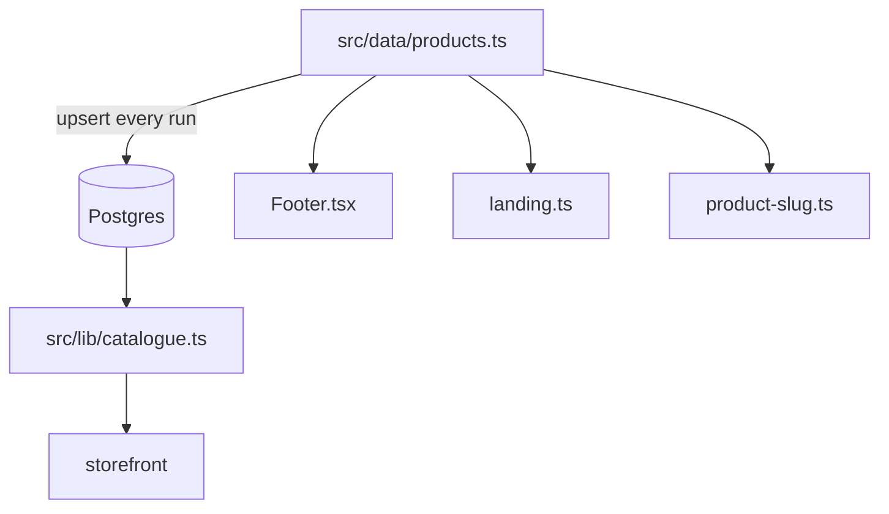
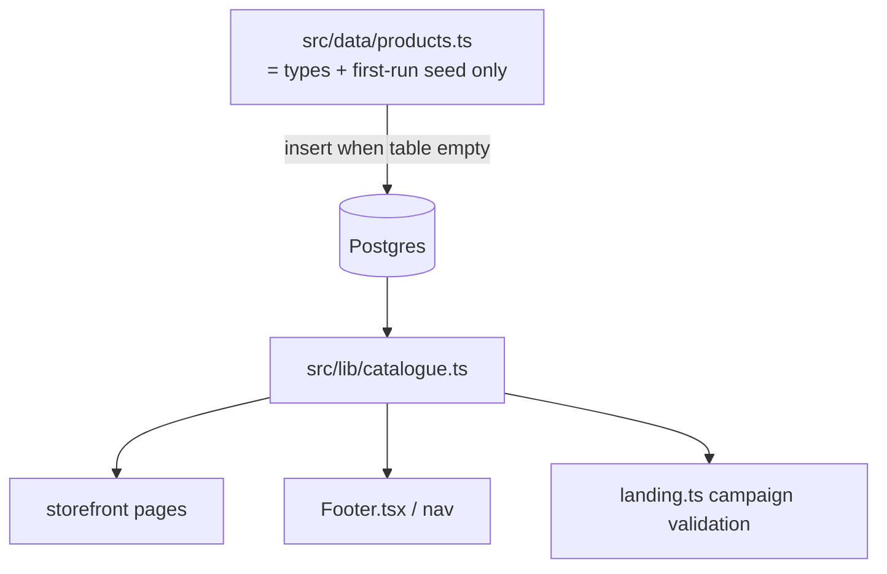

# Design Document

## Overview

Make the database the single source of truth for the catalogue, and give the owner a complete, safe
lifecycle over categories, products, variations and bundles.

Three changes carry the whole feature:

1. **Remove the runtime coupling to `src/data/products.ts`.** Today three runtime surfaces read the
   static arrays: the footer's category links, the campaign registry's product validation, and the
   hand-written product-slug union. The storefront must read the database for all of these.
2. **Make the seed insert-only for owner-owned rows.** `prisma/seed.mts` currently `upsert`s every
   category and product from the static arrays on every run and rewrites their prices, names and
   availability. That is what undoes admin edits and resurrects deleted rows. The seed becomes "seed an
   empty table, leave a live one alone".
3. **Close the lifecycle gaps.** An explicit "remove this bundle" action, a reversible archive for
   anything referenced by an order, and a non-destructive path for deleting a non-empty category.

The static module `src/data/products.ts` is **not deleted**: its exported `Product` / `Category` types
are the shape `src/lib/catalogue.ts` maps database rows into, and the arrays are the first-run seed
input. What changes is that it stops being a runtime source of data.

Locked decisions (`_CONTEXT.md` §9) are untouched: owner-only editing, Confirmed-only front end, price
on the site as `priceFrom`, one layout = one make.

## Current State (verified)

**The database is already the catalogue's data source.**

- `src/lib/catalogue.ts` reads `Category`, `Product`, `ProductVariation`, `Bundle` and `BundleItem`
  (`productSelect`, `toProduct`, `toCategory`, `toBundle`) and exposes `listProducts`,
  `listCategories`, `getProduct`, `getCategory`, `listProductsInCategory`, `listProductsWithSales`,
  `getProductWithSale`. It imports its types, `resolveDiscount` and `loadPromotions`.
- `src/app/page.tsx` already reads products and categories through `listProductsWithSales()` and
  `listCategories()`, and media through `resolveAllMedia`.

**…but three runtime surfaces still read the static arrays, and one writes them back.**

- `src/components/Footer.tsx` — `import { CATEGORIES } from "@/data/products"`, so the footer's
  category links are static.
- `src/data/landing.ts` — `import { getProductBySlug } from "@/data/products"`; `assertCampaignLandings`
  rejects any campaign whose `productSlug` is not in the static `PRODUCTS`, and `resolveCampaign`
  re-checks the same. A database-only product can never be an ad target.
- `src/lib/product-slug.ts` — `import { PRODUCTS } from "@/data/products"`, a hand-written slug union.
- `prisma/seed.mts` — `prisma.category.upsert` (`:83-87`) and the product loop (`:91-130`) write
  `name`, `note`, `regular`, `premium`, `rowApplicable`, `threeRowSurcharge`, `images`, `availability`
  and the PDP prose from the static arrays on every run. The file's own header says the goal is to make
  the database "a copy of the catalogue rather than a second, drifting source".

**What the console already does.**

- `src/app/admin/(console)/catalogue-actions.ts`: `createCategory`/`updateCategory`/`deleteCategory`
  (the last refuses when `_count.products > 0`), `createProduct`/`updateProduct`/`deleteProduct`
  (guards on `_count` of `layoutVariants`/`orderItems`), `createVariation`/`updateVariation`/
  `deleteVariation` (guards on `orderItems`/`layoutVariants`), and `saveBundle`/`addBundleItem`/
  `removeBundleItem`.
- `src/app/admin/(console)/products/[id]/page.tsx` — `BundleEditor` with an `isBundle` checkbox
  (unticking makes the product a single product again and emits `bundleRemoved`), a per-part "Take out"
  (`removeBundleItem`), and a `deleteProduct` form.
- `src/app/admin/(console)/flash-messages.ts` — `bundle`, `bundleRemoved`, `variationDeleted`,
  `categoryDeleted`.
- `src/app/admin/(console)/catalogue-guard.ts` — `validateProduct` requires **both** `regular` and
  `premium`; `RESERVED_SLUGS`; `slugify`. Tested by `scripts/catalogue-guard.test.mjs`.

**Schema facts that constrain the design** (`prisma/schema.prisma`).

- `Category` has `slug @unique`, `blurb?`, `seoTitle?`, `seoDescription?`, `heroLine?`, `products`,
  `promotions`. No `active`/`archived` field.
- `Product` has `slug @unique`, `categoryId` (`onDelete: Cascade`), `regular`, `premium`,
  `rowApplicable`, `threeRowSurcharge?`, `images String[]`, `availability?`, the PDP prose columns
  (`materials?`, `inBox String[]`, `coverage?`, `install?`, `care?`, `faq Json?`, `seoDescription?`),
  `isCarSpecific`, `createdAt`, `updatedAt`. Relations: `orderItems`, `layoutVariants`, `variations`,
  `promotions`, `bundle?`, `partOf`. **No `active`/`archived` field.**
- `Bundle` is `@id productId` with parts in `BundleItem`; `discountKind`, `discountValue`,
  `derivePricing`.

## Architecture

### Data flow, before and after

### Where each requirement lands

| Req | Mechanism |
|---|---|
| 1 | Footer/nav read categories from `src/lib/catalogue.ts`; storefront keeps reading the DB; the error surface is used instead of a static fallback. |
| 2 | `prisma/seed.mts` gains an `isTableEmpty` guard per entity and stops writing owner-editable columns on a non-empty table. |
| 3 | `catalogue-actions.ts` gains a move-or-delete path for a non-empty category. |
| 4 | `Product.archivedAt` (new) + an archive action; `deleteProduct` unchanged as the no-references path. |
| 5 | `catalogue-actions.ts` gains an explicit `removeBundle`; `BundleEditor` gains the control; the product row survives. |
| 6 | `ProductVariation.archivedAt` (new) + archive; storefront filters archived variations. |
| 7 | The two price sources are surfaced together; a catalogue edit cannot silently overwrite or lose to a `LayoutVariant.priceFrom`. |
| 8 | A pre-removal "who references this" report; storefront surfaces derive from the DB so a removal cannot dangle. |
| 9 | `landing.ts` validates through the DB; `product-slug.ts` stops encoding the set of products. |
| 10 | Every removal uses the `admin-console` Req 12 confirmation and writes an `AuditEntry`. |
| 11 | No change to fitment seeding or locked decisions. |

## Components and Interfaces

### `src/lib/catalogue.ts`

- **Add** `listNavCategories(): Promise<CategoryRow[]>` — the fields the footer/header need (`slug`,
  `name`), ordered by name, so a nav surface does not fetch the whole category object.
- Keep every existing function unchanged; they already read the DB.

### `src/components/Footer.tsx`

- **Change** from `import { CATEGORIES }` to an `async` Server Component call to
  `listNavCategories()`. The footer is already a Server Component, so this adds an `await` and a
  `Promise` page boundary and no client JavaScript.

### `src/components/Header.tsx` / `src/components/MobileNav.tsx`

- **Change** the category source from the static `Category` type to the row shape returned by
  `listNavCategories()`; these already take `categories` as a prop, so the change is at the call site in
  `src/app/layout.tsx` (which must fetch them once and pass them down, rather than each island fetching).

### `src/lib/product-slug.ts`

- **Change** `ProductSlug` from a hand-written union derived from `PRODUCTS` to `string`, and validate
  membership at runtime against the catalogue everywhere a specific slug is load-bearing. If nothing
  still imports the type after Requirement 9, delete the file and let `catalogue.ts` own validation.

### `src/data/landing.ts`

- **Keep** the static registry (an ad link is a code artifact and stays reviewable in git) and the
  `ALLOWED_OFFER` guard, which is about the *checkout honouring an offer*, not about products.
- **Change** the product-existence check: `assertCampaignLandings` can no longer call the static
  `getProductBySlug`. Split it: the static assertion keeps checking slug/offer shape; a resolver
  (`resolveCampaign` at request time, or a build step that reads the DB) validates `productSlug` and
  `variationSlug` against `src/lib/catalogue.ts`.
- **Consequence to name:** a campaign naming a deleted product must fail loudly. If the DB is
  unreachable at build time, the campaign cannot be validated at build time — so the check runs at
  request time and returns the honest not-found path, and a CI check (see Testing) covers the build.

### `prisma/seed.mts`

- **Add** `async function isEmpty(model)` using each table's `count()`.
- **Change** each entity loop: if the table is non-empty, log that it was left alone and skip it. On an
  empty table, insert (not upsert) as today.
- **Remove** the "keep the two in step" re-writes of owner-editable columns entirely; the static arrays
  are a **first-run fixture**, not a synchroniser.

### `src/app/admin/(console)/catalogue-actions.ts`

- **Add** `archiveProduct` / `unarchiveProduct` and `archiveVariation` / `unarchiveVariation` — set or
  clear `archivedAt`, write an `AuditEntry`.
- **Add** `removeBundle(formData)` — delete the `Bundle` row (and its `BundleItem`s) for a product that
  keeps existing as a normal product, refusing with a named reason when the product has `orderItems`
  and offering the `isBundle` untick as the reversible path.
- **Change** `deleteCategory` for the non-empty case: add `moveCategoryProducts(formData, toCategoryId)`
  and `deleteCategoryAndProducts(formData)` as two separate, separately-confirmed actions (move is the
  default the UI presents first).
- Keep the existing `_count` guards as the *hard* stop for order-referenced rows.

### `src/app/admin/(console)/products/[id]/page.tsx`

- **Change** `BundleEditor` to add a "Remove this bundle" control wired to `removeBundle`, with the
  consequence stated on screen (part of Requirement 5.2).
- **Add** an archive control beside the delete control, with the delete button's `title` explaining
  when delete is refused (mirroring the category page's disabled-button pattern at
  `src/app/admin/(console)/categories/page.tsx`).

## Data Models

Schema additions (a migration):

- `Product.archivedAt DateTime?` — null means live. The storefront's catalogue reads add
  `archivedAt: null` to their `where`; `getProduct`/`getProductWithSale` return null for an archived
  slug so its PDP falls to `not-found.tsx`. Order-referenced archived rows survive untouched.
- `ProductVariation.archivedAt DateTime?` — same semantics; `productSelect.variations` filters
  `archivedAt: null` for the storefront and leaves the admin unfiltered.

No other model changes. In particular:

- **`Category` keeps no archive flag** — a category is removed only when empty, or its products are
  moved or deleted (Requirement 3).
- **`Bundle` keeps no archive flag** — a bundle is removed by deleting its `Bundle` row; the product it
  belonged to remains.
- **`Product.availability` is not an archive** — it is the honesty sentence (Requirement: no row claims
  stock for a car), so it stays distinct from `archivedAt`.

Price precedence (Requirement 7): the catalogue `regular`/`premium` and `LayoutVariant.priceFrom`
remain two facts; the design does not merge them. Instead the product editor renders both, labels the
layout figure as the one the front end shows (locked decision 3), and refuses a save that would
overwrite a layout price without an explicit, separately-confirmed intent.

## Error Handling

- **Database unreachable at request time** → the app's error surface (`src/app/error.tsx` /
  `src/app/global-error.tsx`). Requirement 1.5 explicitly forbids falling back to the static arrays,
  because a silent fallback is indistinguishable from "my edit did not save".
- **Delete refused** → a named reason and the alternative action (archive/move), never a bare refusal.
  The failure vocabulary already exists in `src/app/admin/(console)/confirm-guard.ts` /
  `catalogue-guard.ts`.
- **Seed against a live database** → logs each entity it left alone; never throws for "already seeded".
- **Campaign naming a missing product** → the honest not-found path at request time, and a failing CI
  check (Testing) so it is caught before a deploy.

## Testing Strategy

- **Guard tests** (`scripts/catalogue-guard.test.mjs`, `node --test`): unchanged rules plus the new
  archive/move refusal rules, which are pure functions like the rest of `catalogue-guard.ts`.
- **Seed idempotency test** (new, `node --test` over `prisma/seed.mts`'s pure helpers): assert that the
  decision function returns "skip" for a non-empty table and "insert" for an empty one — the same
  no-database shape `scripts/catalogue-guard.test.mjs` already uses.
- **Static-coupling guard** (new): a test that greps `src/` for a runtime `from "@/data/products"`
  import of `CATEGORIES`/`PRODUCTS`/`getProductBySlug` and fails if one returns. This is the regression
  test for the whole feature: it makes "the static file is not a runtime source" mechanically true.
- **End-to-end**, in the app's existing style: create a category in the admin, assert it appears in the
  footer HTML; delete a product, assert its PDP returns `not-found` and it is gone from `/shop` and the
  sitemap.

## Bundles and the Fit Finder scope (Requirement 12–13)

**A bundle is never a Fit Finder offer.** `full_set` is gone from the `kind` union
(`src/data/fitment.ts`) and from `FLOOR_PAN_PRODUCTS` (`src/data/fitment-catalogue.ts`), so
no floor pan offers a bundle and no bundle carries a `LayoutVariant`. A bundle is priced
from its parts (`derivePricing`) and its car is confirmed in the WhatsApp order.

**The Fit Finder's product scope is the owner's switch, enforced at read time.** In
`src/lib/fitment-live.ts`, `loadLiveFitment` filters a layout's variants by
`product: { isCarSpecific: true, archivedAt: null }`. That is the whole mechanism: ticking
"Show in the Fit Finder" in `/admin/products` makes a product's existing offers visible on
the next request, with no deploy and no re-seed. Floor mats are the only product in-fit by
default.

**Data (applied 2026-10-09).** 231 `full_set` `LayoutVariant` rows were deleted and their
427 `RangePrice`s cascaded; `cargo-liner`, `full-bundle`, `seat-covers-3d` and `mud-flaps`
were moved out of the Fit Finder; the `full-bundle` variation price was synced to its
derived 151,200/163,800, which removes the underpricing the per-floor-pan price carried.
`boot_liner` offers stay — a cargo liner remains eligible behind the owner's switch.

**Trade-off taken.** `isCarSpecific` keeps its column name but changes meaning, from "cut
to a car" to "offered through the Fit Finder". A new column would have been a migration
and a second flag for no behavioural gain, and every existing reader already had the right
shape.

## Open Questions

1. **Migration timing.** The `archivedAt` columns are additive and nullable, so they can ship before the
   actions that use them. Confirm against `commerce-backend`'s migration ownership before the first
   deploy that runs `prisma migrate deploy`.
2. **Where campaign validation runs.** Build-time (needs a DB at build) or request-time (needs a
   working DB at request) — the design leans request-time with a CI check, because this is the one
   place a static fallback is most tempting to re-introduce, and a silently-swallowed static fallback
   is exactly what made the media-manifest failure invisible in production (`src/lib/media-manifest.ts`
   returned `{}` and every product fell back to a placeholder with no error). Decided here:
   request-time, no fallback.
3. **Does `src/lib/product-slug.ts` survive?** Kept only if a real consumer needs a narrowed type;
   otherwise deleted (Requirement 9.2).
