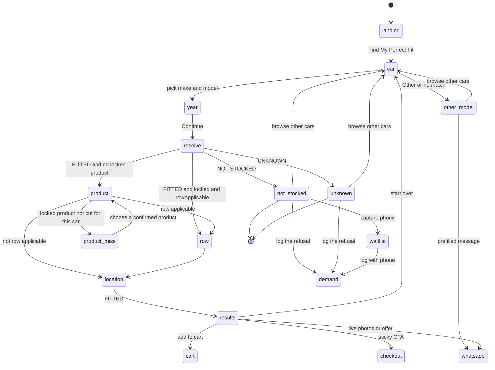
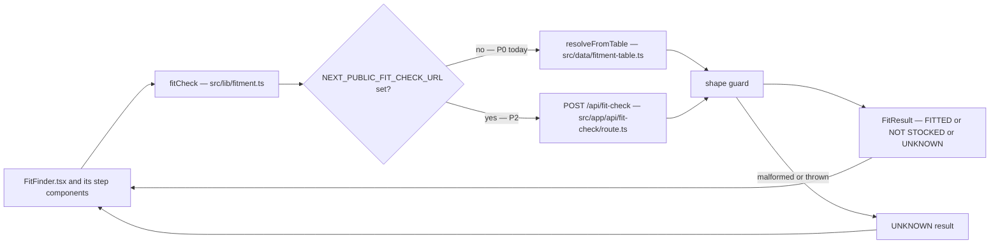
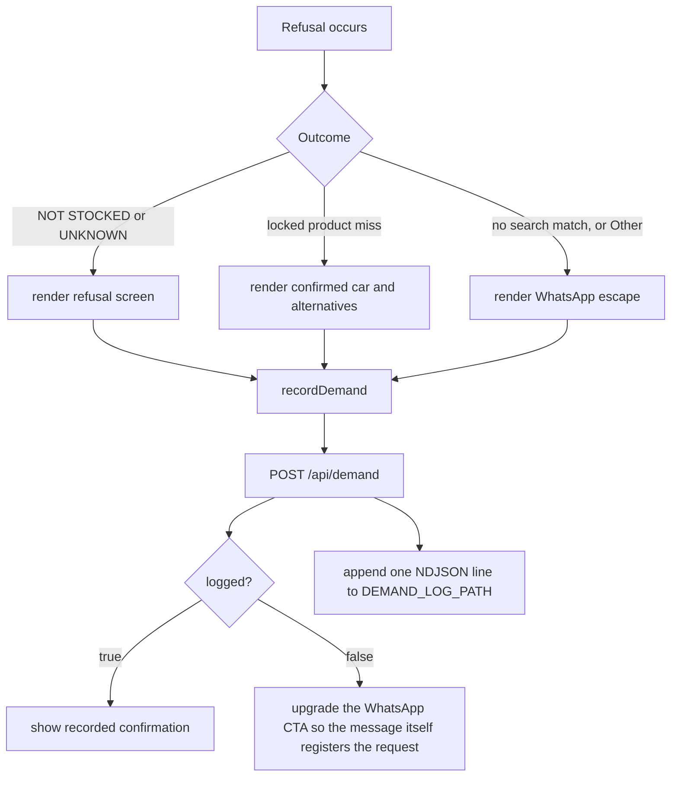

# Design Document — Fit Finder

## Overview

The fit finder keeps its shape — search your car, pick a year, pick a product, pick a row
configuration, pick a delivery zone, see a priced answer — and changes what the answer is allowed to
say.

The design rests on three moves:

1. **A single honesty seam.** Every question about whether something fits goes through one function,
   `fitCheck()`, which returns exactly one of `FITTED`, `NOT STOCKED` or `UNKNOWN` — the same three
   states the fitment spec defines for `POST /fit-check`. In P0 it is answered synchronously from a
   static Confirmed-only table in `src/data/fitment-table.ts`. In P2 it is answered over HTTP by
   `src/app/api/fit-check/route.ts`. Nothing in the UI knows which.
2. **The refusal path is built, not left over.** Refusal copy, a waitlist capture that only promises
   what it can honour, and a demand-log write on every refusal. The fitment spec is explicit that the
   demand log must work from day one; refusals are the only sourcing signal this product generates.
3. **The validated funnel is restored.** The delivery-zone step, the all-in price, the ETA, the
   price-lock line, the spill badges, the sticky checkout CTA, the campaign landing map and the
   checkout copy/back controls all come back, because they were validated with real traffic and
   their removal cost both conversion and price integrity.

The key structural change is *when* the fit check happens. Today it never happens. In the new design
it happens **immediately after the year step and before the product step**, because the fitment
contract's payload is `{ make, model, year }` with no product, and the answer it returns — a layout
plus a list of variants — is what makes the product step able to say honestly which products exist
for this car.

---

## Current State (verified)

Every line below was read from these files in this session.

### What exists and works

| Thing | Where |
|---|---|
| Funnel step machine `car → year → product → row → results` (+ a `comingsoon` state) | `luxeride-web/src/components/FitFinder.tsx:15` |
| Car search over the flattened catalogue, substring match, max 8, popular cars when empty | `src/components/FitFinder.tsx:39-49`, `:141-175` |
| Year select, defaulting to the top of the range | `src/components/FitFinder.tsx:177-202` |
| Product step showing `note · ₦X (2-row) / ₦Y (3-row)` | `src/components/FitFinder.tsx:204-224` |
| Row step, 2-row / 3-row | `src/components/FitFinder.tsx:226-241` |
| Tier lookup from the brand record | `src/components/FitFinder.tsx:81` |
| Unit price = `productBase(product, tier, rows)` | `src/lib/pricing.ts:9-14` |
| Progress bar with a configuration-dependent step list; hidden on results because `results` is not in the list | `src/components/FitFinder.tsx:113-123` |
| Result card: image strip, name, year·product, `FIT ✓`, price, row line, guarantee badge | `src/components/FitFinder.tsx:243-281` |
| Add to cart → "Added ✓" → Go to Cart / Keep Shopping | `src/components/FitFinder.tsx:283-304` |
| `Request Live Photos First` WhatsApp deep link | `src/components/FitFinder.tsx:306-315` |
| Negotiate-offer panel and its WhatsApp deep link | `src/components/FitFinder.tsx:317-343` |
| `Not in stock — yet` screen with an optional phone field | `src/components/FitFinder.tsx:351-393` |
| `?product=<slug>` plumbed from the page into the component | `src/app/fit-finder/page.tsx:1-14` → `src/components/FitFinder.tsx:21-22` |
| 33 brands with per-brand `tier` and `available`, per-model override | `src/data/cars.ts:20-54` |
| 7 products with slugs, row applicability, tier prices, 3-row surcharge, image paths | `src/data/products.ts:32-107` |
| 4 delivery zones with fee and ETA | `src/data/locations.ts:7-13` |
| Nigerian phone validation | `src/lib/validation.ts:2-13` |
| WhatsApp deep-link builder, coming-soon and not-found message builders | `src/lib/whatsapp.ts:38-51` |
| Persisted cart (`localStorage` key `luxeride-cart`) with subtotal and count | `src/store/cart.ts:29-51` |
| Checkout: zone `<select>`, live total, live message preview in a `<pre>` | `src/app/checkout/page.tsx:125-176` |

### What does not exist, and what that costs

| Gap | Where it should be | Consequence today |
|---|---|---|
| **No fitment data of any kind.** No layout, vehicle, mapping, variant, exclusion or demand-log record anywhere in the repository. | `src/data/fitment-table.ts` (new) | Every fit claim is unearned. |
| **The year is never validated.** `confirmYear()` stores `year` and moves on; nothing else in the file reads it except the display strings at `:247`, `:265` and `:308`. | inside the resolve step | "2009" and "2026" get the identical answer. |
| **Availability comes from a boolean.** `pickCar()` reads `c.available` (`src/data/cars.ts:69-76`) and, when false, jumps straight to the refusal screen at `src/components/FitFinder.tsx:51-60` — before a year is known. | `fitCheck()` | A refusal that does not know the year, the product or the customer's intent. |
| **The refusal logs nothing.** Both refusal exits are `wa.me` links — `src/components/FitFinder.tsx:369-382` and `:164-173`. | `POST /api/demand` | The only sourcing signal this product generates is thrown away. |
| **`FIT ✓` is hardcoded.** `src/components/FitFinder.tsx:268`. | result component, outcome-driven | The claim is a constant. |
| **The sub-copy asserts stock.** `"100% precision-molded {product} in stock for your {year} {brand} {model}"` at `src/components/FitFinder.tsx:247`. | refusal-aware copy map | Unverifiable and, for most cars, false. |
| **No delivery-zone step.** `Step` at `:15` has no `location`; the zone is first asked at checkout. | funnel step | Result shows no zone, no ETA. |
| **Result price is product-only** (`:270`), checkout adds the zone fee (`src/app/checkout/page.tsx:26-28`). | `resolvePrice()` | The number on the result is not the number charged. |
| **No landing hero.** `src/app/fit-finder/page.tsx:10-13` renders the funnel and nothing else. | page | An ad link lands on "What do you drive?". |
| **No campaign map.** Only literal product slugs are accepted; `getProductBySlug` returns `undefined` for `mats`, and `lockedProduct` is then `undefined` (`src/components/FitFinder.tsx:22`) so the funnel silently runs unlocked. | `src/data/campaigns.ts` (new) | Old ad links do nothing. |
| **`YEAR_FROM`/`YEAR_TO` literals** at `src/components/FitFinder.tsx:17-19`. | one shared constant | The site stops offering new model years in 2027 and keeps offering 2000 forever. |
| **`addItem` never merges** — `set((state) => ({ items: [...state.items, ...] }))` at `src/store/cart.ts:38`, with a fresh `crypto.randomUUID()` id at `:34-37`. | `src/store/cart.ts` | Two taps on the sticky CTA, two identical rows, two charges. |
| **No fit URL.** Nothing writes to the query string after load. | funnel | A customer cannot return to their fit. |
| **`"Other"` is unreachable.** `FLAT_CARS` drops the whole brand at `src/data/cars.ts:70`. | car step | The "ask us on WhatsApp" brand promise is dead in the UI. |
| **No copy control and no back-to-fit at checkout** (`src/app/checkout/page.tsx:166-176`). | checkout | Prototype parity lost. |
| **The offer message omits the zone** (`src/components/FitFinder.tsx:334`). | `src/lib/whatsapp.ts` | Negotiation arrives without the delivery context the prototype sent. |
| **`Chip` has no `disabled` prop** (`src/components/Chip.tsx:1-32`). | `Chip` | Cannot show "not cut for this car". |

### Prototype parity, itemised

`luxeride-funnel (2).html` carries all of the following and the app carries none:

| Prototype | Location in the prototype | Prototype parity restored? |
|---|---|---|
| `view-location` step and `renderLocationGrid` | `:457-464`, `:887-898` | Yes — step 5.1 |
| `computePrice()` = `productBase() + location.fee` | `:908-910` | Yes — step 5.4 |
| `Delivery zone` / `Estimated arrival` rows on the fit card | `:500-501` | Yes — step 5.3 |
| `PRICE LOCKED FOR 48 HOURS FROM CONFIRMATION` | `:503` | Yes — step 6.2 |
| Spill badges | `:508-512` | Yes — step 6.3, per product |
| Sticky `Continue to Checkout →` | `:525-527` | Yes — step 7.1 |
| `Copy message` on checkout | `:568` | Yes — cross-referenced to `cart-checkout` |
| `← Back to your fit` | `:563` | Yes — step 9.6 |
| Delivery zone in the offer message | `:1035` | Yes — step 7.4 |
| `CONFIG.PRODUCT_LANDING` + `applyProductLanding` | `:670-691`, `:724-731` | Yes — step 8.x, ad pairing owned by `ad-landing-and-tracking` |
| `updateProgress` including the location step | `:733-749` | Yes — step 8.8 |

Two things about the prototype are worth stating plainly, because they explain how the lie got here.
First, the prototype has no fitment data either — it uses the same `available` boolean, so the
fabricated claim was **inherited by the port, not introduced by it**. Second, the prototype carries
*both* results sub-copies: the honest one as static markup at `:484`, overwritten at render time by
the fabricated one at `:928-929`. The honest string is dead code in the prototype too. Restoring it is
therefore a restoration, not a rewrite.

---

## Architecture

### 1. The funnel



Two states leave the numbered step list and therefore hide the progress bar, exactly as the prototype
does (`updateProgress`, `:745-746`) and as the app does today (`showProgress`, `:123`): the landing
hero and every refusal. That is deliberate — a progress bar that counts down to a refusal reads as a
failure, not a funnel.

### 2. The honesty seam



`fitCheck()` is the only export any UI module may use. The table is importable only by
`src/lib/fitment.ts` and by tooling. This is what makes the P2 swap a one-line environment change
rather than a refactor, which is the specific thing the fitment spec asks for at `:182`
(*"Build it against the P0 sheet — hardcode the mapping for now… the front-end contract above does
not change when it does"*).

The environment variable is `NEXT_PUBLIC_*` because the call happens in a Client Component; Next
inlines those at build time, so changing providers is a redeploy. That is the correct trade for a
storefront that must never show a stale "yes" from a retired layout.

**Fail direction is one-way.** Any throw, timeout, non-200, or unrecognised body becomes `UNKNOWN`
(requirement 1.6). There is no code path from an error to `FITTED`.

### 3. Demand log



`src/app/api/demand/route.ts` is a **Route Handler** running in the Node runtime (the default for
route handlers — `route.md:649` lists `runtime = 'nodejs'` among the defaults), which is what makes
`node:fs` usable. It appends one JSON object per line to `DEMAND_LOG_PATH`
(default `data/demand-log.ndjson`, directory created on demand).

**The honest limitation, stated plainly:** this only survives if the host gives the process a
writable, persistent filesystem. On a serverless platform with an ephemeral bundle the append
succeeds and the data is lost. That is why the handler returns `{ logged: boolean }` and why the UI
degrades to a labelled WhatsApp capture rather than showing a confirmation it cannot back up. This
is listed as Open Question 1 — it is a hosting decision, not an engineering one.

---

## Components and Interfaces

| File | Kind | Responsibility |
|---|---|---|
| `src/lib/fitment.ts` | module | Contract types (`FitRequest`, `FitResult`, `FitFitted`, `FitNotStocked`, `FitUnknown`, `FitVariant`), `fitCheck()`, `FIT_FIT_REFUSAL_COPY`, `validateFitmentTable()`. **No React.** |
| `src/data/fitment-table.ts` | module | `LAYOUTS: LayoutRecord[]` — the P0 Confirmed sheet. Imported only by `fitment.ts`. |
| `src/lib/pricing.ts` | module | Existing `fmtNaira` / `productBase` kept; add `resolvePrice(fit, product, rows, zone)` returning `{ exact: number \| null, from: number, to?: number, lines: PriceLine[] }`. |
| `src/lib/fitUrl.ts` | module | `readFitParams(searchParams)`, `writeFitParams(url, selection)` — the single place that knows the query-key names, and the single place that merges rather than replaces. |
| `src/data/campaigns.ts` | module | `CAMPAIGN_LANDINGS` (alias → `{ productSlug, headline, sub }`), `resolveCampaign(value)` accepting both aliases and product slugs. |
| `src/data/years.ts` | module | `YEAR_FROM`, `YEAR_TO` (current calendar year), `YEARS`, `clampYear()`. |
| `src/components/FitFinder.tsx` | Client Component | The step machine. Orchestrates, calls `fitCheck()` once per (make, model, year), renders step components. Keeps the existing step state model. |
| `src/components/fit/LandingHero.tsx` | Server-rendered section of `src/app/fit-finder/page.tsx` | Headline / sub / badges / CTA, overridable by campaign. |
| `src/components/fit/CarStep.tsx` | Client | Search + popular + results + the always-present "Other" escape. |
| `src/components/fit/YearStep.tsx` | Client | Year select. |
| `src/components/fit/ProductStep.tsx` | Client | Products with per-car availability, disabled where not a confirmed variant. |
| `src/components/fit/RowStep.tsx` | Client | 2-row / 3-row. |
| `src/components/fit/LocationStep.tsx` | Client | Four zones with ETA and fee. |
| `src/components/fit/FitResultCard.tsx` | Client | The fit card. **Renders only for `FITTED`.** |
| `src/components/fit/RefusalScreen.tsx` | Client | One component, copy selected by outcome; waitlist capture; demand write. |
| `src/components/fit/StickyCheckoutCta.tsx` | Client | `Continue to Checkout →`, idempotent. |
| `src/app/fit-finder/page.tsx` | **Server Component** (async) | Reads `searchParams`, resolves the campaign, renders `LandingHero` + `FitFinder`. Already async and already awaits `searchParams` — unchanged in kind. |
| `src/app/api/demand/route.ts` | **Route Handler** (Node runtime) | `POST` demand entries. No database. |

`FitFinder.tsx` at 396 lines is already doing too much for the file it is in; splitting the step
screens out is what makes the outcome-driven rendering testable and keeps the honesty logic in
`fitment.ts`, away from markup.

**Why no server action for the resolve?** The step machine is client state, and resolving on the
server would require round-tripping on every step transition. A same-origin `fetch` to a route
handler is the honest shape and is what the fitment spec's own `POST /fit-check` describes.

---

## Data Models

### `src/data/fitment-table.ts`

```ts
export type EvidenceSource = "physical-fit" | "supplier-confirmation" | "oem-floor-pan";

export interface LayoutVariantRecord {
  productSlug: string;   // must exist in PRODUCTS[].slug
  label: string;         // "Double layer + waterproof base"
  priceFrom: number;     // locked decision 3 — NGN
  priceTo?: number;      // present only when the variant genuinely varies
  inStock: boolean;
  note?: string;
}

export interface LayoutImage { src: string; angle: string; alt: string; }

export interface LayoutRecord {
  code: string;             // "TC-2009-2013" — internal; appears in the WhatsApp ref only
  name: string;             // "Toyota Camry 2007–2011" — customer facing
  make: string;             // must be a key of BRANDS; one layout = one make (locked decision 4)
  models: string[];         // exactly as spelled in FLAT_CARS
  yearFrom: number;
  yearTo: number;
  status: "confirmed";      // only this literal may ship; inferred/draft are rejected at load
  evidenceSource: EvidenceSource;
  confirmationNote: string; // mandatory, per the locked-decision-1 safety consequence
  confirmedOn: string;      // ISO date
  bodyType: string;
  driveSide: "LHD" | "RHD";
  variants: LayoutVariantRecord[];
  images: LayoutImage[];    // fit photography for this layout
  leadTime: string;         // "Ships in 2–4 days from Lagos"
}
```

Load-time rules (`validateFitmentTable()`, run once at module load, entries that fail are **dropped
with a console warning**, never thrown — a broken row must not take the storefront down):

- `status !== "confirmed"` → dropped (locked decision 2).
- `evidenceSource` not one of the three permitted values → dropped (evidence rule, fitment spec
  `:126`).
- missing `code`, `name`, `make`, `yearFrom`/`yearTo`, `confirmationNote` or `confirmedOn` → dropped.
- `make` not a key of `BRANDS` → dropped.
- any `variants[].productSlug` not in `PRODUCTS` → the variant is dropped (and the layout is kept if
  it has other variants).
- a layout whose `make` is not the queried make → never matched (locked decision 4), which is also
  what makes "one layout = one make" enforceable in code rather than in a comment.

### `src/lib/fitment.ts`

```ts
export interface FitRequest { make: string; model: string; year: number; }

export interface FitVariant {
  productSlug: string; label: string; priceFrom: number; priceTo?: number;
  inStock: boolean; note?: string;
}

interface FitBase {
  request: FitRequest;
  layoutName: string | null;   // null unless FITTED
  layoutCode: string | null;
  whatsappMessage: string;      // ALWAYS populated — fitment spec: every state returns a link
}

export interface FitFitted extends FitBase {
  outcome: "FITTED";
  layoutName: string; layoutCode: string;
  variants: FitVariant[];      // what this layout actually has
  images: LayoutImage[];
  leadTime: string;
  evidenceSource: EvidenceSource;
}

export interface FitNotStocked extends FitBase {
  outcome: "NOT STOCKED";
  reason: "no-layout" | "year-out-of-range" | "product-not-cut" | "layout-retired";
}

export interface FitUnknown extends FitBase {
  outcome: "UNKNOWN";
}

export type FitResult = FitFitted | FitNotStocked | FitUnknown;

export function fitCheck(req: FitRequest): Promise<FitResult>;
```

`variants` — not a boolean — is what answers "confirmed for mats but not for seat covers". The
product step renders every product; a product with no in-stock variant for this layout is disabled
with the reason shown. If the product was locked by a campaign, the resolve detects the miss
immediately after the year step, says so in plain words, logs it to the demand log, and offers what
is available (requirement 3.6). It never silently substitutes.

### Query keys for a shareable fit

`?brand=Toyota&model=Camry&year=2012&product=double-layer-mats&rows=2&zone=Lagos+Mainland+%26+Island&layout=TC-2007-2011`

Plain keys, not base64 (requirement 9.4): a bookmark, a WhatsApp paste and a future analytics
payload can all read them. `layout` is carried for attribution and for a human following the ref —
but it is **never trusted**; `fitCheck()` recomputes the outcome and a stale or fabricated `layout`
value changes nothing but the attribution.

`writeFitParams()` builds the new query from `new URLSearchParams(window.location.search)` and only
sets or deletes its own keys. This is the documented Next pattern
(`linking-and-navigating.md:399-414`, which builds from `searchParams.toString()` and then `set`s one
key), and it is what keeps `ad-landing-and-tracking`'s UTM parameters alive across every client-side
URL write (requirement 8.5). Writes use `window.history.replaceState` so a customer pressing Back
leaves the funnel rather than stepping through six internal states.

### Pricing

`resolvePrice()` returns an exact figure **only** when the variant, the tier and the row count are
pinned *and* a zone is selected — which, given the funnel order, they always are by the time the
result renders. If `priceTo` is present, or no zone is selected, it returns `exact: null` and a
`from`/`to` range (requirement 5.7).

**Tier, resolved.** `BRANDS[make].tier` prices the *preview* on the product step, where no layout is
known yet — that is what it is for today and it stays. It does **not** price the *sale*: a `FITTED`
result is priced from `variant.priceFrom`, because a layout belongs to exactly one make and its
`priceFrom` already encodes that make's tier. `threeRowSurcharge` still adds on top for three-row
configurations. At launch, `priceFrom` is seeded from `product[BRANDS[make].tier]`, so the two
agree exactly and no visible price moves when this lands; after that the layout table becomes the
source of truth, which is what locked decision 3 requires.

The result price is `unitPrice + zone.fee`, itemised into two lines (requirement 5.4). The cart
stores the **unit price only**, so delivery is counted once, at checkout, from the same `LOCATIONS`
array the funnel used.

---

## Error Handling

| Failure | Behaviour | Requirement |
|---|---|---|
| Fit table empty | Every car refuses; funnel, hero, campaign locks and all routes still work | 2.2, 11.4 |
| Fit table entry invalid | Entry dropped with a console warning; site unaffected | 2.6 |
| `fitCheck()` throws / non-200 / malformed body | `UNKNOWN`; the refusal screen; nothing positive is claimed | 1.6, 2.5 |
| `layout` in the URL unknown or retired | Outcome recomputed; a stale success screen is impossible | 1.7, 9.3 |
| Deep-linked year out of range | Clamped to the nearest bound | 10.6 |
| `?product=` unrecognised | Default hero, unlocked funnel, no error surface | 8.4 |
| Demand write fails / rate-limited / offline | `{logged:false}` → WhatsApp CTA upgraded and relabelled | 4.4, 4.5 |
| Demand body malformed or oversized | `400`, nothing written | 4.6 |
| Clipboard rejected or unavailable | Selection + manual-copy instruction, or the control hidden | 11.1, 11.2 |
| Product image fails | Slot collapses, card intact (existing `SafeImage` behaviour) | 11.5 |
| Cart already holds the identical line | Quantity increments; no second row | 7.3 |
| Locked campaign product not cut for the car | Confirmed car shown, miss stated, alternatives offered, logged | 3.6 |
| Existing `available: false` flag with a Confirmed layout | Fitment data wins | 10.4 |

---

## Testing Strategy

**There is no test runner in this repository.** `luxeride-web/package.json:7-11` declares `dev`,
`build`, `start`, `lint` and `db:seed`; `db:seed` itself cannot run because `ts-node` is not a
dependency. No test framework is installed, and adding one is a project-wide decision that belongs to
the owner (Open Question 6). So P0 verification is stated honestly:

1. **Static gates.** `npx tsc --noEmit` and `npx eslint .` must both be clean for the changed files.
   Note that `npx tsc --noEmit` currently fails on `prisma/seed.ts:2` — an unrelated pre-existing
   error owned by `commerce-backend` — so the P0 exit criterion is "no *new* errors", not "zero
   errors".
2. **`scripts/check-fitment.ts`.** A small Node script that asserts, for every table entry: make and
   product slugs resolve, evidence source is permitted, year ranges are ordered, `variants` is
   non-empty, and a `priceFrom` exists on every in-stock variant. Run with `npx tsx` — which fetches
   the runner on first use and therefore needs network on the first run. If the box is offline, the
   same assertions run as a `validateFitmentTable()` warning pass and are read off the console.
3. **Pure-function surface.** `fitCheck`, `resolveFromTable`, `resolvePrice`, `resolveCampaign`,
   `clampYear` and `writeFitParams` are written as pure functions with no React and no browser
   access, so they can be lifted into unit tests verbatim the moment a runner is chosen.
4. **Manual verification checklist**, executed once before launch and recorded in the commit message:
   - a Confirmed car → `FITTED` with the correct layout name, ref, price and zone rows;
   - a car in the catalogue with no layout → `NOT STOCKED`, logged, waitlist accepted;
   - a make not in the catalogue at all → `UNKNOWN`, logged, WhatsApp prefilled;
   - the same car at a year outside its layout's range → `NOT STOCKED`, **not** `FITTED`;
   - a Confirmed car where the locked ad product is not a variant → stated plainly, logged, no
     substitution;
   - one of the eleven `available: false` brands → `NOT STOCKED` naming the year;
   - a hand-edited `?layout=NOPE` → the recomputed outcome, not the saved one;
   - `?product=mats` → Double Layer Mats locked, product step absent, mats headline shown;
   - `?product=does-not-exist` → default hero, unlocked funnel, no error;
   - `?fit=…` reload → the same result screen restored;
   - sticky CTA twice → one cart row, quantity 2;
   - zone changed at checkout → total moves by exactly the fee difference;
   - `navigator.clipboard` removed → copy control hidden, preview still selectable.

---

## Open Questions

1. **Where does the P0 demand log physically live?** The design writes NDJSON to the app filesystem
   via `src/app/api/demand/route.ts`. There is no deployment config in this repository (no
   `vercel.json`, nothing in `package.json`), so whether that file survives depends entirely on the
   host. On a VPS or a container with a volume it works. On a serverless host with an ephemeral
   bundle the write succeeds and the data evaporates, and the UI's `{logged:false}` path becomes the
   real behaviour. **The owner has to pick a host before this feature can claim the demand log
   works.** If the host is serverless, the fallback is a hosted form endpoint, which introduces a
   third-party dependency this design has deliberately avoided. **Update, 2 October 2026:** the
   database question behind this was decided for development — a local native Postgres
   (`commerce-backend` `design.md` § Decisions, Decision 1) — so the NDJSON file is revisit-able once
   `commerce-backend` lands and `DemandLog` exists as a table. The P0 fallback described above stands
   unchanged until then, and nothing in this design is rebuilt in anticipation of it.
2. **Does the refusal carry a waitlist?** The fitment spec lists this as still open (`:261`). This
   design assumes **yes**, because the only honest refusal copy either promises notification (and so
   must capture a number) or promises nothing (and so must not say "we're adding new fits
   regularly", which the current screen does at `FitFinder.tsx:357`). Confirm, or accept the blunter
   copy.
3. **How many layouts are genuinely confirmed today?** Everything is gated on it and it is the honest
   basis for any fit claim in ad creative. The table is designed to ship **empty and safely**
   (requirement 2.2), so the site can go live refusing everything, but launching with a small
   number is the real posture and the number should be written down on the day.
4. **Exact price or "from" price?** The fitment spec leaves this open (`:261`). This design resolves
   it as **exact whenever configuration and zone are pinned**, which the funnel guarantees by the
   time the result renders, with a "from" range only when a variant genuinely varies. If the owner
   would rather under-promise, the alternative is to show "from ₦X" unconditionally and keep the
   exact figure for the WhatsApp quote.
5. **Is the 48-hour price lock a promise the owner will honour, and from what moment?** The prototype
   prints `PRICE LOCKED FOR 48 HOURS FROM CONFIRMATION` (`:503`). Printed on a live storefront it
   becomes a commitment with a clock on it, and "confirmation" is ambiguous — the click, the
   WhatsApp message, or the owner's reply. This spec restores the line because it was validated;
   the semantics still have to be settled.
6. **Which test runner?** None is installed. `node:test` (zero dependencies, built in) and Vitest
   (needs a dependency) are the two realistic answers, and the choice affects every later spec.
7. **On a locked-product miss, offer a choice or redirect?** This design shows the confirmed car,
   states the miss, and offers the available products — no automatic substitution, because silently
   showing a different product than the ad promised is the same failure as a wrong fit claim. If the
   owner prefers a one-click redirect, that is a small change to the same component.
8. **Cross-spec boundaries, stated so nothing is silently duplicated.** Order message and refund
   behaviour on the cart, the checkout copy control's final form, and the order's fit-ref
   reconciliation belong to `cart-checkout`. Ad/landing pairing, UTM capture and the pixel events that
   consume `resolveCampaign()` belong to `ad-landing-and-tracking`. The `/fit-check` route handler,
   the Layout/Vehicle/Mapping tables and the admin console belong to `fitment-engine`. The `prisma`
   migration and any real persistence belong to `commerce-backend`.