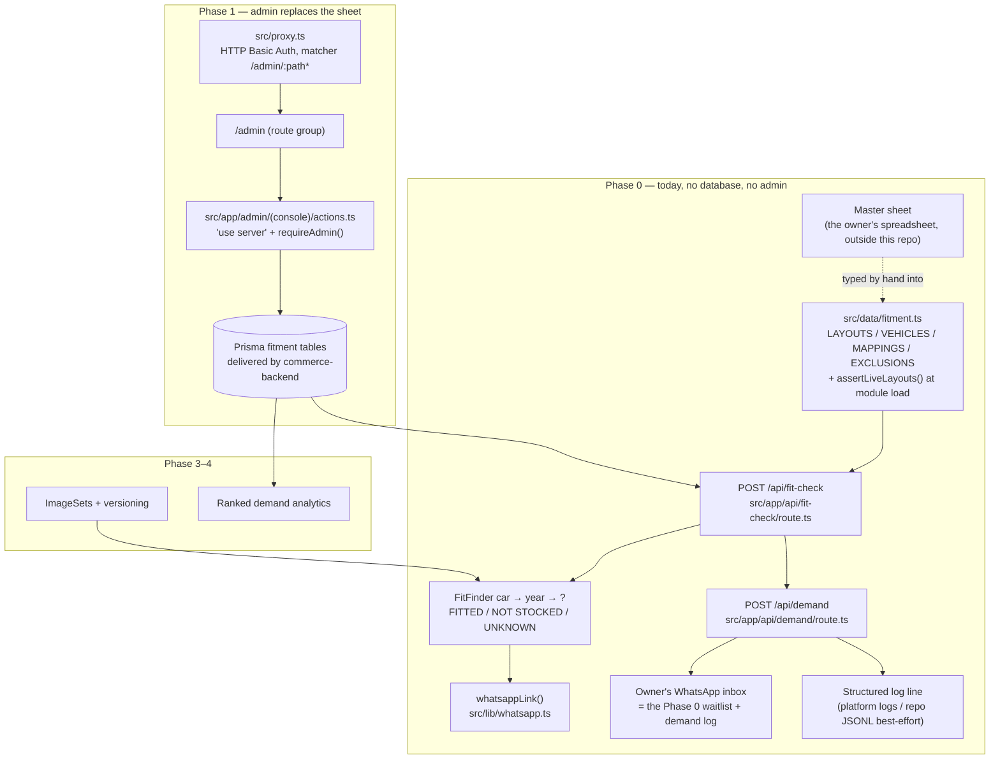
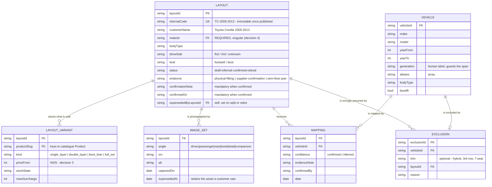
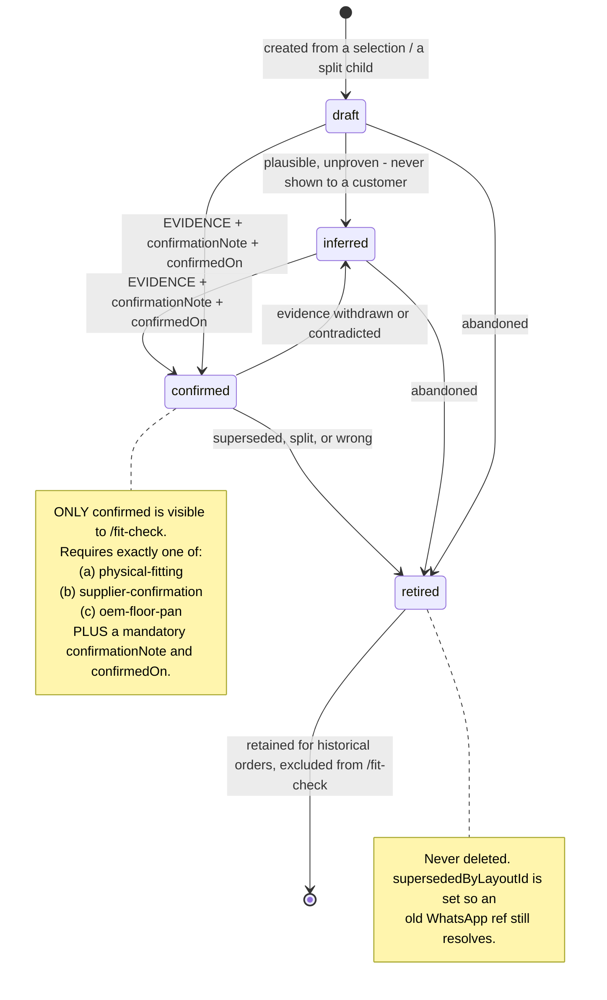
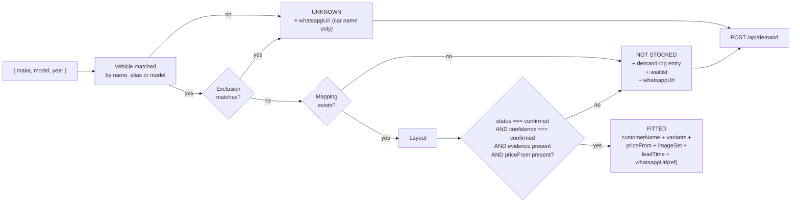

# Design Document

## Overview

This spec turns `luxeride-web/luxeride-fitment-engine-admin-layout-grouping-spec.md` into a buildable
design for a codebase that currently has **no fitment data, no database, no admin, no route
handlers and no auth of any kind**.

Three decisions carry the whole thing, and the rest of this document follows from them:

1. **The P0 master sheet is a TypeScript module, not a spreadsheet and not a database.** The source
   doc says build `/fit-check` against the P0 sheet and hardcode the mapping, with the front-end
   contract unchanged when the admin arrives (source doc lines 178–183). So the machine artefact is a
   typed data file beside `src/data/*.ts`, shaped exactly like the six entities, with the Confirmed
   gate enforced as a **compile-and-load-time invariant** rather than a runtime `if`.
2. **`LayoutVariant` is keyed to a catalogue `Product` slug, and carries the authoritative price.**
   This reconciles the fitment spec's four Variant kinds with the seven `PRODUCTS` without inventing a
   parallel catalogue. It is the hardest decision in the project; the options and the breakage are set
   out in full under *Entity reconciliation* below.
3. **The admin's security is HTTP Basic Auth enforced in Next 16's `proxy.ts`, plus a mandatory
   server-side re-check inside every mutating Server Action.** There is no session library installed,
   one user exists, and the Server Action security guide is explicit that actions are untrusted entry
   points.

**Guides read before specifying anything Next-shaped** (required by `_CONTEXT.md` §12 hard rule 1):

| Guide | File read | What it fixed |
| --- | --- | --- |
| Route Handlers | `luxeride-web/node_modules/next/dist/docs/01-app/01-getting-started/15-route-handlers.md` | `export async function POST(request: Request)`, `Response.json()`, handlers are not cached by default and other verbs never are, `ctx.params` is a Promise, `RouteContext<'/path'>` global helper |
| Route Groups | `.../03-api-reference/03-file-conventions/route-groups.md` | `(folder)` is organisational and absent from the URL; no conflicting paths across groups |
| Proxy (Next 16) | `.../01-getting-started/16-proxy.md` | **Middleware is now called Proxy**; `src/proxy.ts`, one per project, `matcher` config |
| Authentication | `.../02-guides/authentication.md` | Optimistic vs secure checks; "should not be your only line of defense"; Data Access Layer with `cache()`; `cookies()` is async; session libraries are *recommended*, not bundled |
| Server Actions | `.../02-guides/server-actions.md` | "the route is reachable to anyone who can send the same POST. Treat every action as an untrusted entry point"; authenticate inside the action |

---

## Current State (verified)

Everything below was read in this session. Line numbers are exact.

### Exists and is usable

| Thing | Path | Why it matters here |
| --- | --- | --- |
| 33-brand car catalogue with `available` flags and per-brand `tier` | `src/data/cars.ts` — `BRANDS` lines 20–54, `available` line 11, `tier` line 12, `FLAT_CARS` 69–76, `POPULAR_CARS` 78–81 | The seed for `Vehicle` records and the make ticker table. `FLAT_CARS` excludes `"Other"` (line 70), which is why the "Enter model on WhatsApp" row is unreachable |
| Single-model availability exception | `src/data/cars.ts:24` — Acura `MDX` as `{ name, available: false }` | The exact case `CarModelFlag` was invented for. Becomes a `Vehicle` with no Mapping, or an `Exclusion` |
| 7 products with `regular` / `premium` / `threeRowSurcharge` / `images: string[]` | `src/data/products.ts` — interface lines 3–13, data 32–107, `priceRange` 115–119 | The catalogue `Product` a `LayoutVariant` points at |
| `fmtNaira` | `src/lib/pricing.ts:4-6` | How `priceFrom` is displayed |
| `productBase(product, tier, rows)` | `src/lib/pricing.ts:9-14` | The **tier-based** price path this spec narrows, not deletes |
| `whatsappLink(message)` | `src/lib/whatsapp.ts:38-40` | All three `/fit-check` states route through it |
| `comingSoonMessage(what, phone?)` | `src/lib/whatsapp.ts:42-47` | **This is the Phase 0 waitlist.** No database needed; the entry lands in the owner's WhatsApp inbox |
| `notFoundMessage(query)` | `src/lib/whatsapp.ts:49-51` | The existing `UNKNOWN` behaviour |
| The funnel steps `car → year → comingsoon` | `src/components/FitFinder.tsx:15` (`type Step`), car step 141–175, year step 177–202, coming-soon step 351–393 | The query UI, the progress bar and the back-navigation are reusable as-is |
| The "Request Live Photos First" affordance | `src/components/FitFinder.tsx:306-315` | The honest no-images fallback (Requirement 18.5) |
| The Fit Guarantee line | `src/components/FitFinder.tsx:280` | Moves onto `FITTED` only |
| `CartItem` shape | `src/store/cart.ts:6-17` | Gains `layoutCode` and `layoutCustomerName`; already snapshots `unitPrice` and `rows` |
| Design tokens | `src/app/globals.css:4-25` | `bg-panel`, `border-line`, `text-gold-dim`, `font-mono` — the admin console uses the same system, no new styling |

### Exists and must change

| Thing | Path | Why it is wrong under this spec |
| --- | --- | --- |
| **The fabricated `FIT ✓`** | `src/components/FitFinder.tsx:268` | Printed unconditionally on reaching the results step |
| **The fabricated availability sentence** | `src/components/FitFinder.tsx:246-248` — *"100% precision-molded {product.name} in stock for your {year} {brand} {model}"* | Printed for every available brand/model regardless of year |
| **`confirmYear()` never checks the year** | `src/components/FitFinder.tsx:62-69` | Reads `lockedProduct` and calls `setStep`. The `year` state is displayed later but never tested against anything |
| **Fit decided by one boolean** | `src/data/cars.ts:11` via `pickCar` at `src/components/FitFinder.tsx:51-60` | `available: true` is an unearned "yes"; `available: false` is conflated into one `comingsoon` screen for both NOT STOCKED and UNKNOWN |
| **Price from brand tier** | `src/components/FitFinder.tsx:81-82` — `BRANDS[brand].tier` → `productBase(product, tier, rows)` | Contradicts locked decision 3: price attaches to the LayoutVariant |
| **`FITTED` for a product with no layout** | `src/components/FitFinder.tsx:243` | The `results` step has no layout concept at all |

### Does not exist at all

Any fitment data · `Layout` / `Vehicle` / `Mapping` / `LayoutVariant` / `ImageSet` / `Exclusion`
· any evidence gate · any status · any admin console · any route handler · any server action · any
auth · any database connection · any demand logging · any image upload · any test runner
(`package.json` has no vitest/jest) · `src/proxy.ts` · `server-only` package (verified **not
resolvable**; only `client-only` is present, as a transitive dependency) · `jose` and `iron-session`
(verified not installed) · the 15 product images referenced at `src/data/products.ts:56-106` that
`public/products/` does not contain.

**Launch precondition that is not this spec's to fix:** `npm run build` currently fails on
`prisma/seed.ts(2,34): error TS2307: Cannot find module './data/products'` (`_CONTEXT.md` §3, audit
B1). That belongs to `commerce-backend`. This spec's Phase 0 module is designed so that a
load-time assertion failure in it also breaks the build — which is the intent, but the owner should
know the build is already red before this work starts.

---

## Architecture



### Phase 0 versus Phase 1+ build — what actually changes

| | Phase 0 | Phase 1+ |
| --- | --- | --- |
| Source of truth | `src/data/fitment.ts`, typed by hand from the sheet | Prisma tables, edited through `/admin` |
| How a price changes | edit the file, redeploy | edit in the console |
| Who can edit | whoever has the repo (one person) | one authenticated operator |
| Gate enforcement | `assertLiveLayouts()` throws at module load | same rules, enforced in the Server Action and by the DB constraint |
| Front-end contract | `{ make, model, year }` → three states | **identical** |
| Demand log | WhatsApp inbox + structured log line | ranked table in `/admin/demand` |

The contract is identical in both columns. That is the point of source doc line 183: *"it means
today's work is not thrown away by tomorrow's build."*

---

## Components and Interfaces

### The Phase 0 interim representation — `src/data/fitment.ts`

The spec says hardcode the mapping and keep the contract stable. In this codebase's idiom that means
**one typed data module beside `src/data/cars.ts` and `src/data/products.ts`** — no framework, no
async, no `'use client'`, no `'use server'`, so the *same module* can be imported by the route
handler, by a Server Component and by a Client Component without a seam. That is what makes the
Phase 1 swap a data-source change rather than an architectural one.

The shape, with the gate as a type rather than a conditional:

```ts
// src/data/fitment.ts  — shape only; the real file is written in task 2.1
export type LayoutStatus = "draft" | "inferred" | "confirmed" | "retired";
export type EvidenceSource = "physical-fitting" | "supplier-confirmation" | "oem-floor-pan";

export interface Layout {
  layoutId: string;          internalCode: string;   // "TC-2009-2013"
  customerName: string;      // "Toyota Corolla 2009–2013"
  makeId: string;            // REQUIRED, singular (locked decision 4)
  bodyType: "sedan" | "suv" | "wagon" | "hatch" | "van" | "pickup";
  driveSide: "lhd" | "rhd" | "unknown";
  kind: "footwell" | "boot";
  status: LayoutStatus;
  evidence?: EvidenceSource;
  evidenceNote?: string;
  confirmationNote?: string; // mandatory when status === "confirmed"
  confirmedOn?: string;      // mandatory when status === "confirmed"
  leadTime: string;          // "2–3 days"
  notes?: string;            // also where a cross-brand Layout gets cross-referenced
  variants: LayoutVariant[];
  images: ImageSetEntry[];
}

export interface LayoutVariant {
  productSlug: FitProductSlug;   // keyed to the catalogue, not a parallel list
  kind: "single_layer" | "double_layer" | "boot_liner" | "full_set";
  priceFrom: number;             // locked decision 3
  stockState: "in_stock" | "made_to_order" | "out_of_stock";
  rowsSurcharge?: number;        // only where the same floor pan covers both row counts
}

export interface Vehicle {
  vehicleId: string; make: string; model: string;
  yearFrom: number; yearTo: number;
  generation: string;            // human-entered generation label, e.g. "E140"
  aliases: string[]; bodyType: Layout["bodyType"];
  facelift?: boolean;
}
export interface Mapping { layoutId: string; vehicleId: string; confidence: "confirmed" | "inferred"; evidenceNote?: string; }
export interface ImageSetEntry { angle: "driver"|"passenger"|"rear"|"boot"|"detail"|"comparison"; src: string; alt: string; }
export interface Exclusion { make: string; model: string; yearFrom: number; yearTo: number; trim?: string; layoutId?: string; reason: string; }
```

**How the Confirmed gate is represented so a layout cannot accidentally go live.** Four layers, none
of which is a runtime `if` a future editor can delete:

1. **Type narrowing.** `LiveLayout = Layout & { status: "confirmed"; evidence: EvidenceSource;
   confirmationNote: string; confirmedOn: string; internalCode: string }`. Writing
   `status: "confirmed"` in the object literal without the three companion fields is a TypeScript
   error at build time, because `Layout` requires them via the narrowed shape.
2. **Load-time assertion.** `assertLiveLayouts(LAYOUTS): LiveLayout[]` runs at module import and
   throws naming the offending `internalCode` if the runtime object violates the type. Because
   `tsconfig.json` includes `**/*.ts` and Next type-checks the tree, a malformed confirmed Layout
   aborts `next build` rather than shipping.
3. **Lookup isolation.** `checkFit()` reads `LIVE_LAYOUT_IDS` — the `Set` built from
   `assertLiveLayouts` — and never touches `LAYOUTS` directly. There is no code path where the
   status of a Layout is compared ad hoc.
4. **Negative assertion.** A Layout whose status is `confirmed` but which carries a blank
   `confirmationNote` fails at load. So does a `boot_liner` variant sitting on a `footwell` Layout
   (Requirement 3.7), a duplicate `internalCode` (2.6), and two Vehicles of the same make + model
   with overlapping years sharing one Layout (7.2).

Layer 2 costs nothing and needs no test runner — that matters, because `package.json` has no test
dependency and adding one before P1 would be building tooling ahead of trading.

### Replacing the fabricated `FIT ✓`

`src/components/FitFinder.tsx` changes shape in three places, and the funnel's UX is untouched:

| Step | Today | After |
| --- | --- | --- |
| `confirmYear()` (62–69) | reads `lockedProduct`, calls `setStep` | `POST /api/fit-check` with `{ make: brand, model, year: Number(year) }`; sets `result` and steps to `fitted` / `not_stocked` / `unknown` |
| `results` step (243–349) | renders `FIT ✓` and *"in stock for your {year}…"* unconditionally | renders only when `result.state === "FITTED"`, prices from `result.variants[].priceFrom`, names the Layout's `customerName` and `leadTime` |
| `comingsoon` step (351–393) | one screen for unavailable brand *or* model | becomes the renderer for both `NOT STOCKED` and `UNKNOWN`, with different copy per state (Requirement 10.4) |

The **lookup goes over HTTP even in Phase 0**, rather than resolving the module locally in the
browser. Three reasons: the gate is then enforced in exactly one place; the demand-log write for an
anonymous visitor happens server-side where an ad blocker or a closed tab cannot skip it; and the
client never needs the evidence and pricing data. One round trip on a single step is cheap. The
pending state is explicit, and **any failure — timeout, non-JSON, 500, module-load throw —
resolves to `UNKNOWN`, never `FITTED`** (Requirement 8.6). That is the single most important error
rule in this spec.

### The Phase 0 master sheet — what columns it needs

The sheet lives outside this repository and is, in practice, a spreadsheet the owner reads on a
phone. Two tabs.

**Tab 1 — `Layouts` (one row per Layout, which is one floor pan):**

| Column | Why the code needs it |
| --- | --- |
| `layoutId` | stable primary key, assigned once, never reused |
| `internalCode` | `TC-2009-2013`; immutable once published (2.5) |
| `customerName` | `Toyota Corolla 2009–2013` |
| `makeId`, `make`, `model` | `makeId` is required and singular (locked decision 4) |
| `yearFrom`, `yearTo` | the span that becomes the code |
| `generation` | the human label that stops a span crossing a generation line (7.2) |
| `bodyType`, `driveSide` | wagon/hatch/sedan check (7.6); RHD tokunbo record (7.3) |
| `kind` | `footwell` or `boot` — decides the whole Layout shape (3.7, 7.5) |
| `status` | `draft` / `inferred` / `confirmed` / `retired` |
| `evidence` | one of the three values; blank means the Layout can never go `confirmed` |
| `evidenceNote` | free text: what was seen, or who confirmed it |
| `confirmationNote` | **mandatory when `confirmed`** — e.g. *"fitted 2012 Corolla on 14 Sep, own car"* |
| `confirmedOn` | **mandatory when `confirmed`**, ISO date |
| `aliases` | pipe-separated; drives 8.9 |
| `leadTime` | rendered on the `FITTED` card |
| `priceSingle`, `priceDouble`, `priceBootLiner`, `priceFullSet` | the `priceFrom` per variant, from Phase 0 (16.2) |
| `stockSingle`, `stockDouble`, `stockBootLiner`, `stockFullSet` | in_stock / made_to_order / out_of_stock |
| `imgDriver`, `imgPassenger`, `imgRear`, `imgBoot`, `imgDetail`, `imgComparison` | the six ImageSet angles; blanks are allowed |
| `notes` | free text; also where a cross-brand Layout is cross-referenced (17.3) |

**Tab 2 — `Exclusions`:** `make`, `model`, `yearFrom`, `yearTo`, `trim`, `layoutCode`, `reason`.

**Tab 3 — `Quick view` (what the owner actually reads in WhatsApp):** `internalCode`,
`customerName`, `yearFrom–yearTo`, `leadTime`, `priceFrom` (lowest available variant), `ref` — six
narrow columns, because the Phase 0 sheet's real job is to let him answer *"do you have my car?"*
from a phone in seconds without the admin (Requirement 13.3).

Hand-typing Tab 1 into `src/data/fitment.ts` is the Phase 0 workflow. At 15–25 layouts that is
minutes per Layout. It is replaced, not maintained, by the Phase 1 admin.

### Admin authentication with exactly one user

Constraints verified in this session: there is **no auth anywhere** in the app; `jose`,
`iron-session` and `server-only` are **not installed**; `next@16.3.5` renamed middleware to
**`proxy.ts`** (`docs/01-app/01-getting-started/16-proxy.md`); the authentication guide is explicit
that Proxy "should not be your only line of defense" and that render-time gating "is not a security
boundary".

Three options were considered.

| Option | What it costs | What breaks |
| --- | --- | --- |
| **A. HTTP Basic Auth in `src/proxy.ts`**, matcher `['/admin/:path*']`, compared against `ADMIN_USER` + a `scrypt` hash in env, plus a mandatory `requireAdmin()` call inside every Server Action | ~60 lines, **zero new dependencies** (`node:crypto` is built in; Proxy runs on the Node runtime) | Basic Auth prompts are a browser-level dialog; credentials are cached by the browser until it closes. Acceptable for one operator |
| B. Password page + signed cookie session (`jose`) | A login page, a `session.ts`, a DAL with `cache()`, a logout, a secret env var, **a new dependency** | Roughly five times the surface. Locked decision 1 says explicitly not to add surface area with one user |
| C. Shared secret in the URL or a hardcoded header | Nothing | Insecure. Rejected outright |

**A is taken**, with the secure check the framework demands: `src/proxy.ts` is the *optimistic*
check that keeps a stranger off the whole `/admin` subtree; `requireAdmin()` in
`src/lib/admin-auth.ts` is the *secure* check that every Server Action calls first, because the
Server Actions guide states a Server Action "is reachable to anyone who can send the same POST".

- Hash format `scrypt$<saltHex>$<hashHex>`, compared with `crypto.timingSafeEqual`.
- `ADMIN_USER` and `ADMIN_PASSWORD_HASH` are environment variables. `luxeride-web/.env` currently
  holds only a placeholder `DATABASE_URL`; this adds two keys and neither is committed.
- `src/proxy.ts` contains no layout, price or demand data — it only reads the header and decides
  allow/deny, which keeps it inside the guide's "not intended for slow data fetching" warning.
- No login page, no roles, no second seat, no permission matrix (Requirement 14.1).
- Nothing links to `/admin` from `src/components/Header.tsx` or `src/components/Footer.tsx` (the
  footer has zero links today), so the console is not discoverable by traversal.

### The demand log without a database

Locked decision 2 makes "works from day one" binding, so the Phase 0 mechanism cannot be "we'll add
it with the admin". Three layers, cheapest first:

1. **The WhatsApp prefilled message is the owner's copy.** `comingSoonMessage(what, phone?)`
   (`src/lib/whatsapp.ts:42`) already puts the model into a prefilled message, and the optional phone
   field on the coming-soon step (`:363-368`) already captures a waitlist entry. Extending the message
   to carry the year and the internal ref turns the owner's WhatsApp inbox into a demand log that
   requires **zero build and zero infrastructure**. This is the whole Phase 0 answer, and it is
   already 80% present in the current code.
2. **`POST /api/demand` (route handler).** Writes one structured JSON line with `make`, `model`,
   `year`, `askedAt`, `source` and any first-party attribution already on the request, then returns
   `204`. The line goes to `console.log` (platform log aggregation survives on any host) and, best
   effort, appends to a repo-local `data/demand.jsonl` where the runtime filesystem permits. Filesystem
   writes are ephemeral on serverless; that is why the log line is the primary sink and the JSONL is
   documented as best-effort.
3. **Ranked analytics in `/admin/demand`** at Phase 4, once `commerce-backend` has persistence.

The governing rule is 11.6: **the refusal screen must render regardless of what the demand write
does.** A failed demand log is invisible to the visitor. The handler is therefore wrapped so it can
never throw into the response, and it is never awaited on the critical path of rendering the
refusal.

UTM taxonomy is **not** defined here — `ad-landing-and-tracking` owns it. This spec carries whatever
attribution exists on the request at that moment and adds no keys of its own.

### ImageSets versus `Product.images`

They are different axes and both stay. `Product.images: string[]` (`src/data/products.ts:12`) is
*"what this product is"* — it powers `/shop` and the three-image strip on `/products/[slug]`.
`ImageSet` is *"how it sits in this specific car"* — it powers the fit result. The fit result shows
**only** ImageSet, because the sentence next to the picture is a claim about this car.

The live problem: `public/products/` holds 6 watermarked SVG placeholders; the 15 other paths
referenced at `src/data/products.ts:56-106` do not exist, and `SafeImage` renders `null` on error.
Most new Layouts will have no photographs at all. **The honest path must not look more broken than
the dishonest path did.** So: an empty angle is omitted silently (18.4), the fit result never depends
on an image to exist, and a zero-image `FITTED` result swaps the strip for the "Request Live Photos
First" affordance that already exists at `src/components/FitFinder.tsx:306-315` (18.5) — which is
also, not coincidentally, the most trust-building thing the page can do with no photo.

Required angles differ by `kind` (18.6): a `kind: "boot"` Layout needs `boot`; a `kind: "footwell"`
Layout needs `driver`/`passenger`/`rear`/`detail`, and `comparison` is always optional.

`next.config.ts:4-8` sets `images.dangerouslyAllowSVG: true`, needed only by the placeholders. New
ImageSets are raster; the flag is unrelated to this spec and is flagged by audit defect D7.

---

## Data Models

### The six entities



Supporting tables that are **not** among the six but are required by the admin screens and the
launch consequences: `DemandLog` (`make`, `model`, `year`, `askedAt`, `source`, `count`, per source
doc line 257), `AuditEntry`, and `LayoutRevision` for Phase 3 amendment history.

### Layout status gate



`confirmed → inferred` is permitted: evidence can be withdrawn when a customer returns a set, and
hiding the layout again is the honest response. `draft → confirmed` skips `inferred` because a
layout can be physically fitted and confirmed in the same sitting — that is the normal case at
Phase 0, where the owner fits a set on a customer's own car and types the note the same day.

### The status gate must be data, not a code path



The `status === confirmed` test happens against `LIVE_LAYOUT_IDS` only, so `inferred` and `draft`
Layouts are not merely filtered at the end — they were never in the candidate set.

### Entity reconciliation — the hardest decision in the project

Three vocabularies collide:

| | Fitment spec | Catalogue today | Prisma today |
| --- | --- | --- | --- |
| what is sold | `Variant`: single layer, double layer, boot liner, full set (source doc line 40) | `PRODUCTS`: 7 slugs (`src/data/products.ts:32-107`) | `Product` with `basePrice Int` + `tier String` (`schema.prisma:18-34`) |
| what a car is | `Vehicle`: make/model/yearFrom/yearTo/generation/aliases | `BRANDS`/`FLAT_CARS` (`src/data/cars.ts`) | `Car` + `CarModelFlag` (`schema.prisma:36-53`) |
| price | `priceFrom` on the variant (source doc line 255) | `product[brandTier]` via `productBase()` (`src/lib/pricing.ts:9-14`) | one `basePrice`, one meaningless `tier` (audit D2) |

The Variant vocabulary is four items; the catalogue is seven. `single layer`→`single-layer-mats`,
`double layer`→`double-layer-mats` and `boot liner`→`cargo-liner` are near-exact. `full set` is
ambiguous — `seat-covers` is literally described as *"Full-set custom seat covers"* and `full-bundle`
is *"Double layer mats + seat covers"*. And **`mud-flaps` and `sun-shade` have no slot in the fitment
spec's Variant list at all.**

**Option A — Variant is a closed enum mirroring the spec's four kinds; each kind maps to one
catalogue slug.** Simple, and the vocabulary is exactly the source doc's.
*Breaks:* `seat-covers` alone becomes unsellable through the fit path, because a customer who wants
covers and not mats has no variant. `mud-flaps` and `sun-shade` can never be sold through a fit
result at all. A real revenue path disappears to buy tidiness.

**Option B — `LayoutVariant.productSlug` is an open reference into the catalogue; the engine requires
only that a `boot_liner` variant sits on a `kind: "boot"` Layout.** (3.7)
*Breaks:* it creates a foreign key from fitment to catalogue, so `Product` must exist in the database
before `LayoutVariant` — a migration-ordering constraint handed to `commerce-backend` (§19.7). It also
means a Layout may legitimately stock only one variant, which is correct and must be allowed.

**Option C — Keep pricing on `Product`; `LayoutVariant` carries only stock.**
*Breaks:* locked decision 3 outright ("Price attaches to the layout variant, not the car"), and it
cannot express "double layer for Corolla 2009 is ₦68,000 but for a Hiace it is ₦95,000", because
`priceFrom` would have nowhere to live. Rejected by a binding decision.

**B is recommended.** It is the only option that keeps all seven catalogue products reachable,
satisfies locked decision 3, and matches source doc line 27 — *"Images, price, notes and stock status
attach to the layout"* — without forking the catalogue. It costs one migration-ordering constraint,
which `commerce-backend` was already going to have to resolve for `Product.tier` (audit D2).

Concretely, in the Phase 0 file `productSlug` is a hand-written union so a typo is a build error:

```ts
export type FitProductSlug =
  | "single-layer-mats" | "double-layer-mats" | "seat-covers"
  | "full-bundle" | "cargo-liner" | "mud-flaps" | "sun-shade";
```

`PRODUCTS` is typed `Product[]`, not a const tuple, so `typeof PRODUCTS[number]["slug"]` would widen
to `string` and catch nothing — the explicit union is load-bearing. A load-time resolver
`resolveVariantProduct(slug)` throws if a variant names a slug absent from `PRODUCTS`, so the union
and the catalogue cannot drift.

**What is a `LayoutVariant` kind, then?** It is *semantic* (what is being sold for this floor pan);
`productSlug` is *commercial* (which catalogue line it settles into). `full_set` may legitimately
resolve to either `seat-covers` or `full-bundle` on different Layouts, because a Layout that has been
physically fitted for covers has not necessarily been fitted for a bundle. The two vocabularies are
kept, and the mapping is per-Layout, not global.

**What about `mud-flaps` and `sun-shade`?** They have no Variant kind in the source doc, and neither
is a floor pan. They stay reachable through `/shop` and `/products/[slug]` only, and they never enter
`/fit-check`. That is the honest answer: the fitment spec does not claim them, so this spec does not
manufacture evidence for them. Raised as an Open Question rather than decided silently.

**What about `Brand.tier`?** It survives. `productBase()` is imported by
`src/components/FitFinder.tsx:8` and by `/checkout`, and deleting it would break a working path. But
its role narrows: it prices a **browsing** decision on `/shop` and the PDP, and it stops being an input
to anything sold after a `FITTED` result (16.5). The residual risk is named below.

**The named residual risk.** `priceRange(p)` (`src/data/products.ts:115-119`) will render
₦45,000–₦97,000 on the PDP while `/fit-check` renders the layout's `priceFrom`. Two prices for the
same product is precisely the "site price the quote then contradicts" failure that locked decision 3
exists to prevent — except here it is the PDP and the fit result disagreeing with each other rather
than the site and the quote. This spec fixes the fit side; the PDP side is `storefront-catalog`'s.
Raised as an Open Question, not decided here.

### Reconciliation table

| Today | Becomes | Rule |
| --- | --- | --- |
| `Car` (`schema.prisma:36-46`) | superseded by `Vehicle` + `Layout` + `Mapping` | a car name is no longer a sellable row (1.5) |
| `CarModelFlag` (`schema.prisma:48-53`) | superseded by a `Vehicle` with no Mapping, or an `Exclusion` | it is an ad-hoc availability hack (19.1) |
| `Car.tier` / `Brand.tier` | catalogue browsing input only | never a fitment price input (19.4) |
| `Car.available = false` | `NOT STOCKED` | it always meant exactly that (19.2) |
| `Car.available = true` | **not carried forward** | most of it becomes `NOT STOCKED` at launch (19.3) |
| `Product.regular` / `premium` / `threeRowSurcharge` | browsing prices | `LayoutVariant.priceFrom` is authoritative after `FITTED` (19.5) |
| `Product.images: string[]` | stays, catalogue-level | ImageSet is the fit-level axis (18.2, 18.3) |
| `OrderItem.rows` | stays | plus a fitment snapshot (20.1) |
| `OrderItem.unitPrice` | stays | already a snapshot; that is the right pattern, extended (20.5) |
| `threeRowSurcharge` as a product-wide modifier | becomes `rowsSurcharge` on the LayoutVariant | the `row` question feeds the fit, not just the price — a 7-seat Highlander may not share the 5-seat floor pan (7.4) |

---

## Error Handling

LuxeRide's refusals and failures are product features, not exceptions. Each row is a designed state.

| Condition | Response | Why |
| --- | --- | --- |
| Unknown make / model / year | `UNKNOWN` + WhatsApp link naming what the visitor typed | nothing is claimed; a human answers |
| Malformed body (missing field, non-numeric year, >2 KB) | `UNKNOWN` + `validationReason`, **no demand-log entry** | a bot's garbage must not pollute the sourcing roadmap (8.7) |
| Vehicle recognised, no Mapping | `NOT STOCKED` + demand entry + waitlist + WhatsApp | an honest no that still produces data |
| Vehicle mapped to a `draft`/`inferred` Layout | `NOT STOCKED`, never `FITTED` | locked decision 2 (15.1) |
| Mapping confidence below `confirmed` | `NOT STOCKED` (8.8) | confidence is the second half of the gate |
| Confirmed Layout with no `priceFrom` on an offered variant | `NOT STOCKED`, not `FITTED` (16.6) | a wrong price on a confirmed fit is worse than an honest refusal |
| `/api/fit-check` network error, timeout, non-JSON, 5xx | `UNKNOWN`, with the same WhatsApp link | **the one rule that must never be violated**: a failure may never resolve to `FITTED` (8.6) |
| `assertLiveLayouts` throws at import | module fails to load → `UNKNOWN`; in `next build`, the build fails | a malformed confirmed Layout stops the deploy instead of shipping (4.6) |
| Demand-log write fails | refusal still renders, `204` still returned, error logged server-side | a broken demand log must never become a broken refusal (11.6) |
| Visitor closes the tab mid-refusal | the WhatsApp link was already built client-side; nothing is lost | the link is in the DOM before the fetch resolves |
| Two Vehicles selected onto different Confirmed Layouts | merge refused, conflicting codes named, Split offered | this is exactly how a bad fit ships (6.1) |
| Selection spans two generations | warn, require a written acknowledgement, audit it | never cross a generation line without a human check (7.2) |
| `/admin` reached without credentials | `401` with `WWW-Authenticate`, no data rendered | 5.7 |
| A Server Action POSTed without credentials | action reverts and returns an error before touching data | render-time gating is not a boundary (14.4) |
| Layout split or retired after an order exists | order snapshot untouched; parent gets `supersededByLayoutId` | history is never rewritten (20.2, 20.3) |
| Layout has no images | empty angles omitted; zero-image result shows "request live photos" | the honest path must not look broken (18.4, 18.5) |

---

## Testing Strategy

No test runner is installed — `package.json` has no `vitest`/`jest` entry. Adding one before Phase 1
would be building tooling ahead of trading, so the gate is enforced in three escalating layers.

**Layer 1 — free, and it is the Phase 0 gate.** `assertLiveLayouts()` runs at module import and
throws on: a `confirmed` Layout missing `evidence`/`confirmationNote`/`confirmedOn`; a duplicate
`internalCode`; a `boot_liner` variant on a `footwell` Layout; a variant naming a `productSlug` absent
from `PRODUCTS`; two Vehicles of the same make + model with overlapping years sharing one Layout. It
costs nothing and it breaks `next build`, because `tsconfig.json` includes `**/*.ts`.

**Layer 2 — a manual phone test, once, at Phase 0.** The owner picks four cars from `POPULAR_CARS`
(`src/data/cars.ts:78-81`), plus one model he does not carry, plus one he has never heard of. Each
must return the right one of the three states, and each must produce a WhatsApp message that opens in
WhatsApp with the car named and the ref present.

**Layer 3 — automated, Phase 1, one dev dependency (`vitest`).** Six test files:

| Test | Asserts |
| --- | --- |
| `gate.test.ts` | every Layout reachable by `checkFit` has `status: "confirmed"`, evidence, `confirmationNote`, `confirmedOn` and a `priceFrom` on each offered variant |
| `no-cross-generation.test.ts` | no Layout contains two Vehicles of the same make + model with overlapping years (7.2) |
| `one-make.test.ts` | every Layout's mapped Vehicles share one `makeId` (17.2) |
| `contract.test.ts` | every one of the three states returns a `whatsappUrl`; the `FITTED` one decodes to text containing the internal code (Requirement 9) |
| `failure.test.ts` | a throwing data source, a 500 and a malformed body all resolve to `UNKNOWN` and never to `FITTED` (8.6) |
| `refusal.test.ts` | every `NOT STOCKED` payload contains `demandLogged: true` and a waitlist-capable WhatsApp link (10.3, 11.1) |

There are no component or e2e tests. There is no `loading.tsx`, `error.tsx` or `not-found.tsx` in the
app today (`_CONTEXT.md` §11) and this spec does not introduce a testing stack to compensate for
missing error boundaries — the failure modes are enumerated above and each has a designed state.

**The verification that is not a test.** After Phase 1, the Confirmed Layout count is read with one
call, `liveLayoutCount()`, and **written down on go-live day** (Requirement 15.7). That number is the
launch metric; it is not a vanity metric and it is not recoverable later.

---

## Open Questions

Each of these is a decision for the owner, not an engineering question. None blocks Phase 0.

1. **Exact price or "from" price on `/fit-check` and the PDP?** Source doc line 240 leaves this open.
   This spec requires a range or a "from" whenever the figure varies by model (16.3), but the *display
   style* — a struck-through range, a bare "from ₦68,000", or a single `priceFrom` per variant — is
   a copy decision. Recommend: bare "from ₦68,000" on the fit card, range on the PDP.
2. **Does the refusal carry a waitlist?** Source doc line 240. **Recommend yes**, and note it is
   already built: the optional phone field and `comingSoonMessage()`
   (`src/components/FitFinder.tsx:363-381`, `src/lib/whatsapp.ts:42`) are the waitlist, and the
   owner's WhatsApp inbox is the store. Requires no database, so it can be live in Phase 0.
3. **The Confirmed Layout count at go-live.** Source doc line 240. Decide the number in advance of the
   day; it is the launch metric and it should also set the ad audiences (15.5, 15.6).
4. **Does the PDP price range get replaced by the layout price range?** `priceRange()`
   (`src/data/products.ts:115-119`) will show ₦45,000–₦97,000 while `/fit-check` shows the layout's
   `priceFrom`. Two prices for one product is the same failure mode locked decision 3 guards against.
   This spec fixes the fit side; `storefront-catalog` owns the PDP.
5. **Do `seat-covers`, `mud-flaps` and `sun-shade` ever get a Layout?** None has a floor pan, and the
   fitment spec's Variant vocabulary has no slot for mud flaps or sun shades. Recommendation: they
   stay catalogue-only for now. But `seat-covers` genuinely need a per-car fit, so it may deserve a
   `kind: "cabin"` Layout at Phase 1.
6. **Does the literal path `POST /fit-check` matter?** Source doc line 86 says `POST /fit-check`. This
   design specifies `src/app/api/fit-check/route.ts`, which serves `/api/fit-check` — the Next
   convention, consistent with `commerce-backend`'s `/api/checkout` and the architecture plan's
   `/api/whatsapp/webhook` (plan line 60), and compatible with the Proxy matcher example in the
   authentication guide. `src/app/fit-check/route.ts` would serve the literal path and is legal, since
   no `page.tsx` exists at that segment — it is a one-line move if the literal URL is preferred.
   The *contract* is identical either way.
7. **Does a split child inherit the parent's evidence?** This design says **no** — a child starts
   `draft` (6.7) — because the parent's evidence covered the parent's span and the child's span is a
   newly asserted claim. But if the split is administrative (moving a facelift row out for tidiness)
   rather than a discovered non-fit, requiring fresh evidence is friction the owner may not want.
   Alternative: a split may declare `inherited: true` with a written reason.
8. **Where does the Phase 0 demand log physically land?** Structured log lines go wherever the host
   aggregates them, and repo-local JSONL only works on a host with a writable, durable filesystem.
   If the answer is Vercel, the durable answer is the WhatsApp inbox plus a scheduled digest — a
   decision that belongs with `commerce-backend` once a database exists.
9. **What is the shared secret store for `ADMIN_USER` / `ADMIN_PASSWORD_HASH`?** The hosting decision
   the architecture plan §8 left open is now made for development — a local native Postgres, decided
   2 October 2026 and recorded in `commerce-backend/design.md` § Decisions, Decision 1 — and it does
   not change this. Any host with environment variables is fine, and a self-hosted-only setup could
   instead put a second credential in a file excluded from the build. What is still open is the
   *promotion* to a hosted provider (`commerce-backend` task 10.5): that is the point at which these
   two values move from a local env file to provider-managed secrets.
