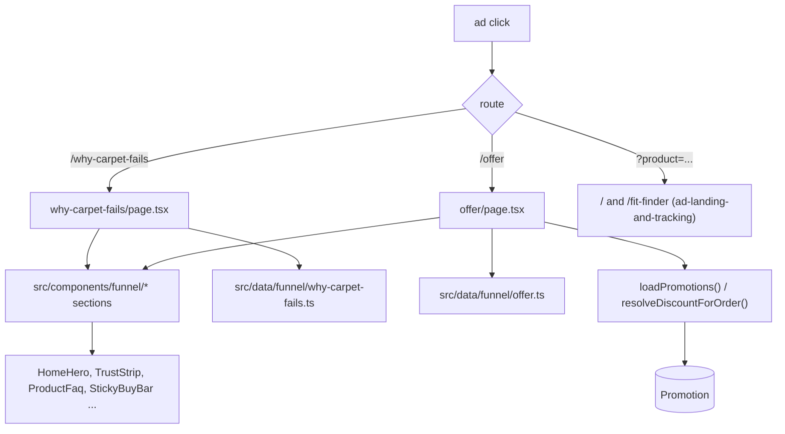

# Design Document

## Overview

Deliver the two funnel pages the ads actually need and the section library they are built from, without
duplicating anything that already exists or shipping a claim the business cannot honour.

The shape is deliberately small:

- **A section library** — a closed set of Server Components (`src/components/funnel/`) composed of
  Tailwind tokens already in `src/app/globals.css`, reusing existing components wherever one exists.
- **Two new routes** — `/why-carpet-fails` (education) and `/offer` (the live offer) — each a Server
  Component whose copy lives in one typed module under `src/data/funnel/`.
- **Nothing else.** The homepage, `/shop/[category]` and `/products/[slug]` are enhanced with sections,
  not replaced.

Everything that is already owned elsewhere is left there: campaign variants and tracking
(`ad-landing-and-tracking`), the footer/announcement/trust placement (`trust-and-policies`), catalogue
data and PDP/category rendering (`storefront-catalog`), catalogue editability
(`catalogue-admin-control`).

## Current State (verified)

**Routes that exist** (`src/app/`): `/` (`page.tsx`), `/shop` and `/shop/[category]`,
`/products/[slug]`, `/fit-finder`, `/cart`, `/checkout`, `/order/[reference]`, `/order/confirmation`,
`/policies/[slug]`, `/contact`, `/api/*`. **No `/why-carpet-fails` and no `/offer`.**

**Reusable components present** (`src/components/`): `HomeHero`, `TrustStrip`, `ProductFaq`,
`StickyBuyBar`, `BuyBox`, `ProductGallery`, `ProductCard`, `CategoryTile`, `RelatedProducts`,
`AnnouncementBar`, `ProductImage`, `ProductPlaceholder`, `PageView`, `ViewItemTracker`, `CampaignCapture`.

**Campaign copy and the offer guard** — `src/data/landing.ts`: `resolveCampaign`, `CAMPAIGN_LANDINGS`,
`assertCampaignLandings`, and `ALLOWED_OFFER = "Save ₦2,000 with bank transfer"`. The module rejects, at
load time, any campaign that names a product not in the static `PRODUCTS` or an offer the checkout does
not honour.

**Offer data** — `src/lib/discounts-server.ts`: `loadPromotions()` returns live `Promotion` rows
(`badge`, `label`, `headline`, `description`, `image`, `startsAt`, `endsAt`, `scope`), and
`resolveDiscountForOrder()` computes the actual saving on a basket. `src/app/page.tsx` already uses both
for the homepage offer band; `/offer` reuses them.

**Metadata** — `src/lib/seo.tsx`: `pageMetadata({ title, description, path, image?, type? })` returns a
self-referencing canonical plus OG/Twitter tags; `productJsonLd`, `faqJsonLd`, `breadcrumbJsonLd` are
available. The file deliberately has **no `AggregateRating` or review field**, and
`scripts/seo-check.mjs` asserts their absence.

**Media** — `src/lib/media.ts` (`mediaUrl`) and `src/lib/media-manifest.ts` (build-time manifest import);
`src/components/ProductPlaceholder.tsx` is the honest fallback when a photograph is absent.

**Analytics** — `src/lib/analytics/events.ts` holds the event registry (`page_view`, `view_item`,
`add_to_cart`, `begin_checkout`, `lead`, `purchase`, `cart_view`, `checkout_start`, `order_prepared`,
`campaign_landing_viewed`). `lead` already fires on an order (`src/app/checkout/CheckoutView.tsx`,
`src/app/order/confirmation/ConfirmationView.tsx`).

**Schema** — `prisma/schema.prisma` declares `Category`, `Product`, `Bundle`, `BundleItem`,
`ProductVariation`, `Make`, `Vehicle`, `Location`, `Order`, `OrderItem`, `Layout`, `LayoutVariant`,
`RangePrice`, `Mapping`, `ImageSet`, `Exclusion`, `DemandLog`, `AuditEntry`, `Promotion`, `Coupon`,
`SiteSetting`. **There is no subscriber/lead table.**

**Constraints already written down** — `trust-and-policies` 1.3/1.4/10.6/11.3 forbid fabricated
scarcity, countdowns and unearned social proof; `ad-landing-and-tracking` 1/3/4/5 own campaign variants,
the event taxonomy, providers and UTM.

## Architecture

Every funnel page is a **Server Component**. No funnel section is a Client Component; the only client
JavaScript on these pages is what is already mounted globally (`PageView`, `ViewItemTracker`,
`Analytics`).

## Components and Interfaces

### Routes

- `src/app/why-carpet-fails/page.tsx` — Server Component. `export const metadata = pageMetadata({...})`;
  reads `src/data/funnel/why-carpet-fails.ts`; renders sections. No `searchParams`.
- `src/app/offer/page.tsx` — Server Component. `await loadPromotions()` → choose the live promotion
  (the same window predicate `src/app/page.tsx` uses: `startsAt <= now <= endsAt`, with the existing
  "null means open" rule); `await resolveDiscountForOrder({ lines })` for the real saving. IF no live
  promotion THEN render the honest "no offer running" state (Requirement 9.3), not an empty shell.
- `src/app/sitemap.ts` — add both routes with a static `lastModified` policy consistent with the file's
  existing note about not claiming every page changed today.

### Section library — `src/components/funnel/`

Each is a Server Component taking plain props; none imports `@/lib/db` or `@/data/products` directly.

| Component | Props (shape) | Requirement |
|---|---|---|
| `SectionHeading` | `{ eyebrow?, title, body? }` | 2 |
| `ProseSection` | `{ heading, paragraphs: string[] }` | 7 |
| `MechanismGrid` | `{ items: { title, body, icon }[] }` | 2, 8.1 |
| `ComparisonTable` | `{ columns: string[]; rows: { label, cells: string[] }[] }` | 5 |
| `CostCards` | `{ items: { label, value, note? }[]; footnote? }` | 5.4 |
| `StepProcess` | `{ steps: { title, body }[] }` | 8 |
| `RiskReversal` | `{ items: string[] }` | 3 |
| `FaqBlock` | `{ items: { q, a }[] }` — renders `
` like `ProductFaq` | 2.4 |
| `ProofStrip` | `{ items: Testimonial[] }` — **renders `null` when `items` is empty** | 3.2 |
| `CtaBand` | `{ primary: { label, href }, secondary?: { label, href } }` | 1 |

`ComparisonTable` and `CostCards` carry text only; the build test (Testing) asserts they contain no
price literal and no forbidden scarcity string.

### Content modules — `src/data/funnel/`

- `sections.ts` — the `Section` discriminated union (`{ kind: "mechanism" | "comparison" | "faq" | ...
  , ... }`) and the `FunnelPage = { slug, metadata, sections: Section[] }` shape.
- `why-carpet-fails.ts` — the education copy.
- `offer.ts` — the offer page's static copy; **no prices** (those come from `loadPromotions`).
- A `renderSection(section)` switch in `src/components/funnel/render-section.tsx` maps the union to a
  component, so a page module cannot reference an unknown section.

This keeps every string in one reviewable file per page and makes "no free-form HTML" structural: a
content module can only express sections the union declares (Requirement 2.1).

### Reuse, not rebuild (Requirement 8)

- `/shop/[category]` gains `MechanismGrid` and `ComparisonTable` in `src/app/shop/[category]/page.tsx`
  above the existing `CatalogExplorer`; nothing about `CatalogExplorer` changes.
- `/products/[slug]` gains its fit-guide/mechanism content inside the existing page, reading the
  product's own data; `BuyBox` and `StickyBuyBar` remain the only buy controls.

### Existing helpers reused

- `src/lib/whatsapp.ts` (`whatsappLink`) for any WhatsApp call-to-action, so no new link builder exists.
- `src/lib/copy.ts` for guarantee/delivery strings (`trust-and-policies` owns their content).
- `src/lib/media.ts` `mediaUrl` + `ProductPlaceholder` for imagery.

## Data Models

**No database change.** The funnel pages are code; their content is a TypeScript union.

- `Section` — a discriminated union over section kinds, with props mirroring the components above.
- `FunnelPage` — `{ slug: string; metadata: PageMetadataInput; sections: Section[] }`.
- `Testimonial` — `{ quote: string; name: string; car: string; location?: string; verified: boolean }`;
  `ProofStrip` renders only `verified: true` items and `null` when there are none (Requirement 3.2).
- The **offer page reads `Promotion`** (existing model) through `loadPromotions()`; it stores no offer
  of its own (Requirement 4.3).

## Error Handling

- **Missing dependency** (no live promotion, no verified testimonial, no PDF asset, no subscriber
  store) → the section renders nothing and the page degrades to its honest parts (Requirement 9.3).
  `ProofStrip` returning `null` on empty input is the pattern.
- **Dangling links** → every `href` in a content module points at a route that exists; a build test
  (Testing) asserts the set of link targets is a subset of a declared allow-list
  (`/`, `/shop`, `/shop/[category]`, `/products/[slug]`, `/fit-finder`, `/cart`, `/checkout`,
  `/contact`, `/offer`, `/why-carpet-fails`).
- **No imagery** → `ProductPlaceholder`, never a broken `` (the `media-manifest` build-time import
  means a missing path is a build failure, not a runtime 404).
- **Prices** → never typed into a funnel module; read from the catalogue/engine, so the page cannot
  disagree with the cart.

## Testing Strategy

- **Content guard test** (new, `scripts/funnel-content.test.mjs`, `node --test`, following
  `scripts/catalogue-guard.test.mjs`):
  - assert no content module contains a naira figure or the digit-sequence of a price;
  - assert no module contains a forbidden scarcity token ("only … left", "expires", "slots", "sold in
    the last", "people viewing");
  - assert no module fires `lead` and no module declares an analytics event;
  - assert every `href` is in the allow-list above.
- **Render checks** (in the app's existing style): assert `/why-carpet-fails` and `/offer` return 200,
  contain a self-referencing canonical, and appear in `sitemap.xml`.
- **No-JS check**: assert the FAQ renders as `
`/`
` in the HTML (the `ProductFaq` rule).
- **Regression against `trust-and-policies`**: the same guard test asserts the forbidden words, so a
  future "urgency" section fails CI rather than shipping.

## Open Questions

1. **Offer slug** — decided `/offer` (season-agnostic; the page resolves whichever `Promotion` is live,
   matching the homepage's promotion-driven hero). `rainy-season` becomes a `Promotion.headline`, not a
   route.
2. **Lead capture** — deferred. There is no subscriber table (`prisma/schema.prisma`), so the
   "Join the Inner Circle" section does not ship until a spec delivers a destination; `DemandLog` exists
   but is the fitment-demand log, not a marketing list. Requirement 9.1 holds this.
3. **Imagery** — the blueprint's visuals (water-on-carpet, macro texture) do not exist in `public/`.
   Sections fall back to `ProductPlaceholder` until the owner supplies them; sourcing is an
   owner decision (`_CONTEXT.md` §12 rule 4 keeps it out of tasks).
4. **`ScrollDepth`** — if wanted, it is a new GA4-only custom event registered in
   `src/lib/analytics/events.ts` under `ad-landing-and-tracking` Requirement 3; this spec uses it or not
   accordingly, and adds nothing itself.
