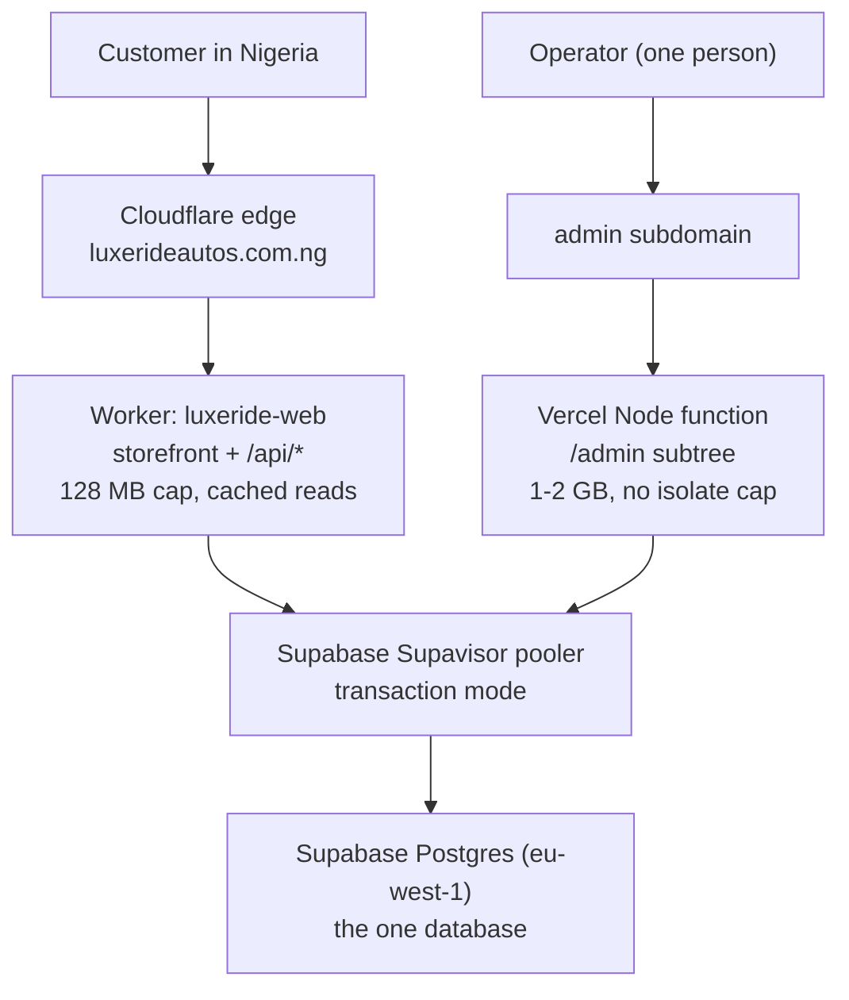

# Design Document

## Overview

The application already separates cleanly into two surfaces with opposite needs:

- The **storefront** is read-heavy, public, and latency-sensitive for customers in
  Nigeria. Cloudflare's edge (PoPs in Lagos and Port Harcourt) serves it well, and its
  heaviest read path — the fitment graph — is already cached per isolate
  (`luxeride-web/src/lib/isolate-cache.ts`).
- The **admin** is one operator, low traffic, write-heavy, and renders large pages. It
  is exactly the workload that does not belong on a 128 MB isolate.

So the recommended design is **not** "move the app". It is **"give the admin a runtime
with a real memory budget, and leave the storefront where it is fastest."** The design
also states the single-host alternative plainly, because the choice is the operator's.

## Current state (verified, not assumed)

| Fact | Value | Source |
|---|---|---|
| Worker | `luxeride-web` | `luxeride-web/wrangler.jsonc` |
| Build | `opennextjs-cloudflare build`, Next 16.3.5 | build log |
| Runtime | Cloudflare Workers, `nodejs_compat` | `wrangler.jsonc` |
| DB path | Hyperdrive `HYPERDRIVE` → Supabase | `wrangler.jsonc`, `src/lib/db.ts` |
| DB client | Prisma 6 + `@prisma/adapter-pg` | `package.json` |
| Node server available | `npm run start` → `next start` | `package.json` |
| Failure | `exceededResources` (1102), ~20 ms CPU at death ⇒ **memory**, not CPU | Cloudflare GraphQL, 2026-10-12 |
| Trigger | `/admin/vehicles` = 4.6 MB HTML / 2.8 MB RSC flight | measured |
| Fixed | make level URL-driven; 4.6 MB → 122 KB default | `e55c5ec` |

The 128 MB isolate cap is documented and **not raisable**. That is the constraint this
spec exists to route around.

## Options considered

| Option | Memory model | Storefront TTFB (NG) | Effort | Cost/mo (verify) | Notes |
|---|---|---|---|---|---|
| **A. Split: storefront on Workers, admin on Vercel** | Admin: 1–2 GB function | **Best** (edge kept) | Medium | Vercel Pro ~$20/seat | Two deploys; each boring |
| **B. Single host: whole app on Vercel** | 1–3 GB function | Worse (functions run in one region, likely `fra1`) | Low–Med | ~$20/seat | Simplest to own; loses the NG edge |
| **C. Single host: Fly.io / Render / Railway (Node)** | Whatever you buy (256 MB–1 GB+) | Region-dependent; Fly has a Johannesburg region | Med | ~$3–10 | You own uptime |
| **D. VPS + Nginx + PM2** | Full box | Region-dependent | High | ~€5 | Cheapest at scale; most ops |
| **E. AWS Lambda via SST** (`@opennextjs/aws` already installed) | 128 MB–10 GB configurable | Worse | Med–High | <$5 at this scale | Most moving parts |
| **F. Netlify / AWS Amplify** | Node functions, no cap | Worse | Low | Free–$19 | Same trade as B |
| **G. Cloudflare Containers** | Real memory | Edge | High | Usage-based | Young; heavy re-architecture |

Two facts constrain the choice:

1. **The storefront's edge advantage is real.** Ad traffic is Nigerian; Cloudflare has
   PoPs in Lagos/PH, and a Node function on Vercel or Fly answers from Europe. Losing
   that is a conversion cost, not a vanity metric.
2. **Payload discipline is required on every option.** Vercel serverless functions cap a
   response at 4.5 MB — the pre-fix `/admin/vehicles` would have failed there *too*. The
   122 KB fix is necessary regardless of host, which is why it shipped first.

## Recommended design — Option A (split)

### Components and interfaces

1. **Storefront Worker (unchanged target).** Keeps `wrangler.jsonc`, Hyperdrive, the
   Images binding, and the per-isolate cache. Deployment stays `opennextjs-cloudflare
   deploy`.

2. **Admin host (new, Vercel).** Runs the same Next.js app with `next start` semantics
   (Vercel's native Next runtime). One region, chosen next to Supabase — `fra1`
   (Frankfurt) for `aws-0-eu-west-1`. No OpenNext shims, no `nodejs_compat`, no
   Hyperdrive.

3. **Routing.** The admin is reachable at a host the storefront does not serve —
   `admin.luxerideautos.com.ng` (or `/admin` proxied by a rule) — so a request lands on
   exactly one runtime. The console already emits `robots: noindex` and lives behind the
   signed cookie; nothing about its auth changes.

4. **Database access (the one real code change).** `src/lib/db.ts` must stop assuming
   `env.HYPERDRIVE` exists. On the Node host there is no Hyperdrive binding, so the
   client must use `DATABASE_URL` with the **pooler**:

   - Supavisor **transaction** mode needs `pgbouncer=true` and `connection_limit=1` for
     Prisma, and named prepared statements off.
   - One client per serverless instance, cached on the module (Prisma's singleton),
     never per request.
   - `@prisma/adapter-pg` is already a dependency, so no new package is required.

5. **Secrets.** Identical names on both hosts (`DATABASE_URL`, `ADMIN_SESSION_SECRET`,
   `ADMIN_USER`, `ADMIN_PASSWORD_HASH`). A build-time `DATABASE_URL` (the session pooler,
   IPv4) remains required for prerendering, exactly as today.

### Data models

No schema change. No migration. The `prisma/schema.prisma`, the Supabase database, and
all rows are untouched by this spec. Requirement 4.3 forbids running migrations as part
of it.

### Error handling

- **Resource limit.** On the Node host a mis-sized function returns a 5xx, and
  `next.config.ts` / Vercel's function config sets the memory size explicitly; the goal
  is that this never occurs for the admin, so a 5xx here is a bug, not a ceiling.
- **Database unreachable.** `src/lib/db.ts` already surfaces handled errors; the admin
  must render its error boundary rather than a raw platform error (Requirement 4.4).
- **Missing secret.** Deploy fails (Requirement 5.3) — the same posture `wrangler.jsonc`
  takes with `secrets.required`.

### Testing strategy

1. **Payload smoke test** (Requirement 1.2–1.3): for every route in the Next route
   manifest, fetch it and assert the gzipped body is under budget. Add to `npm run
   verify`. This is the guard that keeps any future page from re-breaking the ceiling.
2. **Connection test** (Requirement 4.2): assert the app opens at most one pooled
   connection per instance under a concurrent smoke load.
3. **TTFB measurement** (Requirement 2): capture before/after from a Nigerian vantage
   (or a European one as a proxy) and record it here.
4. **Rollback drill** (Requirement 6): redeploy the previous Cloudflare Worker and
   confirm the site serves, timed.

### Cost (assumptions stated)

- **Option A**: Vercel Pro (~$20/seat/mo) + Cloudflare Workers Paid (~$5/mo) + Supabase
  (existing plan). Assumes admin traffic is negligible — one operator.
- **Option B**: Vercel Pro only; same ~$20 + Supabase.

Both are dominated by the existing Supabase plan, which this spec does not change.

## Key decisions and trade-offs

- **Split over single-host, recommended because the edge is a real asset for Nigerian
  ad traffic.** The cost is two deployments. If the operator prefers one place to look
  at, Option B is a legitimate choice and this design's DB/env/alerting work applies
  unchanged.
- **Vercel first among Node hosts** because a `jbraide/luxeride-platform` remote already
  exists for it and it needs no OpenNext shim.
- **Do not run the admin and storefront on one Worker if a page can exceed 1 MB.** The
  cap is shared by every route on the isolate, so an admin spike can take the storefront
  down with it — which is what happened.
- **The payload fix is not optional on any host** (4.5 MB Vercel limit).

## Open questions for the operator

1. Split (A) or single host (B)?
2. If A: is a `admin.luxerideautos.com.ng` subdomain acceptable, or must it stay at
   `/admin` on the main domain (which then needs a proxy rule)?
3. Vercel hobby vs Pro — is the $20/seat acceptable, or should Fly.io (Option C) be the
   admin host instead?
