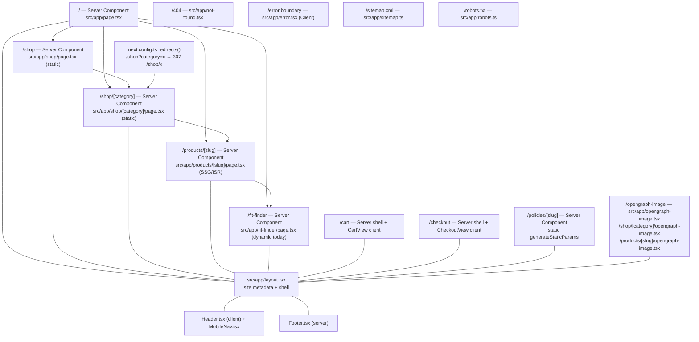
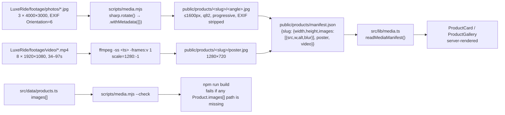
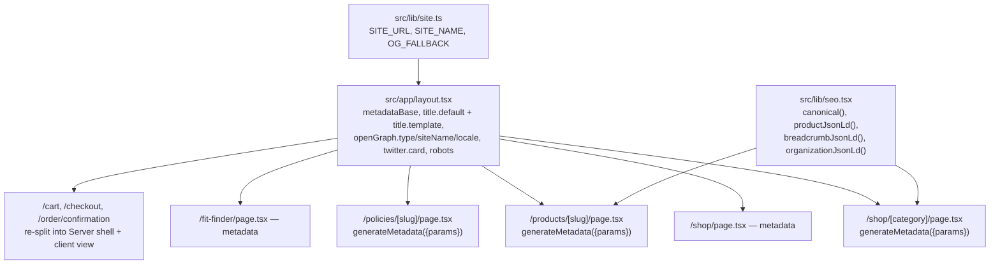

# Design Document — storefront-catalog

## Overview

The catalogue becomes a real storefront. Five structural changes carry most of the work:

1. **Categories become routes.** `/shop?category=floor-mats` becomes `/shop/floor-mats`, prerendered at
   build time, with its own title, description, canonical and Open Graph card. The query-parameter form
   survives as a 307 redirect so old ad links keep working.
2. **Every page describes itself.** A shared site-config module plus per-segment `metadata` /
   `generateMetadata` and code-generated `opengraph-image` files replace the single global object in
   `layout.tsx`. `sitemap.ts`, `robots.ts`, `not-found.tsx` and `error.tsx` join them.
3. **Imagery gets a contract.** A media pipeline turns the raw photographs and footage on disk into
   correctly-oriented, size-capped JPEGs plus poster frames, and writes a manifest the renderer reads. A
   build-time check fails the build if any referenced file is missing, and a server-rendered placeholder
   covers anything that is still missing, so a card is never an empty grey box again.
4. **The PDP becomes a product page.** Gallery with selection, what's in the box, materials, coverage,
   installation and care, delivery fee/ETA from `LOCATIONS`, FAQ, related products, sticky call to action,
   and honesty about availability (no "in stock" anywhere).
5. **Navigation works on a phone.** A hamburger panel in `Header` reachable below 640px, plus a footer
   carrying category links, policies, contact and the guarantee mechanics.

Nothing in this design assumes a database. `PRODUCTS`, `CATEGORIES` and `LOCATIONS` remain the source of
truth as static TypeScript. Persistence is named where it lands: reviews are `commerce-backend`.

**Next.js version notes.** This is `next@16.3.5` with the App Router. Guides read in
`luxeride-web/node_modules/next/dist/docs/` before this design was written:

| Guide | Used for |
|---|---|
| `01-app/03-api-reference/04-functions/generate-metadata.md` | per-route metadata, `metadataBase`, title templates, merge/override semantics, `themeColor`/`viewport` deprecation, SEO status codes for `not-found` |
| `01-app/03-api-reference/03-file-conventions/01-metadata/sitemap.md` | `MetadataRoute.Sitemap` shape, `images` entries |
| `01-app/03-api-reference/03-file-conventions/01-metadata/robots.md` | `MetadataRoute.Robots` shape, per-agent rules |
| `01-app/03-api-reference/03-file-conventions/01-metadata/opengraph-image.md` | `opengraph-image.tsx`, `params` prop, 8 MB build limit, build-time optimisation |
| `01-app/03-api-reference/04-functions/generate-image-metadata.md` | multiple OG sizes |
| `01-app/03-api-reference/03-file-conventions/not-found.md` | root vs segment 404, `noindex` behaviour |
| `01-app/03-api-reference/03-file-conventions/error.md` | `error.tsx` must be a Client Component; `error` / `retry` props |
| `01-app/03-api-reference/03-file-conventions/loading.md` | `loading.tsx` + Suspense, and why it would never show on static routes |
| `01-app/02-guides/json-ld.md` | inline `<script type="application/ld+json">`, `\u003c` escaping |
| `01-app/02-guides/caching-without-cache-components.md` | `dynamic`, `revalidate`, `dynamicParams`; this project is on the pre-Cache-Components model |
| `01-app/03-api-reference/05-config/01-next-config-js/redirects.md` | `source`/`destination`/`permanent`, query matching via `has` |
| `01-app/03-api-reference/05-config/01-next-config-js/images.md` and `01-app/03-api-reference/02-components/image.md` | `dangerouslyAllowSVG`, `contentSecurityPolicy`, `qualities`, `formats`, `sizes`, `priority` → `preload` deprecation in 16 |
| `01-app/01-getting-started/12-images.md` | local vs remote images, `remotePatterns`, blur placeholders |
| `01-app/03-api-reference/04-functions/generate-static-params.md` | `dynamicParams` behaviour |
| `node_modules/next/dist/shared/lib/get-img-props.js` | the exact condition under which SVG sources are auto-unoptimized |

---

## Current State (verified)

Everything in this section was read or executed against the working tree in this session. Paths are
relative to `luxeride-web/` unless stated otherwise.

### Exists and works

| Thing | Evidence |
|---|---|
| Root layout with Oswald/Inter/JetBrains Mono via `next/font/google`, header/main/footer shell | `src/app/layout.tsx:28-41` |
| Homepage: hero, 3 badges, 5 `CategoryTile`s, `PRODUCTS.slice(0, 4)` as "Popular Right Now" | `src/app/page.tsx:8,41-43,56-58` |
| Shop with category chips and a `ProductCard` grid | `src/app/shop/page.tsx:19-45` |
| PDP with a 3-image strip, `priceRange()`, Fit Guarantee badge, one CTA to `/fit-finder?product=<slug>` | `src/app/products/[slug]/page.tsx:16-51` |
| SSG of all 7 PDPs via `generateStaticParams` | `src/app/products/[slug]/page.tsx:7-9` |
| 5 categories, 7 products, `getProductBySlug`, `getCategoryBySlug`, `priceRange` | `src/data/products.ts:21-27,109-119` |
| 4 delivery zones with `eta` + `fee`, `WHATSAPP_NUMBER = "2347049621694"` | `src/data/locations.ts:7-14` |
| `fmtNaira`, `productBase`, `buildOrderMessage`, `whatsappLink` | `src/lib/pricing.ts`, `src/lib/whatsapp.ts` |
| Zustand cart persisted to `luxeride-cart` | `src/store/cart.ts:29-50` |
| Design tokens: `--ink #0a0a0a`, `--panel #141210`, `--panel-2 #1c1916`, `--gold #d4af37`, `--gold-dim #8c7853`, `--line rgba(212,175,55,.22)`, `--muted rgba(255,255,255,.55)` | `src/app/globals.css:3-11` |

### Does not exist

| Gap | Evidence |
|---|---|
| Mobile navigation. The nav is `hidden … sm:flex`; no hamburger, no drawer, no `MobileMenu` component anywhere in `src/components/` | `src/components/Header.tsx:28`; full `src/components/` listing |
| Footer links. `Footer` is 10 lines, two `<p>` elements, zero anchors | `src/components/Footer.tsx` |
| `/shop/[category]`. Categories are `?category=` query params only | `src/app/shop/page.tsx:31`, `src/components/CategoryTile.tsx:7` |
| Site search, sort, pagination, result counts | `src/app/shop/page.tsx` (whole file) |
| Per-page metadata. `layout.tsx` exports one object with `title` + `description` only — no `metadataBase`, no `openGraph`, no `twitter`, no `alternates`, no `robots` | `src/app/layout.tsx:23-26` |
| `sitemap.ts`, `robots.ts`, `not-found.tsx`, `error.tsx`, `loading.tsx`, `opengraph-image.*`, `twitter-image.*` | complete file listing of `src/app/` |
| Breadcrumbs, JSON-LD, reviews, stock status, specs, FAQ, gallery interaction, cross-sell, related products, video | `src/app/products/[slug]/page.tsx` (whole file) |
| `remotePatterns`, `qualities`, `formats` in image config | `next.config.ts` (whole file) |

### The specific defects this feature fixes

| # | Defect | Exact evidence |
|---|---|---|
| D1 | **15 of 21 referenced product images do not exist.** `PRODUCTS` references 21 paths; `public/products/` holds 6 files, all SVG, 1.7–2.1 KB, `viewBox="0 0 480 360"`. The 5 products `seat-covers`, `full-bundle`, `cargo-liner`, `mud-flaps`, `sun-shade` reference 15 paths that resolve to nothing | `src/data/products.ts:42-106` vs `ls public/products/` |
| D2 | **`SafeImage` hides the slot, so the missing images look like bugs.** It returns `null` after `onError` | `src/components/SafeImage.tsx:11-14` |
| D3 | **`SafeImage` is `"use client"`,** so every card image and every gallery image turns part of a server render into a client component | `src/components/SafeImage.tsx:1` |
| D4 | **The homepage ships two empty boxes.** `PRODUCTS.slice(0, 4)` = `single-layer-mats`, `double-layer-mats`, `seat-covers`, `full-bundle`; the last two have no images | `src/app/page.tsx:8` + `src/data/products.ts:56-76` |
| D5 | **`ProductCard`'s `sizes` does not match its own grid.** Declared `(min-width: 768px) 25vw, 50vw`; the grid is `grid-cols-2 sm:grid-cols-3 lg:grid-cols-4`. Between 640px and 1023px — the most common Nigerian Android viewport — the browser is told the image is 50vw wide when it is about 33vw, so it downloads roughly 1.5× more than it needs | `src/components/ProductCard.tsx:18` vs `src/components/ProductCard.tsx:18` grid in `src/app/shop/page.tsx:41` |
| D6 | **The PDP gallery images have no `sizes` at all.** Each sits in a fixed `h-40 w-52` (208×160) box with `fill`. With no `sizes`, the browser assumes `100vw` | `src/app/products/[slug]/page.tsx:23-25` |
| D7 | **The PDP image boxes are `h-40 w-52` — landscape 4:3 — while the cards are `aspect-[4/3]`.** The same photo is framed two different ways on the same journey | `src/app/products/[slug]/page.tsx:23` vs `src/components/ProductCard.tsx:13` |
| D8 | **No PDP metadata at all.** `/products/double-layer-mats` renders the same `<title>` as `/` | `src/app/products/[slug]/page.tsx` exports no `metadata` |
| D9 | **`/shop` is dynamic purely because it awaits `searchParams`** | `src/app/shop/page.tsx:10`; `/_CONTEXT.md` §3 records `/shop` as `ƒ` |
| D10 | **Three routes are `"use client"` page files, so they cannot export `metadata`** | `src/app/cart/page.tsx:1`, `src/app/checkout/page.tsx:1`, `src/app/order/confirmation/page.tsx:1` |
| D11 | **`images.dangerouslyAllowSVG: true` is unnecessary today.** In `shared/lib/get-img-props.js`: `if (isDefaultLoader && !config.dangerouslyAllowSVG && src.split('?',1)[0].endsWith('.svg')) { unoptimized = true }`. With the flag **false**, the `.svg` sources already bypass the optimizer. With it **true**, they go through `/_next/image` with `contentDispositionType: "attachment"` — strictly worse | `next.config.ts:5-7` + `node_modules/next/dist/shared/lib/get-img-props.js:280` |
| D12 | **`npm run build` fails.** `prisma/seed.ts(2,34): error TS2307: Cannot find module './data/products'`; `tsconfig.json` `include` is `**/*.ts`, so Next type-checks it | recorded in `_CONTEXT.md` §3; `tsconfig.json:26-32` |

### Raw media, measured in this session

`LuxeRide/footage/` (outside the app, outside this spec's write scope):

| File | Measured |
|---|---|
| `20260801_114841.jpg`, `20260801_114925.jpg`, `20260801_121405.jpg` | MJPEG, **4000×3000**, 3.16–3.57 MB each. **EXIF tag 0x0112 Orientation = 6 on all three** (parsed from the APP1 segment directly). The APP1 EXIF segment alone is **51 021 / 48 473 / 36 843 bytes**. `sharp().metadata().autoOrient` reports `{ width: 3000, height: 4000 }` — i.e. **the raw pixels are landscape but the photograph is meant to be viewed as a 3000×4000 portrait.** A pipeline that ignores EXIF serves all three lying on their side |
| 8 × `.mp4` | H.264, 1920×1080 @ 30fps, **34.4 s – 96.9 s**, ~17 Mbps, 73.7 MB – 208.5 MB. Total ≈ 7.6 min, ≈ 1.05 GB. None of it is servable as a `<video src>` on a mobile connection in Nigeria |

Tooling available on this machine, verified by running it:

| Tool | Result |
|---|---|
| `ffmpeg` / `ffprobe` | **present**, `7.0.2-static` at `~/.local/bin/`. Muxers include `avif` and `webp`; encoders include `libwebp` and `libaom-av1` |
| `sharp` | **present**, v0.35.4 in `luxeride-web/node_modules/` (transitive via Next, **not declared in `package.json`**) |
| `magick` / `convert` / `exiftool` | **absent from PATH** — the pipeline must not depend on them |

### Corrections to `_CONTEXT.md` found while reading

1. `_CONTEXT.md` §4 says `SafeImage` is "used with `alt=""` in both galleries". It is not. Both call sites
   pass `alt={product.name}` (`src/components/ProductCard.tsx:16`, `src/app/products/[slug]/page.tsx:24`).
   Alt text is already correct and needs no work; the defect is `alt=""` never occurring, so the
   `SafeImage` rewrite must preserve `alt` rather than strip it.
2. `_CONTEXT.md` §1 says the photographs are "EXIF orientation = upper-right (needs auto-orient)". The
   precise value is **6** ("right-top"), and the consequence is a 90° rotation: 4000×3000 in, 3000×4000
   out. The pipeline requirement is unchanged; the number in this design is exact.

---

## Architecture

### Route map after this feature



### Caching strategy — the decision

`/shop` is `ƒ` today only because line 10 awaits `searchParams`. There are exactly **two** `searchParams`
reads in the whole app (`src/app/shop/page.tsx:10` and `src/app/fit-finder/page.tsx:8`, confirmed by
grepping `src/app/`).

**Decision: search and sort live in client state, not in the URL.** The catalogue is 7 products. Passing
the full `PRODUCTS` array to a small client component and filtering in the browser costs nothing, keeps
`/shop` and `/shop/<slug>` fully prerendered, and makes search instant. Putting `?q=` and `?sort=` in the
URL would make the routes dynamic again for no user-visible benefit at this size. Criterion 7.8 makes this
reversible: above 50 products, state moves to the URL.

**Legacy URLs are absorbed by `next.config.ts` `redirects()`**, using `has` query matching:

```ts
// next.config.ts
import { CATEGORIES } from "./src/data/products"; // or hard-coded; see Open Questions
async redirects() {
  return CATEGORIES.map((c) => ({
    source: "/shop",
    has: [{ type: "query", key: "category", value: c.slug }],
    destination: `/shop/${c.slug}`,
    permanent: false, // 307: not cached, so a future slug change is not a permanent trap
  }));
}
```

`permanent: false` is deliberate: `next.config.ts` redirects are compiled into the build, and a slug that
is renamed later would leave a 308 baked into browsers that visited it.

**`/products/[slug]`**: keep `generateStaticParams`, add `dynamicParams = false`. With 7 products generated
at build, an unknown slug should 404 immediately rather than being rendered on demand — that gives a real
404 status and a real `not-found` page instead of a soft 404. New products land on the next build, which
they would anyway.

**No ISR interval is added.** The catalogue is a compile-time constant. Adding `export const revalidate =
3600` would imply a data source that does not exist. Requirement 15.4 says so explicitly. When
`commerce-backend` introduces real reads, ISR belongs to that spec.

### Media pipeline



**Decision: ship from `public/products/`, not object storage.** The architecture plan §2 recommends
Supabase Storage or Vercel Blob so photos can be swapped from a dashboard. That is the right end state, and
it is not the right thing to do this week:

| | `public/products/` | Object storage |
|---|---|---|
| Infra to stand up now | none | bucket + `images.remotePatterns` + a CDN in front of it |
| Failure mode if the provider is down | none | every product image 404s on paid traffic |
| Swapping a photo without a deploy | requires a commit + build | immediate |
| Repo/deploy size cost | ~1–3 MB per master, ≈ 20 MB for 7 products | zero |
| Works with the current Next-only deploy | yes | needs the CDN and config first |

The seam that keeps this reversible: `src/lib/media.ts` exposes `MEDIA_BASE_URL` (default `""`), and the
manifest stores paths **relative** to it. Moving to a bucket is changing one constant and adding a
`remotePatterns` entry — no component touches a path literal. That migration is a P2 task.

**Decision: master-only, let `next/image` do the ladder.** Pre-generating a WebP+AVIF ladder into
`public/` means ~20 files per angle and a hand-maintained ladder that drifts from the components. Instead
one auto-oriented, 1600px-capped JPEG master per angle is committed, and `next/image` generates the
responsive `srcset` from `deviceSizes` at request time. The one thing the built-in optimiser cannot do is
produce a blur placeholder for a dynamically-pathed `src`, so the pipeline emits a 16px-wide JPEG and
base64s it into the manifest as `blurDataURL` — which is exactly the manual path the `image.md` guide
describes for dynamic sources.

**Decision: WebP only, no AVIF.** `next.config.ts` gets `images.formats` left at its default
`['image/webp']`. The `images.md` guide states AVIF "generally takes 50% longer to encode but it compresses
20% smaller" and explicitly says "We still recommend using WebP for most use cases". At this traffic volume
the encode cost is not worth the 20%. Enabling AVIF later is a one-line change (P2).

**Decision: delete `images.dangerouslyAllowSVG` now, not later.** The premise of the flag was "placeholders
are SVG". But `get-img-props.js` shows that when the flag is **false**, `.svg` sources are automatically
`unoptimized` and served as-is — which is precisely what the `images.md` guide recommends. Keeping the flag
`true` pushes the six placeholder SVGs through the image optimiser and serves them with
`Content-Disposition: attachment`. Removing the flag is strictly better on day one, and the cleanup
condition in the brief ("once real raster photos land") turns out not to be a dependency at all. If the
placeholders are replaced by raster photography before this lands, the flag is removed by deleting it from
a 9-line file either way.

### Placeholder strategy

Three layers, so no single failure shows:

1. **Manifest** — `src/lib/media.ts` resolves `Product.images[]` against the manifest. A path with no entry
   is known-missing *at render time on the server*, with no client round-trip.
2. **Server-rendered placeholder** — `ProductPlaceholder` renders a `bg-gradient-to-b from-panel-2 to-ink`
   panel with gold reticle corners drawn in the same idiom as the existing `single-layer.svg` (which uses
   `#D4AF37` strokes and a `#1C1916`→`#0A0A0A` gradient), plus the product name in `font-display`. It is
   the same 4:3 box the real image occupies, so the grid never reflows.
3. **Runtime `onError` safety net** — `ProductGallery` is the only client component that keeps an
   `onError` handler, because it is the only place an image can arrive after hydration and be wrong.

`SafeImage` is deleted. Keeping it would leave every card image as a client component (D3) while doing
nothing that the server-rendered path does not already handle better.

### Metadata architecture



**The trap this design avoids.** Per `generate-metadata.md`, metadata objects are *shallowly merged*:
`title` is replaced by the child, but a nested object like `alternates` or `openGraph` defined in a parent
is **inherited** by any child that does not define it. So putting `alternates: { canonical: "/" }` in
`layout.tsx` would stamp `https://site/` as the canonical on every page in the site. `canonical` is therefore
set per page and never in the root layout. Same reasoning for `openGraph.images`: any page that defines
`openGraph` without `images` loses the root image, so `OG_FALLBACK` lives in `src/lib/site.ts` and is spread
into every `openGraph` block.

**`/cart`, `/checkout`, `/order/confirmation` cannot export `metadata` today** — their page files start
with `"use client"` (D10), and `generate-metadata.md` states metadata exports are Server-Component only.
Each is split: the page file becomes a Server Component that exports `metadata` and renders a new client
component containing the existing body. `/fit-finder/page.tsx` already uses exactly this pattern (14 lines,
renders `<FitFinder lockedProductSlug={product} />`), so there is a precedent to copy rather than invent.

**`/cart` and `/checkout` are also `noindex`.** They are transactional, have no content, and must not
compete with `/shop` in search. `robots: { index: false, follow: true }` per page.

### JSON-LD shape

`Product` + `Offer` is emitted on the PDP. The critical honesty point: `priceRange()` returns
`[regular, premium + threeRowSurcharge]`, so the band genuinely is a band driven by the car's tier and
row configuration — a single `price` would be a number the WhatsApp quote can contradict. The emit is
therefore an `Offer` whose `priceSpecification` carries `minPrice`/`maxPrice` and whose `url` carries the
price text. `availability` is not asserted; `priceValidUntil` is set to a date the owner can defend.

No `AggregateRating` is emitted until real reviews exist. Fabricated ratings are a structured-data
violation and would be the single most damaging thing this feature could ship.

---

## Components and Interfaces

### New components

| Component | File | Kind | Why this kind |
|---|---|---|---|
| `MobileNav` | `src/components/MobileNav.tsx` | Client Component | Needs open/closed state and Escape handling. Rendered next to `Header`, which is already `"use client"` |
| `Breadcrumbs` | `src/components/Breadcrumbs.tsx` | Server Component | Pure `<nav>` + links. The JSON-LD that accompanies it is emitted by the page, not the component |
| `ProductPlaceholder` | `src/components/ProductPlaceholder.tsx` | Server Component | Must render server-side so no client boundary and no layout shift |
| `ProductImage` | `src/components/ProductImage.tsx` | Server Component | Resolves the manifest and picks real image vs placeholder |
| `ProductGallery` | `src/components/ProductGallery.tsx` | Client Component | Selected-index state and thumbnail selection are the only interactivity |
| `BuyBox` | `src/components/BuyBox.tsx` | Server Component | Static price, delivery and CTA. No interactivity → no client bundle |
| `StickyBuyBar` | `src/components/StickyBuyBar.tsx` | Server Component | `position: fixed` CSS needs no JS; it links to `/fit-finder?product=<slug>` |
| `CatalogExplorer` | `src/components/CatalogExplorer.tsx` | Client Component | Owns query, sort and the empty state. Receives the whole product array as a prop |
| `ProductFaq` | `src/components/ProductFaq.tsx` | Server Component | Static Q&A; use `<details>`/`<summary>` so it needs no JS |
| `RelatedProducts` | `src/components/RelatedProducts.tsx` | Server Component | Deterministic selection from static data |
| `JsonLd` | `src/components/JsonLd.tsx` | Server Component | Single escape point: `JSON.stringify(x).replace(/</g, '\\u003c')` per the JSON-LD guide |

### Modified components

| File | Change |
|---|---|
| `src/components/Header.tsx` | Keep `"use client"`. Render `<MobileNav>` below `sm`; keep the existing desktop `<nav className="hidden … sm:flex">`; add `aria-current` |
| `src/components/Footer.tsx` | Becomes a Server Component (drop nothing — it has no client code today). Link columns + contact + policy links, all figures sourced from `LOCATIONS` |
| `src/components/ProductCard.tsx` | Swap `SafeImage` → `ProductImage`; fix `sizes` to `(min-width: 1024px) 25vw, (min-width: 640px) 33vw, 50vw`; add `aria-label` availability wording |
| `src/components/CategoryTile.tsx` | `href={`/shop/${category.slug}`}` |
| `src/data/products.ts` | Add per-product merchandising fields (`materials`, `inBox`, `coverage`, `install`, `care`, `faq`, `related`) — a typed extension of `Product`, still a compile-time constant |
| `src/app/globals.css` | Nothing required today. If the sticky bar needs a safe-area padding utility, add it under `@theme inline` alongside the existing tokens |
| `next.config.ts` | Remove `dangerouslyAllowSVG`; add `redirects()` |

### Deleted

| File | Reason |
|---|---|
| `src/components/SafeImage.tsx` | Replaced by `ProductImage` (server) + the gallery's `onError` (D2, D3) |

### Interfaces

```ts
// src/lib/site.ts
export const SITE_URL: string;      // process.env.NEXT_PUBLIC_SITE_URL, validated at import
export const SITE_NAME = "LuxeRide";
export const SITE_LOCALE = "en_NG";
export const OG_FALLBACK = "/opengraph-image";   // file-convention route
export const MEDIA_BASE_URL = "";   // "" today; a bucket URL later — the storage seam

// src/lib/media.ts
export interface MediaEntry {
  src: string;          // relative to MEDIA_BASE_URL
  width: number; height: number;
  alt: string;
  blurDataURL?: string; // 16px JPEG, base64, generated by scripts/media.mjs
}
export interface ProductMedia {
  images: MediaEntry[];
  poster?: string;
  video?: { src: string; poster: string; durationSec: number };
}
export function readMediaManifest(): Record<string, ProductMedia>;
export function resolveMedia(slug: string): ProductMedia | null;  // null = use placeholder

// src/lib/seo.tsx
export function pageMetadata(opts: { title, description, path, image? }): Metadata;
export function productJsonLd(product: Product): object;          // Product + Offer, no rating
export function breadcrumbJsonLd(trail: {name, url}[]): object;
export function organizationJsonLd(): object;
```

---

## Data Models

`src/data/products.ts` is extended, not replaced. The existing seven fields stay byte-identical so the
fitment engine, pricing and cart are unaffected.

```ts
export interface ProductFaq { q: string; a: string }

export interface Product {
  // ... unchanged: slug, name, categorySlug, rowApplicable, regular, premium,
  //                threeRowSurcharge?, note, images[]
  materials: string;     // "Recycled TPE, 4mm, anti-slip textured face"
  inBox: string[];       // ["1 × driver mat", "1 × passenger mat", ...]
  coverage: string;      // "Full floor pan + boot lip"
  install: string;       // truth only — what the supplied fixings actually do
  care: string;          // "Wipe with a damp cloth; no harsh solvents"
  faq: ProductFaq[];     // omitted questions are omitted, not invented
  availability: string;  // honest availability sentence; never "in stock"
}

export interface Category {
  // ... unchanged: slug, name, blurb
  seoTitle: string;      // <= 60 chars
  seoDescription: string;// 120-160 chars
  heroLine: string;      // visible H1-supporting copy unique to this category
}
```

`public/products/manifest.json` is generated, never hand-edited, and is committed so that the app runs
without a build step for media:

```jsonc
{
  "double-layer-mats": {
    "images": [
      { "src": "/products/double-layer-mats/hero.jpg", "width": 1600, "height": 1200,
        "alt": "Double layer floor mats fitted to a car footwell",
        "blurDataURL": "data:image/jpeg;base64,..." }
    ],
    "poster": "/products/double-layer-mats/poster.jpg",
    "video": { "src": "https://…/double-layer-mats.webm", "poster": "…", "durationSec": 45 }
  }
}
```

When the media pipeline has not run, the manifest is absent. `readMediaManifest()` returns `{}` and
`resolveMedia()` returns `null` for every slug, which puts every product on the placeholder — the exact
behaviour we want on day one.

**No database is designed here.** Reviews (§12.4), stock, and per-user order history all arrive with
`commerce-backend`. Until then the storefront shows no rating, no stock badge and no review count, and says
nothing that implies otherwise.

---

## Error Handling

| Failure | Today | After |
|---|---|---|
| Unknown product slug | `notFound()` → framework default page | `notFound()` → `src/app/not-found.tsx` with `/shop`, `/fit-finder`, and a WhatsApp link pre-filled with the attempted slug |
| Unknown category slug | No such route — falls through to framework 404 | `notFound()` in `/shop/[category]/page.tsx`, same page |
| Missing product image file | Slot disappears (D2) | Placeholder panel; if it happens at runtime, `onError` swaps to the same panel |
| Missing image **at build time** | Silent | `npm run build` exits non-zero naming every missing path |
| Missing media manifest | n/a | Placeholder for every product; no error, no crash |
| Route component throws | Framework default error page | `src/app/error.tsx` (Client Component) with `retry()` + WhatsApp fallback |
| Search returns nothing | n/a | Named empty state + clear-search + `/shop` + pre-filled WhatsApp message |
| Category with no products | Empty grid | Named empty state + `/shop` + Fit Finder (criterion 4.7) |
| Unknown policy slug | No such route | `notFound()` |

`error.tsx` must be a Client Component and receive `{ error, retry }` — confirmed by `error.md`. `not-found.tsx`
is a plain Server Component taking no props, and Next.js injects `noindex` on a 404 response itself, so
criterion 14.5 is satisfied without a hand-written robots directive there.

**A note on `loading.tsx`.** It is deliberately **not** in scope at P0/P1. `loading.tsx` renders a Suspense
fallback while a segment streams; once `/shop` and `/shop/<slug>` are prerendered there is nothing to
stream, so a `loading.tsx` on them would be dead code that implies latency that does not exist. It becomes
worthwhile only if `commerce-backend` makes the catalogue dynamic. Recorded as a P2 task with that reason.

---

## Testing Strategy

There is no test runner, no CI and no git repository in this project (`_CONTEXT.md` §1, §11). Adding a
test framework is out of scope for this feature and would delay the ads. The verification strategy is
therefore **build output plus explicit manual checks**, chosen so that a competent developer can execute
`tasks.md` top to bottom without inventing a harness.

### Automated, zero new dependencies

| Check | Command | Pass condition |
|---|---|---|
| Type safety | `npx tsc --noEmit` | 0 errors (this is the gate for Requirement 1) |
| Lint | `npx eslint .` | 0 errors |
| Production build | `npm run build` | exit 0, `.next/BUILD_ID` exists |
| Route classification | read the `next build` route table | `/`, `/shop`, all 5 `/shop/[slug]` shown as prerendered (`○`/`●`), **not** `ƒ`; `/products/[slug]` still 7 paths |
| Media manifest integrity | `npm run media:check` | exits 0; lists any `Product.images[]` path with no file |
| Sitemap | `curl -s localhost:3000/sitemap.xml` | contains `/`, `/shop`, 5 category URLs, 7 product URLs, and no `?` query strings |
| Robots | `curl -s localhost:3000/robots.txt` | disallows `/cart`, `/checkout`, `/order/`; points at the sitemap |
| Metadata uniqueness | `curl -s` the head of 15 URLs | 15 distinct `<title>` and `<meta name="description">`; every canonical self-referencing and query-free |
| OG tags | same sweep | every page emits `og:image`, `og:image:width` 1200, `og:image:height` 630 |
| JSON-LD | paste each PDP through the Rich Results Test | `Product` and `BreadcrumbList` valid; **no `AggregateRating`**; `Offer` present |
| Image weight | `curl -sI` a card image and a PDP gallery image | the `srcset` entry the browser would pick is ≥320px and ≤1280px wide, never 3840 |

### Manual, on a real phone

1. Load `/` at 360px. Menu button present; open it; all destinations reachable; Escape and backdrop close it;
   background does not scroll.
2. Load `/` at 360px. Every one of the four "Popular Right Now" cards shows either a real photo or the
   branded placeholder. **No grey voids.**
3. Visit `/shop/seat-covers` (one of the 5 products with no photography). Card, PDP and `/shop` all render
   placeholders with no missing-image icon, no collapsed box, and the same grid geometry as `/shop`.
4. Paste `/shop?category=floor-mats` into the address bar → lands on `/shop/floor-mats` and the address bar
   shows the new URL.
5. Share `/products/double-layer-mats` in WhatsApp. The preview shows the product name and a 1200×630 image.
6. Search "boot" on `/shop`. The cargo liner appears. Search "zzzz". The named empty state appears with a
   working WhatsApp link.
7. Scroll a PDP on a phone. The sticky CTA stays reachable, never covers the footer, and tapping it opens
   the Fit Finder with that product already locked.

---

## Open Questions

1. **What is the production domain?** `metadataBase`, canonicals, `sitemap.xml` and `robots.txt` all need an
   absolute origin, and `metadataBase` must be set or any relative `openGraph.images` path is a build error.
   `NEXT_PUBLIC_SITE_URL` is the proposed mechanism with a `.env` value and a build-time throw if it is
   missing. `.env` currently contains only a placeholder `DATABASE_URL`. **This blocks Requirement 11 and
   13 and needs the owner's answer before the first deploy.**
2. **Which product is which in the three photographs?** The files are named by timestamp
   (`20260801_114841.jpg`, …), not by product. The pipeline needs a mapping from product slug to source
   file. Until it exists, the manifest will be empty and every product stays on the placeholder — which is
   why the placeholder path is a P0 deliverable and the pipeline is P1.
3. **Which clip belongs to which product?** Same problem for the 8 MP4s (34–97 s, no naming). A poster
   frame is only useful on the PDP it belongs to. Not blocking; the pipeline is written to be run once the
   mapping exists.
4. **Are the 15 missing per-angle images (`-detail.jpg`, `-fit.jpg`) expected to exist at all, or were they
   placeholders for a three-angle set that will be shot?** `Product.images[]` promises three angles per
   product. If only hero photography will exist, the data model should carry one image per product plus
   optional extras, rather than keeping three entries that resolve to nothing. The pipeline's manifest
   handles both shapes; the question is what to ask a photographer, and photography is deliberately not a
   task in `tasks.md`.
5. **Should `/fit-finder` be indexed?** It is the money route and it is currently `ƒ` because
   `src/app/fit-finder/page.tsx:8` awaits `searchParams`. Making it static means reading `?product=` in
   `FitFinder.tsx` instead and passing `lockedProductSlug` from the client — the component already accepts
   that prop. That is a `fitment-engine` change, not a storefront change, but it is listed here because the
   answer affects `robots.ts` (criterion 13.4) and it is worth deciding together.
6. **Do the footer policies need an owner/legal review?** `tasks.md` specifies the *code* — routes, layout,
   structure and the facts that must be sourced from `LOCATIONS` — but the words in
   `/policies/returns` and `/policies/terms` are the owner's call, particularly around the Fit Guarantee.
   Criterion 3.5 constrains what the code is allowed to claim; it cannot decide what is true.
7. **Should the six SVG placeholders be deleted once raster media lands?** The pipeline writes
   `public/products/<slug>/<angle>.jpg`; the existing flat SVGs at `public/products/*.svg` would become
   dead files still referenced by `PRODUCTS[].images[]` until the data is rewritten. Left as an explicit
   cleanup task rather than assumed.