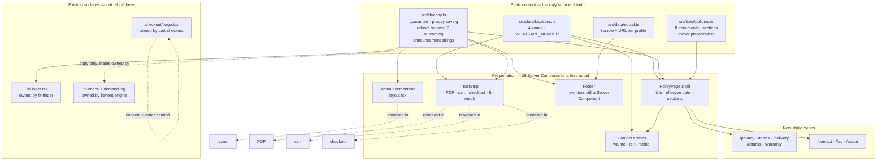
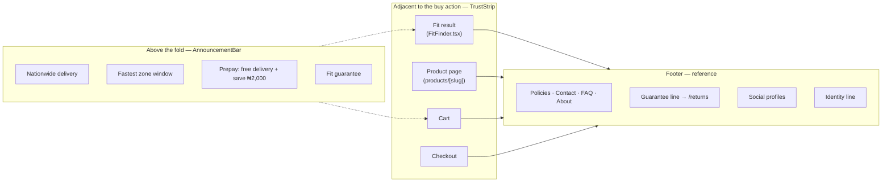

# Design Document — Trust & Policies

## Overview

This spec adds the trust layer LuxeRide does not currently have: a set of eight static policy and
contact routes, a shared copy register, an announcement bar, a rewritten footer, a trust strip that
sits next to the buy action, and a media pipeline that turns the raw footage the business already
owns into publishable, honestly-labelled proof.

Four decisions shape everything below.

**Decision A — Static Server Components, zero database.** Every route added here is a static page
generated at build time from a TypeScript content module. There is no `prisma` import, no route
handler, no fetch. This follows `_CONTEXT.md` §11b and hard rule 7: the database does not exist, so a
spec that assumes it produces a spec that cannot ship. The cost is that policy content becomes a code
change; the benefit is that the whole trust layer is deliverable this week, which is the actual
constraint.

**Decision B — One source per fact.** The guarantee line exists in three files today with identical
text and no shared source; the zone fees exist in one file and a promise about them exists in a second
(`cart/page.tsx:73`); the phone number exists in one module. The design makes every trust fact
single-sourced: copy in `src/lib/copy.ts`, policy content in `src/data/policies.ts`, identity and
socials in `src/data/social.ts` + `src/data/locations.ts`, zones in `src/data/locations.ts`. A trust
surface that can disagree with another trust surface is a liability, because the customer will find
both.

**Decision C — Honesty is enforced by build failure, not by good intentions.** Requirement 1's
prohibition on fabricated proof is only worth something if violating it breaks something. The
placeholder scan (`scripts/check-placeholders.mjs`) fails the build on an unresolved legal placeholder;
the single-source rule means a fabricated count cannot be added without editing a data file where it
would sit next to the real numbers.

**Decision D — Adjacency, not a trust section.** The classic CRO answer is a testimonial strip with
stars near the CTA. This design refuses that (Requirement 1 bans the stars; there is no review to
count) and places instead the four facts a phone-first buyer who has been scammed actually asks: will
it arrive, when, what does it cost, what happens if it doesn't fit.

---

## Current State (verified)

All of the following was read in this session, in the files named.

### What exists

| Fact | Evidence |
|---|---|
| The footer is **two `<p>` lines with zero links** | `src/components/Footer.tsx:1-10` — the whole component is 10 lines, no `next/link` import |
| The guarantee line is hardcoded in **three** files, byte-identical | `Footer.tsx:6`, `src/components/FitFinder.tsx:280`, `src/app/products/[slug]/page.tsx:44` |
| The only `wa.me` call site in the entire app is one helper | `src/lib/whatsapp.ts:38-40` |
| There is **no** social link, `tel:` link, email address or external URL anywhere under `src/` | grep for `instagram\|facebook\|twitter\|tiktok\|wa\.me\|tel:\|linkedin\|x\.com` across `src/` → exactly one hit, `whatsapp.ts:39` |
| Checkout collects name, phone, home address with **no consent control and no link to any policy** | `src/app/checkout/page.tsx:90-123`; the file imports no `next/link` at all |
| Checkout is the only place a delivery zone is chosen, after the cart has already promised a fee | `checkout/page.tsx:126-138` vs `cart/page.tsx:73` |
| Pay-on-delivery vs prepay maths, in one place | `checkout/page.tsx:26-28` — `shippingFee = payment === "prepay" ? 0 : zone.fee`; `discount = payment === "prepay" ? 2000 : 0` |
| The four delivery zones, with real fees and ETAs | `src/data/locations.ts:7-12` |
| The WhatsApp number | `src/data/locations.ts:14` — `WHATSAPP_NUMBER = "2347049621694"` |
| Business name as the business already states it | `Footer.tsx:5` and `src/lib/whatsapp.ts:19` — both say "LuxeRide Nigeria" |
| The header hides its nav on mobile with no hamburger | `Header.tsx:28` — `hidden items-center gap-7 text-sm text-white/80 sm:flex` |
| The header is `sticky top-0 z-20` | `Header.tsx:23` |
| The footer is a Server Component today (no `"use client"`) | `Footer.tsx:1` — the directive is absent |
| Only one global metadata export; no per-page metadata | `src/app/layout.tsx:23-26`; no `generateMetadata` anywhere under `src/app` |
| `<Header />` and `<Footer />` wrap `<main>` in one layout | `src/app/layout.tsx:35-37` |
| Raw evidence exists and is unused | `Luxeride/footage/` — 3 JPG (3.1–3.6 MB, 4000×3000) + 8 MP4 (74–208 MB, 1920×1080, 34–97 s); `Luxeride/ad-voiceovers/` — 2 `.aup3` projects |
| `public/products/` holds only 6 watermarked SVG placeholders | `ls public/products/` → 6 files; the other 15 referenced paths do not exist |

### What does not exist

Per `_CONTEXT.md` §11, verified against the route tree (`find src/app -type f` returns exactly 9
files: 6 pages, `layout.tsx`, `globals.css`, `favicon.ico`):

`/privacy` · `/terms` · `/delivery` · `/returns` · `/warranty` · `/contact` · `/faq` · `/about` ·
`sitemap.ts` · `robots.ts` · `not-found.tsx` · `error.tsx` · `loading.tsx` · per-page `metadata` or
`generateMetadata` · `openGraph` / `twitter` / `og:image` · JSON-LD · breadcrumbs · any consent
control · any announcement bar · any social link · any `tel:` or email affordance · any persistent
WhatsApp/call affordance · any reviews, testimonials, ratings or customer photos · any FAQ · any
contact or about page · a media directory (`public/` contains only the Next.js scaffold SVGs and
`public/products/`).

### Two things the design must not break

1. **`cart-checkout` Requirement 10.4** — "WHILE the linked privacy or terms page does not exist THEN
   THE SYSTEM SHALL NOT render a link to it." The consent checkbox cannot ship pointing at `/privacy`
   until this spec delivers `/privacy`. This spec is upstream of that task, not parallel to it.
2. **`fit-finder` Requirement 1** — the current results sub-line at `FitFinder.tsx:247` claims
   "100% precision-molded … in stock" for combinations the fitment engine has no data for. This spec
   must not copy that string into `copy.ts` where it becomes load-bearing everywhere
   (`fit-finder` R1, 1.7).

---

## Architecture



### Route inventory

| Route | File | Type | Rendered | Why this type |
|---|---|---|---|---|
| `/privacy` | `src/app/privacy/page.tsx` | Server Component, **static** | `PolicyPage` | Pure content. Statically generated; zero JS shipped; crawlable by ad-platform review bots that do not execute JS. |
| `/terms` | `src/app/terms/page.tsx` | Server Component, static | `PolicyPage` | as above |
| `/delivery` | `src/app/delivery/page.tsx` | Server Component, static | `PolicyPage` + live `LOCATIONS` table | as above |
| `/returns` | `src/app/returns/page.tsx` | Server Component, static | `PolicyPage` + guarantee claim route | as above |
| `/warranty` | `src/app/warranty/page.tsx` | Server Component, static | `PolicyPage` | as above |
| `/contact` | `src/app/contact/page.tsx` | Server Component, static | bespoke | The page is mostly links (`wa.me`, `tel:`, `mailto:`); the only interactive part is an optional free-text box that builds the prefilled message, which can be a small Client Component island (`src/components/ContactForm.tsx`) inside a Server Component page. |
| `/faq` | `src/app/faq/page.tsx` | Server Component, static | bespoke | Uses native `<details>/<summary>` — disclosure with **no JavaScript at all** on a cheap phone. Deliberately not a client accordion. |
| `/about` | `src/app/about/page.tsx` | Server Component, static | `PolicyPage` layout, prose | P2. Narrow scope: who we are, how a fit is verified, service area. Not a marketing page. |

Every one is a file-based route under `src/app/...`, satisfying `_CONTEXT.md` hard rule 6. None is a
Route Handler, none is a Server Action, and none touches the network at request time.

### Placement map



---

## Components and Interfaces

### `src/lib/copy.ts` (new) — the single copy register

One module, exported as typed frozen objects. Everything else in this spec and several existing
surfaces read from it.

```ts
export interface RefusalCopy {
  headline: string;
  body: (what: string) => string;
  /** A promise of future stock is only renderable together with its capture. */
  promise: string | null;
  capture: { label: string; placeholder: string; required: boolean } | null;
  whatsappAction: (what: string, phone?: string) => { label: string; href: string };
}

export const copy = {
  guarantee: "🛡️ 100% Perfect Fit Guarantee — doesn't fit? We swap it free.",
  guaranteeShort: "🛡️ Perfect Fit Guarantee — free swap if it doesn't fit.",
  prepay: { saving: 2000, line: "Prepay by transfer — free delivery, save ₦2,000" },
  announcement: { /* the four bar lines, each traceable to LOCATIONS or prepay */ },
  delivery: { range: (zones) => `${fmtNaira(min)}–${fmtNaira(max)} depending on your zone` },
  refusals: {
    FITTED:     { /* "We Found Your Fit!" + "Confirmed by our configurator, verified on WhatsApp before dispatch" */ },
    NOT_STOCKED:{ /* "Not in stock — yet" + promise + waitlist capture */ },
    UNKNOWN:    { /* "Let's check that together" + route to a human, no stock promise */ },
  },
} as const;
```

**Boundary with `fit-finder`:** this module supplies the *words and the promise/capture pairing*. It
does not own the screens, the step machine, the demand-log write or the search. `fit-finder` swaps
its literals for imports from `copy`; it keeps deciding when each outcome renders.

**Boundary with `fitment-engine`:** when `/fit-check` lands, the same `refusals` object is the only
copy source for its three states. The demand-log write stays entirely with those specs — this spec
adds no capture path of its own.

### `src/data/policies.ts` (new) — policy content as data, not JSX

```ts
export interface PolicySection {
  id: string;            // stable anchor, used for in-page links
  heading: string;
  /** Unresolved legal input is written as a literal token and fails the build scan. */
  body: string[];
  ownerInputRequired?: boolean;
}

export interface PolicyDoc {
  slug: string;              // "privacy" | "terms" | "delivery" | "returns" | "warranty"
  title: string;
  summary: string;           // one line, used for metadata description and the footer tooltip
  effectiveDate: string;     // ISO date, single value in this module
  sections: PolicySection[];
  related: PolicySlug[];     // cross-links, per 2.7
}
```

The skeleton of each section list (headings and the *category* of disclosure required) is specified
in Requirement 3/4/5/6. The words are the owner's, written as owner placeholders where unknown.
**This spec authors no legal text.**

### `src/components/PolicyPage.tsx` (new) — the shared shell

Takes a `PolicyDoc`, renders an `<h1>`, the summary, an "Effective from / Last updated" line, each
section as `<h2>` + paragraphs with an `id`, and a related-documents row. Pure Server Component,
props in / JSX out, no client hooks. Keeps heading order, spacing and the date line identical across
eight pages, which is what makes the footer link grid look like one site rather than eight.

### `src/components/AnnouncementBar.tsx` (new)

Server Component, no state, no rotation, no autoplay. Renders at most three items in a row on
`sm:` and stacks on mobile. Strings come from `copy.announcement`; the delivery window is computed
from the **fastest** entry in `LOCATIONS` (`eta` "24–48 hours" for Lagos) rather than retyped.

*Trade-off taken:* a rotating bar would need a client component and would animate text over a
trust claim. A static bar can be misread as decoration, which is the lesser risk.

*Placement trade-off:* rendered in `layout.tsx` **above** `<Header />` and **not** sticky. `Header`
is `sticky top-0 z-20`; making the bar sticky too means either the bar hides under the header or the
header's `top-0` needs a variable offset — a bug class with no upside. The bar scrolls away; the
header sticks as it does today.

### `src/components/TrustStrip.tsx` (new)

Server Component. Four rows, each traceable to a source:

| Row | Source |
|---|---|
| Guarantee line + link to `/returns` | `copy.guarantee` |
| Delivery fee range + link to `/delivery` | `LOCATIONS` min/max via `fmtNaira` |
| Prepay saving | `copy.prepay` (2000, matching `checkout/page.tsx:27`) |
| Contact fallback (optional variant) | `WHATSAPP_NUMBER` + `tel:` |

Rendered on the fit result, the PDP, the cart and the checkout. On the checkout it sits **directly
above** the submit button and adds the "what happens next" line (11.4). The component takes a
`variant` prop (`"cta"` for beside the buy button, `"summary"` for the checkout block) — not a prop
per surface, so a new surface cannot invent its own variant of the truth.

### `src/components/SocialLinks.tsx` (new)

Server Component. Maps `SOCIAL_PROFILES`, filtering out any entry whose `url` is falsy before render.
`target="_blank" rel="noreferrer"` on every external link, matching `FitFinder.tsx:311`.

### `src/data/social.ts` (new)

```ts
export interface SocialProfile { platform: "instagram" | "tiktok" | "youtube" | "facebook"; handle: string; url: string | null; }
```

`url: null` → the profile is declared but not rendered. This is the mechanism that stops a launch with
a dead "Instagram" link: the platform and handle are honest placeholders, the link is simply absent
until the owner supplies it.

### `scripts/check-placeholders.mjs` (new)

Walks `src/data/policies.ts` and `src/data/social.ts` for the literal
`[[OWNER INPUT REQUIRED:` token and for `url: null` on any profile marked `launchCritical`. Exits
non-zero with a file-and-line list. Wired to `npm run check:placeholders` in `package.json`. This is
how 2.5 becomes a build failure instead of a hope.

---

## Data Models

No new persisted models — the database does not exist (`_CONTEXT.md` §6) and this spec does not need
it. Three static shapes only, all shown above: `PolicyDoc`, `SocialProfile`, and the `copy` register.

**Interim P0 behaviour without persistence (hard rule 7):**

| Need | P0 (this spec) | Later owner |
|---|---|---|
| Data-subject requests | WhatsApp / email to the owner | `commerce-backend` order records |
| Reviews | Owner asks in the WhatsApp loop, saves what he gets | `commerce-backend` — a `Review` table is a natural extension but is **not** specified here |
| Confirmed-layout count | Not rendered at all | `fitment-engine` R15 (Confirmed-only) |
| Contact form | Builds a prefilled WhatsApp message / `mailto:` | `commerce-backend` route handler, if ever needed |
| Policy content | A TypeScript module, edited by the owner | Same, until a CMS is justified by volume |

**Assets.** Raw media stays where it is. `scripts/process-media.sh` (P0, host `ffmpeg` required)
emits into `public/media/`: auto-rotated JPEGs at web dimensions (Requirement 9.3) and H.264 MP4
previews with poster JPEGs (9.4). Originals are never copied into `public/`. The EXIF orientation on
the three photos is upper-right, so auto-orientation is mandatory, not cosmetic.

---

## Error Handling

Refusals and absences are the product here, so the failure paths are specified like features.

| Situation | Behaviour |
|---|---|
| A policy page has an unresolved placeholder | The placeholder scan fails the build. A deployed page with a visible `[[OWNER INPUT REQUIRED]]` is a failed deployment. |
| A social profile has `url: null` | The entry is skipped. No `#`, no empty `href`, no icon-only dead link. |
| A phone number is missing or malformed | `whatsappLink()` is the only builder and it interpolates `WHATSAPP_NUMBER`; the contact page renders the number as text so it is never an unparseable href. |
| `LOCATIONS` is empty | The delivery table and the announcement window render an explicit "delivery zones are being finalised — message us" state rather than an empty `<table>`. |
| The WhatsApp hand-off fails (no app, blocked popup, desktop) | The checkout shows the existing prefilled message in the `<pre>` (`checkout/page.tsx:173-176`) **plus** the `tel:` and email fallbacks (11.5). The order is still placed in `localStorage` and the customer is still routed to `/order/confirmation`. |
| A product image fails to load | `SafeImage` already renders `null` (`_CONTEXT.md` §4). The trust strip is **not** an image — it is text from `copy`/`LOCATIONS` — so a broken asset cannot take the guarantee down. |
| A media file is missing after processing | The gallery renders the poster; if that fails, `SafeImage` returns `null`. Proof surfaces degrade to absent, never to a broken frame. |
| JS is disabled | Every policy link, the footer grid, the announcement bar and the FAQ (`<details>`) still work. The only JS on these pages is the contact form island. |

---

## Testing Strategy

There is no test runner, no CI and no git in this repo (`_CONTEXT.md` §1). This spec therefore
specifies **checks that can be run by hand today** plus the build gate, and does not invent a test
framework.

| # | Check | How |
|---|---|---|
| 1 | No fabricated proof | grep `src/` for review/star/`trusted by`/`customers` patterns; every hit must resolve to real data. Run manually before every ad spend. |
| 2 | No orphaned legal link | Every `href` under `/privacy`, `/terms`, `/delivery`, `/returns`, `/warranty`, `/contact`, `/faq`, `/about` returns 200 in `next dev`. |
| 3 | Placeholder gate | `npm run check:placeholders` exits non-zero on any unresolved token. |
| 4 | Single source | The guarantee string appears exactly once in `src/lib/copy.ts` and zero times in any component. |
| 5 | Zone fidelity | `/delivery` renders four rows whose fees and ETAs match `src/data/locations.ts` character for character; changing a fee in the data file changes the page with no second edit. |
| 6 | Build | `npm run build` exits zero and generates all eight new routes as static (`○`) in the build output. |
| 7 | JS-off resilience | Load `/faq` and the footer with JavaScript disabled; every link still navigates. |
| 8 | Mobile footer | At 320 px width the footer stacks, does not scroll horizontally, and all links are reachable without a menu. |
| 9 | Media integrity | Each published photo loads upright and under 300 KB; each clip is under ~5 MB and does not autoplay with sound. |
| 10 | Honesty spot-check | Every number rendered anywhere on the site can be traced to `LOCATIONS`, `PRODUCTS`, `copy` or a real record. If it cannot, it does not ship. |

---

## Open Questions

These need the owner, a lawyer, or a decision this spec is not allowed to make. None blocks the P0
trust floor except **Q1** and **Q2**, which block `/returns` from shipping.

**Legal**

1. **Is the site price binding, or is the WhatsApp quote binding?** LOCKED DECISION 3 says price on
   the site; the fitment-engine doc says "a site price that the quote overrides is worse than no
   price." These are only compatible if the site price is authoritative for the configuration shown.
   `/terms` must state which number wins when the rider quotes differently. Owner/legal decision.
2. **What does "swap it free" actually mean operationally?** A deadline, a return-shipping payer, one
   swap per order, the products it covers, and what "swap" is (replacement / different variant /
   partial refund). The badge says 100% and free; the page must be able to honour that, or the badge
   must be reworded. Until this is answered, `/returns` cannot ship — and Requirement 6.4 says the
   page must then show an owner-facing warning rather than a promise.
3. **Is "100% Perfect Fit Guarantee" an absolute claim that is legally risky in its own right?** An
   unqualified 100% is a strong commercial guarantee. Owner/legal decision; the same wording is
   currently on three surfaces and in the validated prototype.
4. **NDPR consent at checkout:** is a ticked box sufficient written consent for processing name,
   phone and home address, or is a separate signature/record required? And is NDPC data-controller
   registration needed at this volume? Owner/legal.
5. **Business identity:** the registered company name and any CAC registration number. The site
   currently says only "LuxeRide Nigeria", a brand name. Nothing may be invented — the number is a
   placeholder until supplied.
6. **Warranty duration and exclusions**, and whether the warranty and the Fit Guarantee can be
   presented on separate pages at all without one undercutting the other.
7. **Refund method and timescale for prepaid orders.** There is no payment processor; every refund is
   a manual bank transfer by the owner. The timescale is an owner commitment.
8. **Governing law / jurisdiction and any regulator**, for `/privacy` and `/terms`.

**Operational commitments (the site must not publish a number the owner will not honour)**

9. **WhatsApp response hours and expected response time** for `/contact`.
10. **What happens when delivery is attempted and fails, or the customer is unavailable** — re-attempt
    fee, who absorbs it, and the cancellation window for an order that has been confirmed on WhatsApp
    but not dispatched.
11. **Whether prepay concessions are unconditional.** The app grants both (delivery waived *and*
    ₦2,000 off). Does a returned prepaid order forfeit the ₦2,000? This must be stated in `/terms`.

**Scope**

12. **Do we want an `/about` page at all?** Specified here at P2 with a deliberately narrow scope
    (who we are, how a fit is verified, service area). It can be dropped with no effect on anything
    else.
13. **Media processing toolchain.** `ffmpeg` on the host is assumed. If it is unavailable the
    photography still ships; the video does not. Confirm the host has it, or accept photos-only.
14. **The placeholders in `footage/` have not been viewed.** Requirement 9.5 forbids captioning a
    frame as an installed fit unless it shows one. The owner must confirm what each of the 11 files
    actually shows before publication — this spec does not assert what they contain.
