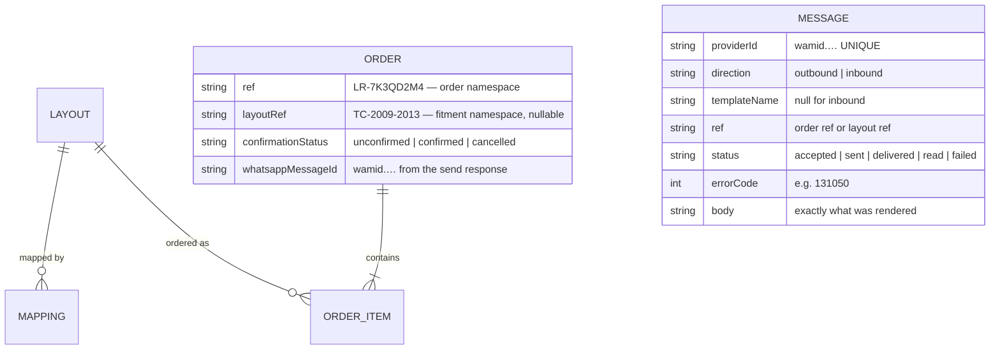

# Design Document — `whatsapp-engine`

## Overview

Replace `window.open("https://wa.me/…")` with a server-side loop: the server creates the order, the
server sends an approved template with Confirm / Cancel buttons, Meta posts the button press to a
webhook, and the server changes the order's state. A scheduled sweep follows up on orders nobody
answered after 12 hours.

Five decisions carry the design, and three of them correct something that would otherwise have been
built from a plausible-sounding assumption.

**Decision 1 — Target Graph API v25.0/v26.0, not the v21.0 that older examples use.** Meta's version
table has v21.0 expiring **21 January 2027**. A new integration has no reason to start on an endpoint
it must migrate off within a year. v26.0 is current.
([Graph API changelog](https://developers.facebook.com/docs/graph-api/changelog),
[versioning](https://developers.facebook.com/docs/graph-api/guides/versioning))

**Decision 2 — A template quick-reply does NOT come back as `type: "interactive"`.** It comes back as
`type: "button"` with `button.payload` and `button.text`. The `interactive.button_reply.id` shape
belongs to *interactive reply buttons*, which are service messages and require an open
24-hour customer-service window — a condition LuxeRide cannot guarantee for a first-touch order.
Building a webhook that only matches `interactive` would silently drop every Confirm press.
([Button messages webhook](https://developers.facebook.com/documentation/business-messaging/whatsapp/webhooks/reference/messages/button/)
· [Interactive messages webhook](https://developers.facebook.com/documentation/business-messaging/whatsapp/webhooks/reference/messages/interactive/))

**Decision 3 — The ref rides in the button payload supplied at send time, and the sender's number is
the real identity check.** Template creation exposes only `{ type, text }` for a quick reply — no
payload field, and the label is capped at **25 alphanumeric characters**. The payload is supplied in
the *send* request as a button component, per Meta's own Node SDK
(`{ type: 'button', sub_type: 'quick_reply', index, parameters: [{ type: 'payload', payload }] }`),
and the webhook returns `button.payload`. So the template carries static labels; the ref is attached
per send. **Even if that payload fails to arrive, the system still works**: the webhook's
`messages[].from` is the customer's number, and the order is found by number. The payload is a
shortcut, not the identity.

**Decision 4 — Identify orders by sender number first, and require the number to match before
changing state.** Meta warns that *"a WhatsApp user's ID and phone number may not always match"*, so
the stored order phone is compared against the webhook sender with the same normalisation used
everywhere else. A payload that names someone else's order is rejected, because the number check
fails. This is what makes a 25-character label limitation survivable.

**Decision 5 — The fallback never goes away.** `whatsappLink()` in `src/lib/whatsapp.ts:38-40` stays
in production code. Meta's own guidance is that approval *"can take up to 24 hours"* with no SLA, and
a business taking orders cannot pause for a review queue. Every send path has a documented fallback
to the link the customer taps themselves.

**A correction worth stating explicitly:** the common belief that marketing templates cannot be sent
outside the 24-hour window is backwards. Meta's rule is that **only non-template (service) messages
are window-restricted**; all template categories may be sent outside a window, which is the entire
point of template messaging. The window matters here for the opposite reason — a **utility** template
is **free** while a window is open and never free otherwise, so the category choice is a pricing
decision, not a delivery one.
([Service messages](https://developers.facebook.com/documentation/business-messaging/whatsapp/messages/send-messages/) ·
[Pricing](https://developers.facebook.com/documentation/business-messaging/whatsapp/pricing/))

---

## Current State (verified)

### Exists today

| What | Where | Verified detail |
|---|---|---|
| A link builder | `luxeride-web/src/lib/whatsapp.ts:38-40` | `` return `https://wa.me/${WHATSAPP_NUMBER}?text=${encodeURIComponent(message)}`; `` |
| The number | `luxeride-web/src/data/locations.ts:14` | `export const WHATSAPP_NUMBER = "2347049621694"` |
| An order message builder | `luxeride-web/src/lib/whatsapp.ts:18-36` | itemised emoji lines, a `paymentLine` that reads *"Prepay by Transfer — ₦x (free shipping, save ₦2,000)"* or *"Pay on Delivery — ₦x (incl. ₦y delivery)"* |
| Two refusal builders | `luxeride-web/src/lib/whatsapp.ts:42-51` | `comingSoonMessage(what, phone?)`, `notFoundMessage(query)` |
| A preview of the message in the UI | `luxeride-web/src/app/checkout/page.tsx:30-37, 173-176` | live `buildOrderMessage(..., true)` inside a `<pre>` |
| One call site | `luxeride-web/src/app/checkout/page.tsx:78` | `window.open(whatsappLink(message), "_blank")` |
| Phone validation | `luxeride-web/src/lib/validation.ts` | `validateNGPhone` — 11-digit `0`-prefixed 70/80/81/90/91, or 13-digit `234…` |

### Does not exist — verified absent

| Absent | Evidence |
|---|---|
| Any Cloud API send | `src/lib/whatsapp.ts` returns `wa.me` URLs only; nothing imports a Meta SDK; `package.json` has no HTTP client. |
| Any template | No template body exists anywhere. The builders emit free text, which is not a template. |
| Any webhook route | `_CONTEXT.md` §6 — no `route.ts` files anywhere in `src/`. No `/api/whatsapp/webhook`. |
| Any order record on a server | `src/store/order.ts` persists to `localStorage` under `luxeride-last-order`. `prisma/schema.prisma` has never been migrated. |
| A ref code in the message | `buildOrderMessage` takes `OrderMessageInput` with no ref field. The id at `src/app/checkout/page.tsx:62` is never passed to it. |
| A cron / scheduled job | No `vercel.json`, no scheduler config, no scheduled route (`_CONTEXT.md` §1, §11). |
| Delivery or read receipts | Nothing consumes Meta status webhooks. |
| A message log | No table, no file, no store. Nothing in the repository records that a message was sent. |
| Opt-in or a consent checkbox | `_CONTEXT.md` §11 and `00-RELEASE-READINESS-AUDIT.md` §5 — the checkout collects a phone with no disclosure. |
| Rate limiting or retries | None. |
| An operator surface | No admin console exists at all (`_CONTEXT.md` §11). |
| Meta credentials | `.env` contains only the placeholder `DATABASE_URL`. No token, no phone-number id, no app secret. |

### The fitment ref contract this spec must honour

`luxeride-web/luxeride-fitment-engine-admin-layout-grouping-spec.md` line 50: *"**Internal code** —
`TC-2009-2013` — for admin, SKUs and refs. **Customer-facing name** — 'Toyota Corolla 2009–2013' —
for the site and WhatsApp. The customer never sees the code; the WhatsApp ref uses it."*

Line 102 gives the exact shape: *"The prefilled WhatsApp message carries the reference — 'Hi, I drive a
2012 Toyota Corolla. Is the black TPE set available? **(ref TC-2009-2013)**'. That ref is what makes
both the conversation and the attribution cheap."*

Line 50 also fixes the word **prefilled**: the fitment path is a `wa.me` link with a composed body.
**That path does not need the Cloud API and should not be rewritten to need it.** The Cloud API earns
its place on the *order* path, where the customer may never have messaged LuxeRide before and where
nothing at all happens today unless they press send.

---

## Architecture

### The verification loop, end to end

```mermaid
sequenceDiagram
    autonumber
    participant C as Customer
    participant W as Checkout page
    participant S as Order server<br/>(commerce-backend)
    participant L as layout/ref lookup<br/>(fitment-engine)
    participant T as whatsapp-engine<br/>(send)
    participant M as Meta Cloud API
    participant H as /api/whatsapp/webhook
    participant D as Message log
    participant Q as Operator queue

    Note over C,M: ---- placement ----
    C->>W: completes /checkout, taps "Place order"
    W->>S: createOrder(name, phone, address, zone, items, ref)
    S->>L: resolve layout ref for each cart line (TC-2009-2013)
    L-->>S: ref per line, or NOT STOCKED / UNKNOWN
    S->>D: record Order created (actor: checkout)

    alt no Cloud API credentials OR template not APPROVED
        S->>T: fallback
        T-->>W: existing wa.me link → customer presses send themselves
        Note right of T: This is today's behaviour. It must keep working.
    else credentials present and template APPROVED
        S->>T: sendConfirmation(orderRef, phone, items, total, zoneEta)
        T->>T: assert phone against validateNGPhone(); normalise to E.164
        T->>M: POST /v26.0/{PHONE_NUMBER_ID}/messages<br/>{messaging_product, to, type:"template",<br/> template:{name, language}, components:[<br/>  body params: ref, items, total, eta,<br/>  button index 0 → payload "LR-…-CFM",<br/>  button index 1 → payload "LR-…-CNL"],<br/> biz_opaque_callback_data: orderRef}
        M-->>T: {messages[0].id = wamid.…, message_status: "accepted"}
        T->>D: record message sent (wamid, template, ref, recipient)
        T-->>S: queued = true
        Note over M: customer taps a button in WhatsApp
    end

    Note over M,H: ---- verification ----
    M->>H: POST /api/whatsapp/webhook<br/>X-Hub-Signature-256: sha256=…
    H->>H: raw = await request.text();<br/>HMAC-SHA256(raw, APP_SECRET) vs header — timing-safe
    alt signature invalid or absent
        H-->>M: 401 — payload never parsed
    else valid
        H->>H: JSON.parse(raw)
        H->>D: insert WebhookEvent(providerMessageId) — UNIQUE = dedup key
        alt already seen
            H-->>M: 200 — processed exactly once
        else first delivery
            Note right of H: A template quick-reply arrives as<br/>type:"button", button:{payload, text}<br/>NOT type:"interactive"
            H->>H: intent = payload?.endsWith("-CFM") ? confirm : cancel<br/>sender = messages[0].from
            H->>S: find open order where phone matches sender
            alt no order for that number
                H->>D: record unmatched press
                H-->>M: 200 (after ack)
                H->>T: reply with generic help
            else found
                H->>H: confirm sender matches order.phone —<br/>a payload alone changes nothing
                alt sender mismatch
                    H->>D: record mismatch for the owner
                else match
                    alt intent = confirm AND confirmationStatus = unconfirmed
                        H->>S: confirmationStatus = confirmed (actor: whatsapp.button)
                        H->>D: record state change
                        H-->>M: 200
                        H->>T: reply "Order confirmed"
                    else intent = cancel AND unconfirmed
                        H->>S: confirmationStatus = cancelled
                        H-->>M: 200
                        H->>T: reply "Order cancelled"
                    else already cancelled / already confirmed
                        H-->>M: 200
                        H->>T: reply explaining, offer to re-order
                    end
                end
            end
        end
    end

    M->>H: statuses[] (sent / delivered / read / failed / played)
    H->>D: record delivery + read against the stored wamid
    alt status = failed
        H->>Q: raise the order
    end
    H-->>M: 200

    Note over D,Q: ---- 12 hours ----
    Q->>T: idempotent sweep: unconfirmed AND now - createdAt > 12h AND followUpSentAt IS NULL
    T->>T: render follow-up template with the same two buttons
    T->>M: send
    T->>D: record followUpSentAt
    Note over Q: No auto-cancel. A customer who was asleep<br/>is chased, not deleted.
```

### Route and component map

| Component | File | Kind | Why this kind |
|---|---|---|---|
| Cloud API client | `src/lib/whatsapp-cloud.ts` | Plain TS, `import "server-only"` | Holds the app secret, the token and the Graph version. The Next guides use `import 'server-only'` exactly to keep server-only modules out of the client bundle (`node_modules/next/dist/docs/01-app/02-guides/authentication-with-cache-components.md`). |
| Message rendering | `src/lib/whatsapp-templates.ts` | Plain TS, `import "server-only"` | One place that knows the parameter order of each template. A mismatch between template and parameters fails silently in the WhatsApp client, so it must be one file. |
| Ref helpers | `src/lib/refs.ts` | Plain TS, isomorphic | `orderRef()` for `LR-…`, `layoutRef()` for `TC-…`. Also used by `fitment-engine` and `cart-checkout`. |
| Link fallback | `src/lib/whatsapp.ts` | Plain TS, existing | **Extended, not replaced.** `buildOrderMessage` gains an optional `ref` parameter so the `wa.me` body also carries the ref (Requirement 3.1). |
| Webhook | `src/app/api/whatsapp/webhook/route.ts` | **Route Handler**, `GET` + `POST` | An inbound server-to-server call. Next.js documents exactly this in the *Webhooks* section of `node_modules/next/dist/docs/01-app/03-api-reference/03-file-conventions/route.md`, which reads the body with `await request.text()` — the raw bytes, which signature verification requires. Route handlers are not cached by default. |
| Follow-up sweep | `src/app/api/cron/whatsapp-follow-up/route.ts` | **Route Handler** `GET`, bearer-guarded | Idempotent, safe at any cadence. The schedule itself is the host's choice. |
| Operator queue | `src/app/admin/orders/page.tsx` | **Server Component** | Read-only triage list; rendered on the server so the message log never ships to the browser wholesale. Owned with the rest of the admin surface by `commerce-backend`. |
| Order creation | `commerce-backend` / `cart-checkout` | Server Action | Not this spec. This spec consumes the created order. |

### Templates

All four are `UTILITY`. Meta's categorisation guide gives an explicit **Order Management** business
goal under Utility — *"Confirm, update, or cancel an order or transaction with a customer, using
specific order or transaction details in the body of your message. These messages should not promote,
recommend, upsell, or cross-sell products…"* — with an example almost identical to what LuxeRide
needs. The API also exposes a `sub_category` with `ORDER_DETAILS` and `ORDER_STATUS`, which fit here.

| # | Template | Category / sub-category | Body carries | Buttons |
|---|---|---|---|---|
| 1 | `luxeride_order_confirmation` | UTILITY / `ORDER_DETAILS` | customer name, order ref, item lines, total, delivery zone + ETA, payment line, "if you didn't order this, reply STOP" | Confirm order · Cancel order |
| 2 | `luxeride_not_stocked` | UTILITY | the car asked for, honest "we don't have it yet", waitlist offer, layout ref when one exists | Notify me when available |
| 3 | `luxeride_order_followup` | UTILITY / `ORDER_STATUS` | order ref, "still waiting", delivery estimate | Confirm order · Cancel order |
| 4 | `luxeride_demand_ack` | UTILITY | the model asked for, "logged", what happens next | — |

Published limits that constrain the copy: body **1024**, header **60**, footer **60**, reply-button
label **25 alphanumeric**. The button labels `"Confirm order"` (13) and `"Cancel order"` (12) fit.

**Cost.** Per-message pricing since 1 July 2025, charged on delivery. Utility templates sent while a
customer-service window is open are **free**; non-template messages are free but window-only. A first
-touch order from someone who has never messaged LuxeRide has **no open window**, so the confirmation
is billable at the utility rate. Sending the confirmation *after* the customer's first message would
make it free — which is a genuine reason to keep the link path as a fallback rather than an apology.

**Recategorisation risk.** Since 9 April 2025 `allow_category_change` is the default: a `UTILITY`
template judged promotional *"is approved as `MARKETING`"*, which changes the rate and cannot be free
inside a window. So the confirmation body must carry **no** urgency, no cross-sell, no offer. The
engine subscribes to `message_template_status_update` and `template_category_update` and alerts.

### Reference codes



Two namespaces, deliberately:

- **`TC-2009-2013` — layout ref.** Fixed by the fitment spec (line 50, line 102). Appears in the
  prefilled fitment enquiry message as `(ref TC-2009-2013)` and on the operator's queue row.
- **`LR-…` — order ref.** The family the codebase already uses at `src/app/checkout/page.tsx:62`.
  Composed only of characters that survive a URL query and a WhatsApp message.

Button payloads are suffixed per intent — `LR-7K3QD2M4-CFM` and `LR-7K3QD2M4-CNL` — so the webhook
can tell Confirm from Cancel from the payload alone. **The suffix is a convenience; the sender-number
match is the check.** If a payload arrives empty or malformed, the engine still resolves the order by
number and takes the intent from `button.text`.

---

## Data Models

`commerce-backend` owns the migration; this spec supplies the shape.

| Model | Purpose | Key constraints |
|---|---|---|
| `Order` | extended with `ref` (unique), `layoutRef`, `confirmationStatus`, `whatsappMessageId`, `followUpSentAt`, `consentShownAt` | `ref` unique — it is the customer-facing id |
| `WhatsappMessage` | one row per message in either direction | `providerId` **unique** — this is the inbound dedup key *and* the outbound correlation key |
| `WhatsappEvent` | raw inbound webhook envelope for dispute resolution | `providerEventId` **unique**; never deleted |
| `WhatsappTemplate` | name, category, sub-category, status, body text, last status change | `status` is Meta's ten-value enum, not a boolean |
| `OrderStatusEvent` | shared with `payments-paystack` | written for accepted **and** refused transitions |
| `DemandLog` | refusals and waitlist sign-ups | owned by `fitment-engine`; this spec only writes to it |

**Why `providerId` is the dedup key and not `button.id`.** Meta documents that a quick-reply returns
its *label* text — there is no per-press unique id on a template button. `messages[].id` (the `wamid`)
is unique per message and is the only stable per-press identifier. One caveat to design around: the
same `wamid` appears on both the inbound press and the subsequent `statuses[]`, so the dedup insert
must key on the event *type* as well as the id.

**Webhook shape, verified.** From Meta's own example: `object: "whatsapp_business_account"`,
`entry[].changes[].value` containing `messaging_product`, `metadata.{display_phone_number,
phone_number_id}`, `contacts[].{profile.name, wa_id}`, `messages[].{from, id, timestamp, type, …}` and
`changes[].field === "messages"`. `statuses[].{id, status, timestamp, recipient_id, errors[]}` sits
beside `messages[]`, **not** on it — there is no `messages[].message_status` in any webhook
reference; that field exists only in the *send response*, where it is a pacing status
(`accepted` / `held_for_quality_assessment` / `paused`).

Two delivery facts worth carrying into the code: the documented `statuses[].status` enum is **five**
values — `sent`, `delivered`, `read`, `failed`, `played` — and *"a status is considered read only if
it is delivered… in some cases the message is both delivered and read at the same time. In these
cases the `delivered` webhook is not sent."* So **never gate `read` behind `delivered`**. Ordering is
also not guaranteed.

**`biz_opaque_callback_data`** is set on the send request and echoed back on every status webhook —
a documented, 256-character correlation channel that costs nothing and removes the need to parse
`wamid` strings.

---

## Error Handling

| Failure | Signal | Response | Owner sees |
|---|---|---|---|
| Template not approved | send returns an error, or `status` is `PENDING` | fall back to `whatsappLink`; flag the order | order in queue, marked "sent manually" |
| Template rejected | `message_template_status_update` with `status: REJECTED` | record the reason; fall back | template health alert |
| Template recategorised to MARKETING | `template_category_update` | record; warn that the message is now billable everywhere | pricing alert |
| Signature invalid | no `X-Hub-Signature-256`, or digest mismatch | 401, nothing parsed, nothing changed | nothing, unless repeated — then a security alert |
| App secret absent | HMAC cannot be computed | refuse all POSTs | loud health failure, never silent acceptance |
| Press for an unknown number | `messages[].from` has no open order | record; reply with generic help | queue entry "unmatched press" |
| Press with a mismatched sender | payload names order A, sender is order B's customer | record the mismatch; change nothing | queue entry "mismatch" |
| Duplicate delivery | `providerEventId` already present | 200, no second effect | nothing |
| Press on a cancelled order | `confirmationStatus = cancelled` | refuse to resurrect; reply explaining | nothing |
| Number unreachable | send or status `failed` | stop retrying; mark `UNREACHABLE`; keep the ref | top of the queue |
| Recipient opted out / blocked | status `failed` with code `131050` | suppress further marketing-category sends | recorded |
| Free-form reply outside a window | customer wrote and the window has closed | only templates are permitted; do not attempt a free-form send | logged |
| `STOP` received | inbound text | suppress; record the opt-out with a timestamp | recorded |
| Duplicate Meta webhook for hours | documented retry up to 7 days on non-200 | 200 fast after storing | nothing |
| Throughput exceeded | error `130429` | back off, resume the queue in order | nothing unless sustained |

**Rate-limit reality, verified.** Cloud API supports **80 messages per second per registered business
number** by default, up to 1,000 by automatic upgrade; the limit is shared across inbound and outbound
and all message types, and exceeding it returns `130429`. A LuxeRide order loop sends to distinct
numbers at human scale, so 80 mps is not the binding constraint — **the messaging limit is**. New
portfolios start at **250 unique recipients outside a customer-service window per rolling 24 hours**,
then 2,000 → 10,000 → 100,000 → Unlimited. Note the familiar **1,000 tier no longer exists**, and the
`messaging_limit_tier` field is deprecated in favour of `whatsapp_business_manager_messaging_limit`.
250/day is above a launch-week order count and below an ad-driven one, so the engine should alert as
the business approaches it rather than discover it as a hard failure.

### Secrets

| Value | Scope | Note |
|---|---|---|
| `WHATSAPP_APP_SECRET` | server only | HMAC key for `X-Hub-Signature-256` |
| `WHATSAPP_VERIFY_TOKEN` | server only | value compared against `hub.verify_token` during the handshake |
| `WHATSAPP_ACCESS_TOKEN` | server only | system-user or business token, `Authorization: Bearer` |
| `WHATSAPP_PHONE_NUMBER_ID` | server only | the number the messages come from |
| `WHATSAPP_GRAPH_VERSION` | server only | `v26.0` |

None of these may carry the `NEXT_PUBLIC_` prefix: Next.js inlines `NEXT_PUBLIC_` variables into the
client bundle at build time (`node_modules/next/dist/docs/01-app/02-guides/environment-variables.md`,
*Bundling Environment Variables for the Browser*). The `server-only` guard turns a mistake into a
build failure instead of a leak. The existing `WHATSAPP_NUMBER` in `src/data/locations.ts:14` is a
public value and stays where it is — it is the `wa.me` fallback number.

---

## Testing Strategy

There is no test framework, no CI and no git repository (`_CONTEXT.md` §1). These are manual
rehearsals, and they must be run in order because each depends on the previous.

**Before any code:** submit all four templates and wait for `APPROVED`. Record the actual review time
— that number is the launch lead time, and it is the one thing the owner needs to plan around.

1. Handshake: configure the webhook URL in the App Dashboard; confirm the GET handshake returns 200
   with the challenge; then confirm a wrong `hub.verify_token` returns 4xx.
2. Signature: send one test webhook with a correct `X-Hub-Signature-256` (accepted) and one with a
   corrupted one (401). Prove the corrupted body is never parsed — put malformed JSON in it.
3. Place an order. Confirm exactly one message arrives, carries the ref, and shows two buttons.
4. Press Confirm. Confirm the order's confirmation state flips and one reply is sent.
5. Press Cancel on a second order. Confirm the state flips and no order is resurrected by a repeat
   press.
6. Replay the same webhook delivery. Confirm no second effect.
7. Press a button, then mutate the payload to name a different order. Confirm the sender-number check
   rejects it.
8. Wait out the 12-hour sweep with one order confirmed and one not. Confirm only the unanswered one
   receives a follow-up, and that running the sweep twice sends nothing extra.
9. Disable the Cloud API token. Confirm the order still completes through the `wa.me` fallback.
10. Message a number that does not exist. Confirm `UNREACHABLE` appears in the queue and the ref
    survives for a phone call.

---

## Open Questions

1. **Does the template quick-reply `payload` actually return on the webhook?** Meta's *button
   messages webhook* reference documents `button.payload`, and Meta's own Node SDK types
   `QuickReplyButtonParametersObject = { type: 'payload', payload: string }`, but
   `developers.facebook.com` documents only `sub_type: "url"` in a send-time button component and
   **no length limit for a template `payload`**. This is the one place where three sources do not
   quite line up. Requirement 3.6 is the answer: the sender-number fallback must work regardless, and
   step 7 of the test plan is what proves it.
2. **What is the real approval latency?** *"up to 24 hours"* is documented as an estimate with no SLA.
   Measure it, because the owner wants to run ads today and this is the longest pole in the spec.
3. **What are the actual per-market utility template rates?** The pricing model is fully documented
   (per-message since 1 July 2025; charged on delivery; utility free inside an open customer-service
   window) but the rate-card figures are only in CSV/PDF files linked from a client-rendered table.
   Every third-party figure found predates the July 2025 change and should not be used. Pull the card
   from the pricing page directly.
4. **Minimum Graph API version for `messages` webhooks.** No documented minimum exists. v24.0 is a
   *behavioural breakpoint* — `statuses[].conversation` is omitted from v24.0+ unless the message was
   sent inside a free-entry-point window, and the v23.0 field name was retired in February 2026 — so
   v24.0+ is implied but not stated. Because the design does not depend on `conversation`, this is low
   risk.
5. **Does the number need a WhatsApp Business Account, a display-name review, or both before it can
   send templates?** Nothing in the repository or the docs answers the lead time for the *number* as
   opposed to the templates, and both gates have to open before the first order message can go out.
6. **`wa_id` versus phone number.** Meta warns *"a WhatsApp user's ID and phone number may not always
   match."* Design normalises both to a comparable E.164 string and requires an exact match, but the
   edge case where they genuinely diverge is unhandled and will surface as a "mismatch" queue entry.
7. **Does the app secret rotate, and how is a rotation survived without dropping real presses?** A
   rotation invalidates every in-flight signature. There is no double-key window designed here.
8. **Is `FREE_SERVICE` a real category?** It appears in the machine-readable `WhatsAppBusinessHSMTag`
   enum but in no narrative documentation. Not used; not worth using for an order confirmation.
9. **Where does the operator queue live?** `commerce-backend` owns the admin console, but the fitment
   spec's locked decision is owner-only with no roles — so "who may load this page" is still open.
   Interim assumption: the same single-operator arrangement as the rest of the admin, with no
   permission matrix built.
10. **What is the honest interim while templates are pending?** This spec's answer is that
    `wa.me` remains the production path and the Cloud API is an accelerator, not a prerequisite. That
    is a deliberate trade of message quality for trading continuity — worth the owner's explicit
    agreement rather than an engineer's assumption.

### References

Verified against live Meta documentation during this session. Meta has migrated the WhatsApp docs to
`developers.facebook.com/documentation/business-messaging/whatsapp/…`; the older
`/docs/whatsapp/cloud-api/…` paths still redirect but some now 404, so links below use the new
canonical URLs.

- [Send messages / service messages and the customer-service window](https://developers.facebook.com/documentation/business-messaging/whatsapp/messages/send-messages/)
- [Message API reference](https://developers.facebook.com/documentation/business-messaging/whatsapp/reference/whatsapp-business-phone-number/message-api/)
- [Create a webhook endpoint — handshake, `X-Hub-Signature-256`, retries](https://developers.facebook.com/documentation/business-messaging/whatsapp/webhooks/create-webhook-endpoint/)
- [Webhooks overview — payload shape, 3 MB limit, batching, mTLS](https://developers.facebook.com/documentation/business-messaging/whatsapp/webhooks/overview/)
- [Button messages webhook — `type: "button"`, `button.payload`](https://developers.facebook.com/documentation/business-messaging/whatsapp/webhooks/reference/messages/button/)
- [Interactive messages webhook — `interactive.button_reply.id`](https://developers.facebook.com/documentation/business-messaging/whatsapp/webhooks/reference/messages/interactive/)
- [Status messages webhook — `statuses[]`, five status values](https://developers.facebook.com/documentation/business-messaging/whatsapp/webhooks/reference/messages/status/)
- [Template fundamentals](https://developers.facebook.com/documentation/business-messaging/whatsapp/templates/overview/)
- [Template components — body 1024, labels 25, button `index`](https://developers.facebook.com/documentation/business-messaging/whatsapp/templates/components/)
- [Template categorization — the Order Management utility goal](https://developers.facebook.com/documentation/business-messaging/whatsapp/templates/template-categorization/)
- [Template review — "up to 24 hours", `allow_category_change`](https://developers.facebook.com/documentation/business-messaging/whatsapp/templates/template-review/)
- [Utility templates — creation payload and response](https://developers.facebook.com/documentation/business-messaging/whatsapp/templates/utility-templates/utility-templates/)
- [Message Template API — `sub_category`, status enum, category enum](https://developers.facebook.com/documentation/business-messaging/whatsapp/reference/whatsapp-business-account/message-template-api/)
- [Messaging limits — 250 → 2,000 → 10,000 → 100,000 → Unlimited](https://developers.facebook.com/documentation/business-messaging/whatsapp/messaging-limits/)
- [Throughput — 80 mps default, error 130429](https://developers.facebook.com/documentation/business-messaging/whatsapp/throughput/)
- [Pricing — per-message since 1 July 2025](https://developers.facebook.com/documentation/business-messaging/whatsapp/pricing/)
- [Graph API webhooks — handshake params, signature, 36-hour retry](https://developers.facebook.com/docs/graph-api/webhooks/getting-started)
- [Graph API changelog](https://developers.facebook.com/docs/graph-api/changelog) · [versioning](https://developers.facebook.com/docs/graph-api/guides/versioning)
- [WhatsApp-Nodejs-SDK](https://github.com/whatsapp/WhatsApp-Nodejs-SDK) — Meta-owned; the authority
  for `sub_type: "quick_reply"` and the send-time `payload` parameter, which `developers.facebook.com`
  does not currently document.
- Next.js 16 guides read in this session:
  `node_modules/next/dist/docs/01-app/03-api-reference/03-file-conventions/route.md` (the *Webhooks*
  section — `await request.text()`; not cached by default),
  `node_modules/next/dist/docs/01-app/01-getting-started/15-route-handlers.md`,
  `node_modules/next/dist/docs/01-app/02-guides/server-actions.md` (treat every action as an
  untrusted entry point),
  `node_modules/next/dist/docs/01-app/02-guides/environment-variables.md` (`NEXT_PUBLIC_` inlining),
  `node_modules/next/dist/docs/01-app/02-guides/authentication-with-cache-components.md`
  (`import 'server-only'`).